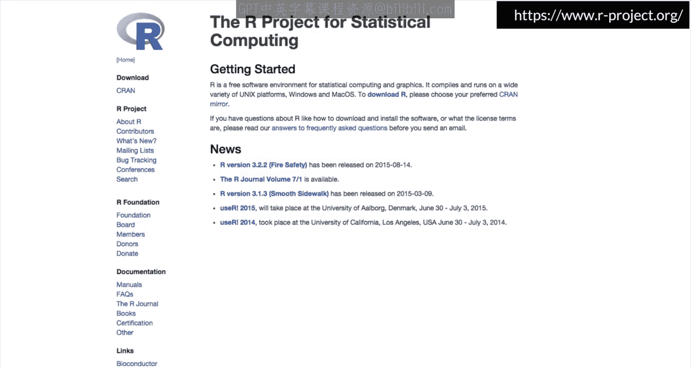
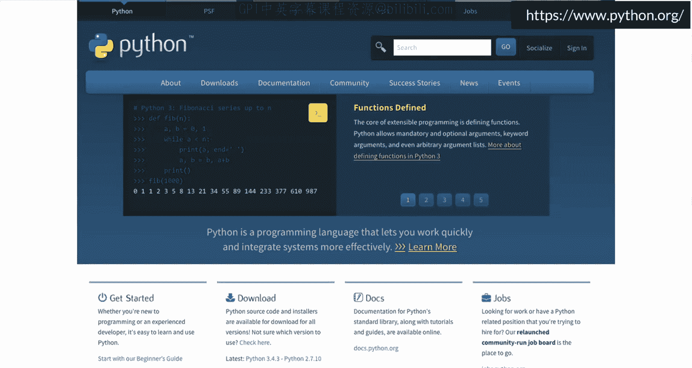
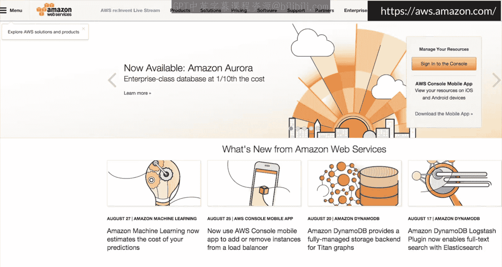
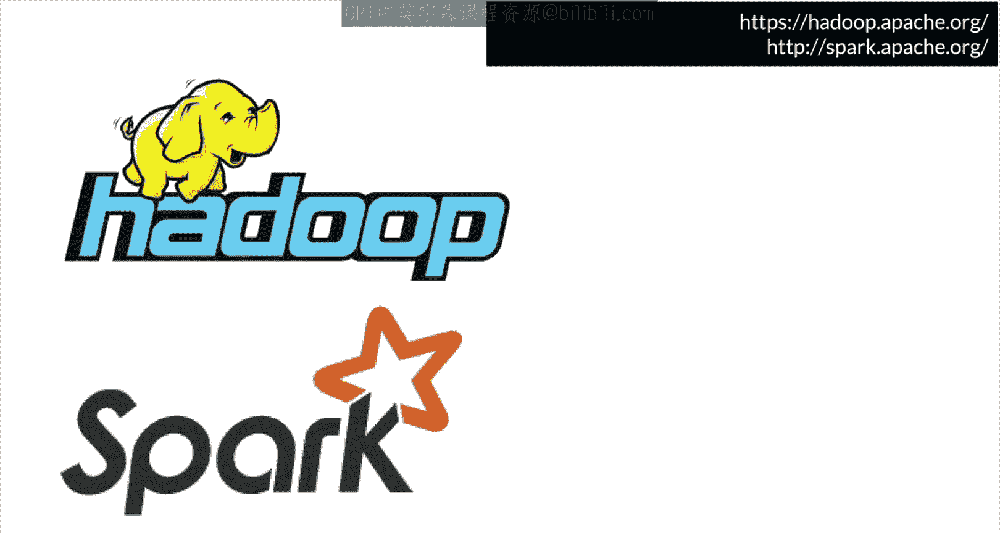
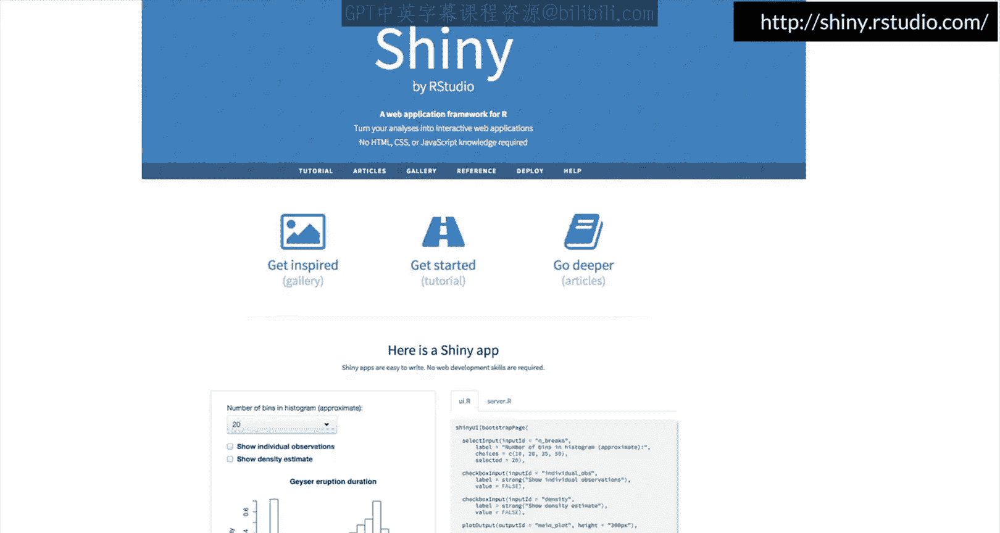

# 高管数据科学：第9课：数据科学家工具箱 🧰

在本节课中，我们将学习数据科学家工具箱。这个工具箱是用于存储、处理、分析数据科学实验结果并进行沟通的一系列工具的集合。

## 数据存储：数据库

首先，我们来讨论数据存储的位置。数据通常存储在数据库中。对于小型组织，这可能是一个小型的MySQL数据库；对于大型组织，则可能是一个分布在多台服务器上的大型分布式数据库。

这里展示的是Postgres数据库的示例，但实际存在大量其他选择。关键要点是：数据在数据库中被存储和备份。然而，大多数分析和生产工作实际上并不在数据库中进行，而是在其他地方完成。

因此，通常需要使用另一种编程语言将数据从数据库中提取出来进行分析。

## 数据分析：编程语言

上一节我们介绍了数据存储，本节中我们来看看用于提取和分析数据的工具。最常见的两种编程语言是R和Python。

以下是两种核心编程语言：

*   **R语言**：本质上是一种统计编程语言，允许你从数据库中提取数据、进行分析并快速生成可视化图表。它是我们数据科学专业课程的基础。
*   **Python**：是另一种类似的编程语言，同样可以用于提取数据、进行分析、操作数据、可视化，并连接到下游的生产环节。

## 计算资源：服务器

为了能够使用这些编程语言并提取数据，你需要某种服务器或计算机来运行它们。因此，整个架构是：数据库存储数据，服务器则用于分析数据，这些服务器将运行R、Python等语言。

这里展示的是亚马逊网络服务（AWS）的示例。这是一套可以从亚马逊租用的计算资源。许多从事数据科学的组织实际上直接租用计算资源，而不是购买和管理自己的服务器。这对于没有庞大IT预算的小型组织尤其常见。

他们会直接租用计算资源，然后利用这些资源来分析数据。

## 大规模分析：扩展工具

一旦你完成了一些初步分析，可能做出了一些发现或实验，并决定了如何利用数据为组织决策，你可能希望扩大这些分析的规模。

因此，存在大量分析工具，可用于对数据进行更可扩展的分析，无论是在数据库内还是通过将数据提取出来。目前最流行的两个框架是Hadoop和Spark。这两者基本上都是用于大规模分析数据的方法。

虽然两者都可以进行交互式分析（特别是Spark），但这过程更复杂，成本也更高，尤其是在应用于大型数据集时。因此，在数据科学流程中，一个典型做法是：从数据库中提取一小部分数据样本，在R或Python中处理和分析，然后与工程团队合作，使用Hadoop、Spark等工具将分析过程规模化。

## 团队协作与知识获取

数据科学家工具箱中的下一个工具是沟通。数据科学家或数据工程师的工作内容通常随着新软件包和新工具的出现而快速变化。让他们跟上节奏的最快方法是保持快速沟通和开放的沟通渠道。

以下是团队常用的协作与学习工具：

*   **即时通讯工具**：许多数据科学团队使用Slack等工具进行内部沟通，以便发布新结果、新想法，并交流最新的可用软件包。
*   **知识社区**：数据科学家经常需要上网搜索如何完成看似简单但实际不熟悉的任务。像Stack Overflow这样的帮助网站允许人们搜索他们需要解答的问题，即使问题技术性很强、细节很多，也能相对快速地获得答案。这使得人们能够在技术快速变化的情况下，依然推动工作进程。

## 结果分享：可重现文档

当分析完成，并希望与组织内的其他人分享时，你需要通过可重现或“文学化”的文档来实现。这基本上意味着一种将数据科学家创建的分析代码、图表与用于解释过程的纯文本集成在一起的方法。

以下是两种常见的文档工具：

*   **R Markdown框架**：一个例子。
*   **iPython Notebooks**：另一个例子。这些工具旨在使你的分析可重现，并确保当一个数据科学家运行分析后想将其移交给他人时，能够轻松实现。

## 成果展示：可视化与交互

你还需要能够将数据科学实验的结果可视化。最终产品通常是某种数据可视化或交互式数据体验。有大量工具可用于构建此类交互式体验和可视化，因为数据科学产品的最终用户通常不是数据科学家本人，而往往是需要处理数据、理解数据动态并做出决策的经理或高管。

这里展示的一个工具是Shiny，它是一种快速构建数据产品的方式，可以与不一定具有丰富数据科学经验的人分享。

## 沟通成果：数据演示

最后，大多数时候，进行数据科学实验并非孤立进行，你需要将结果传达给他人。因此，人们经常制作数据演示文稿，无论是数据科学经理、数据工程师还是数据科学家本人，都需要解释他们是如何进行数据科学实验的、使用了哪些技术、有哪些注意事项，以及如何将其应用于数据以做出期望的决策。

## 总结

本节课中，我们一起学习了构成数据科学家工具箱的核心组件。我们从数据存储的**数据库**开始，探讨了用于分析的**编程语言**（R和Python），以及运行这些工具的**计算资源**（如云服务器）。接着，我们了解了用于大规模分析的**扩展工具**（如Hadoop和Spark），以及促进**团队协作与知识获取**的沟通平台。最后，我们介绍了如何通过**可重现文档**分享分析过程，利用**可视化工具**展示结果，并通过**数据演示**有效地向决策者沟通最终发现。掌握这个工具箱是高效开展数据科学工作的基础。