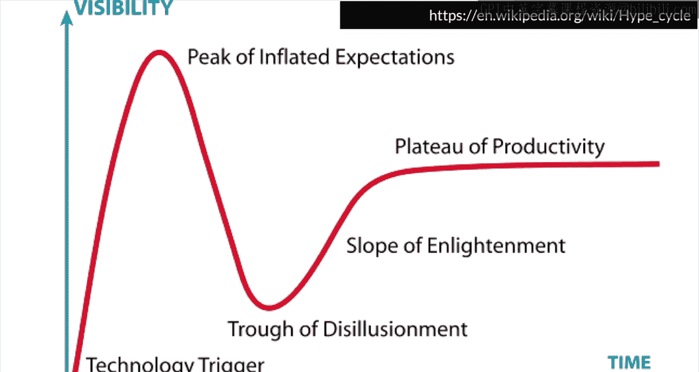
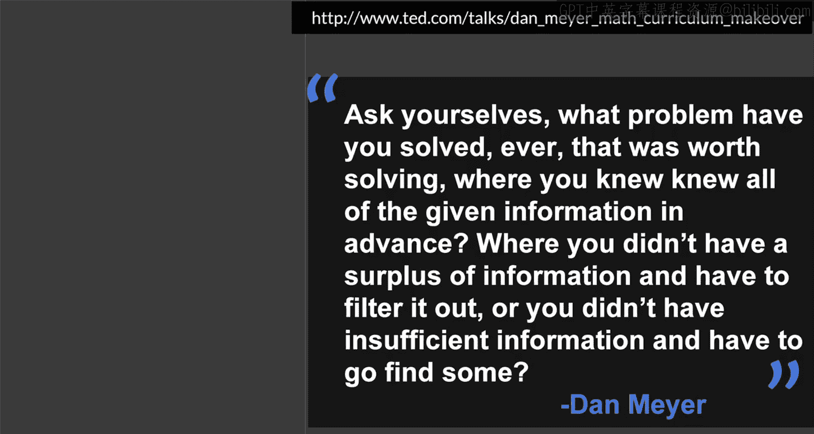
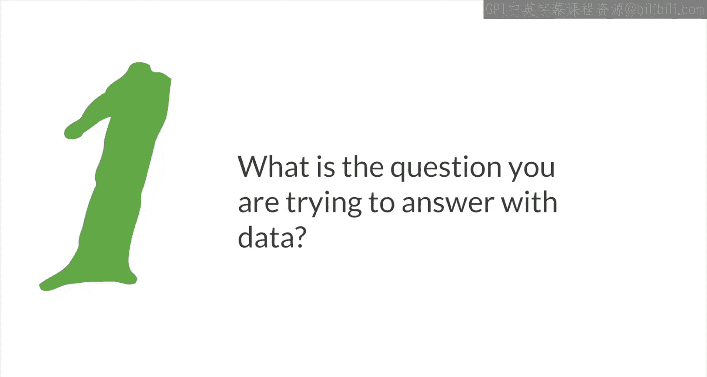
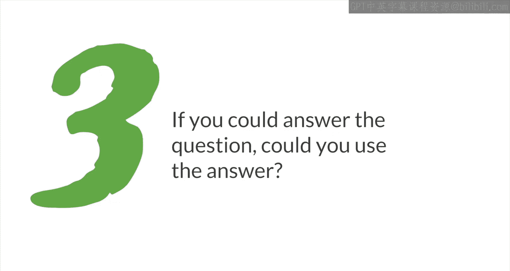

# 高管数据科学：第5课：区分炒作与价值 🔍

在本节课中，我们将学习如何辨别数据科学项目中的“炒作”与“实际价值”。数据科学和大数据领域存在大量宣传，这往往抬高了人们对数据科学实际能力的期望，对整个领域产生了负面影响。我们将通过三个核心问题，帮助你有效评估项目，确保资源投入到能真正推动组织前进的举措上。

---

## 核心挑战：信息与问题的匹配

上一节我们提到了数据科学领域存在期望膨胀的问题。本节中，我们来看看数据科学的核心挑战，这源于丹·迈耶关于数学教育的一个观点，它同样切中数据科学的要害。

**核心挑战**在于：你解决的问题中，有多少是事先就掌握了全部所需信息的？你从未遇到过信息过剩需要筛选，或信息不足需要去寻找的情况吗？

这引出了数据科学的本质：**评估已有信息的价值，并确定需要且能够获取哪些额外信息**。

---

## 关键问题一：你的核心问题是什么？🎯

在评估任何数据科学或大数据项目时，首要任务是明确核心目标。当有人开始谈论最酷的分布式计算技术或机器学习算法时，你应该首先问：

**“你试图用数据回答的具体问题是什么？”**

这个问题能迅速聚焦，过滤掉围绕工具和技术的炒作。虽然讨论新技术很有趣，但如果不能服务于一个明确的问题，它们就无法为你的组织创造价值。

---

## 关键问题二：你拥有回答该问题的数据吗？📊

确定了要回答的问题后，接下来是更困难的一步：评估数据与问题的匹配度。

**“你拥有的数据真的能回答那个问题吗？”**

很多时候，你想回答的问题和你手头的数据并不兼容。因此，你必须评估：**我们能否将数据整理成能够回答目标问题的形态？** 有时答案是否定的，这时你可能不得不放弃该项目。

判断一个项目是炒作还是现实，关键在于：**人们试图使用的数据，是否与他们要回答的问题真正相关？**

---

## 关键问题三：你能应用得出的答案吗？⚙️

假设前两个问题都得到了肯定的回答——你有一个明确的问题，并且拥有能完美回答该问题的数据。最后一个关键问题是：

**“即使你能得出答案，这个答案能被实际应用吗？”**

这让人联想到Netflix大奖赛的例子。竞赛产生了一个非常优秀的影片推荐预测解决方案，但其计算复杂度太高，Netflix无法以经济可行的方式部署。因此，即使问题、数据和解决方案都具备，**最终结果若无法落地应用，其价值也将大打折扣**。

---

## 总结与行动指南 ✅

本节课中，我们一起学习了如何通过三个关键问题，快速甄别数据科学项目的虚实：

1.  **明确核心问题**：用数据要解决的具体问题是什么？
2.  **评估数据匹配度**：现有的数据能否支撑回答这个问题？
3.  **验证结果可行性**：得出的答案能否被有效实施和应用？

通过系统性地提出这三个问题，你可以有效区分围绕数据科学的“炒作”与能够真正为组织创造价值的“希望”，从而引导团队和资源投向最具潜力的方向。