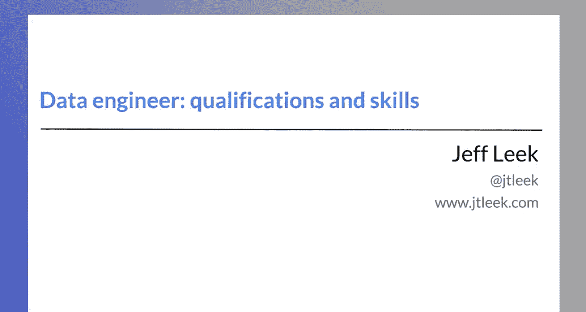
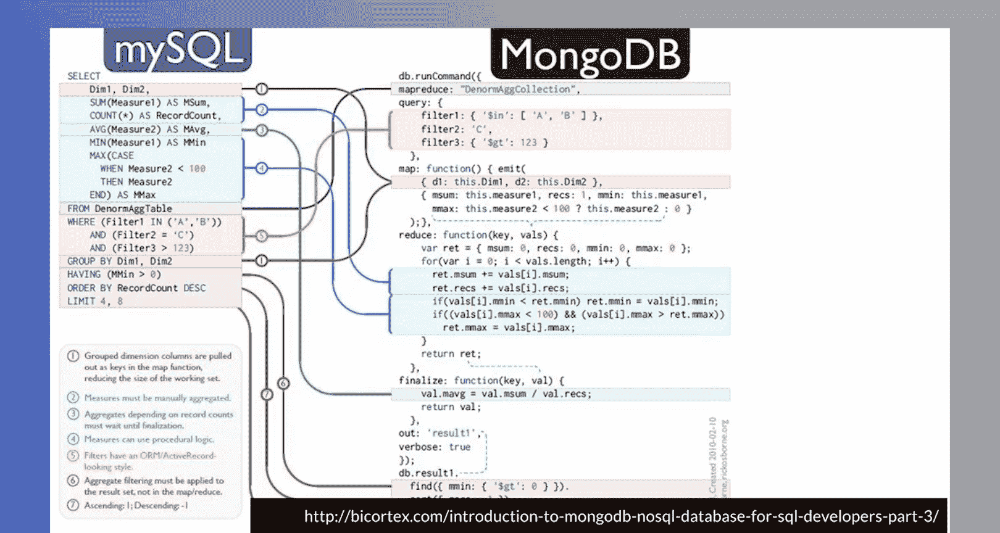
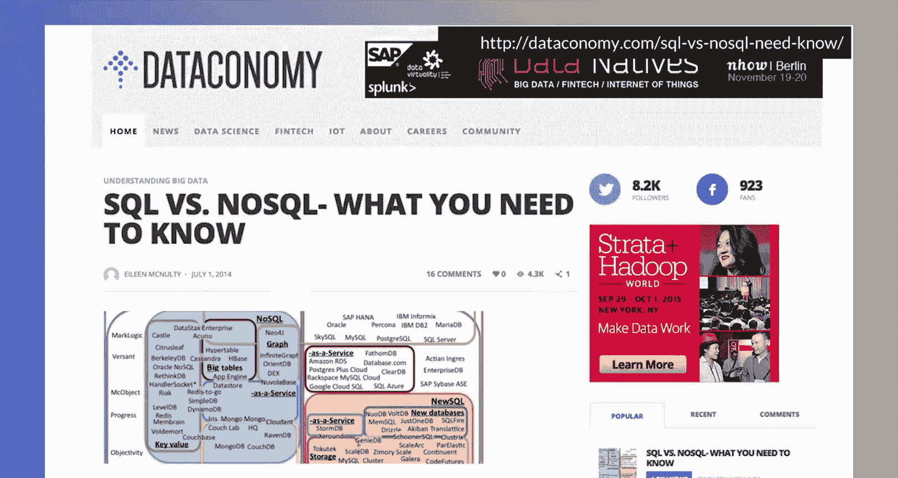

# 高管数据科学：3：数据工程师的资格与技能 🛠️

在本节课中，我们将要学习数据科学团队中的关键角色——数据工程师。我们将探讨数据工程师的职责、所需技能、背景以及他们在团队中的重要性。

## 概述

数据工程师是数据科学团队的核心成员之一。他们负责构建和维护数据基础设施，确保数据能够被高效地存储、处理和使用。本节将详细介绍数据工程师的工作内容、必备技能以及如何寻找合适的数据工程师。

## 数据工程师的职责

数据工程师的主要职责包括构建基础设施、管理数据存储与使用，以及实施生产工具。以下是数据工程师的具体工作内容：

*   **构建基础设施**：负责建立数据库和硬件系统，包括采购、组织和配置服务器与相关软件。
*   **管理数据存储与使用**：监控数据系统的运行状态，管理数据访问权限，并根据需要提取和提供数据。
*   **实施生产工具**：部署和维护用于数据处理的软件工具，确保数据科学模型和算法能够在生产环境中稳定运行。

在小型组织中，可能由一人承担所有职责；随着组织规模扩大，职责会变得更加专业化。

## 数据工程师所需的技能

上一节我们介绍了数据工程师的职责，本节中我们来看看他们需要具备哪些技能来胜任这些工作。数据工程师需要掌握多方面的技术知识，并具备良好的协作能力。

以下是数据工程师需要具备的关键技能：

*   **硬件知识**：了解适用于数据存储和计算的合适硬件。
*   **数据库软件知识**：熟悉各种数据库软件，如 `SQL` 和 `MongoDB`。
*   **计算软件知识**：了解组织可能需要的不同计算软件，并能根据数据科学家的需求进行安装和配置。
*   **大规模数据处理能力**：能够处理大规模数据，运行复杂的数据处理流程和预测算法。
*   **软件工程理解**：理解如何与数据科学团队的其他组件进行交互和集成。

## 数据工程师的背景

数据工程师的背景多样，但通常与计算机科学或相关领域有关。以下是常见的数据工程师背景：

*   **计算机科学/计算机工程**：这是最常见的基础背景。
*   **定量背景辅以计算机科学经验**：例如通过在线课程或实践获得编程和系统知识。
*   **信息技术（IT）**：具有基础设施建设和维护的实际经验。

选择数据工程师时，关键标准是他们能否执行组织所需的具体任务，例如构建和维护基础设施，以及大规模实施数据科学算法。

## 数据工程师的关键特质

除了技术技能，数据工程师还需要具备一些重要的个人特质。这些特质对于确保数据基础设施的稳定和团队协作的顺畅至关重要。

以下是寻找数据工程师时应关注的关键特质：

*   **自主解决问题能力**：能够独立寻找答案，研究合适的硬件、安全措施等技术方案。
*   **数据科学基础知识**：了解数据的使用、提取和分析方式，以便构建有用的基础设施。
*   **抗压能力**：能够在压力下良好工作，因为数据基础设施对组织至关重要，其故障可能导致业务中断。
*   **友好且坚定的沟通能力**：具备良好的人际沟通技巧，能够以简单的语言向非技术人员解释技术决策和问题。

## 总结

本节课中我们一起学习了数据工程师在数据科学团队中的核心作用。我们了解了他们的主要职责是构建和维护数据基础设施，所需技能涵盖硬件、数据库、大规模数据处理和软件工程。数据工程师的背景多样，但关键在于他们能否解决组织的实际问题。此外，优秀的自主性、基础的数据科学知识、抗压能力和清晰的沟通技巧也是成功数据工程师的重要特质。一个合格的数据工程师是确保组织数据驱动决策得以顺利实施的技术基石。