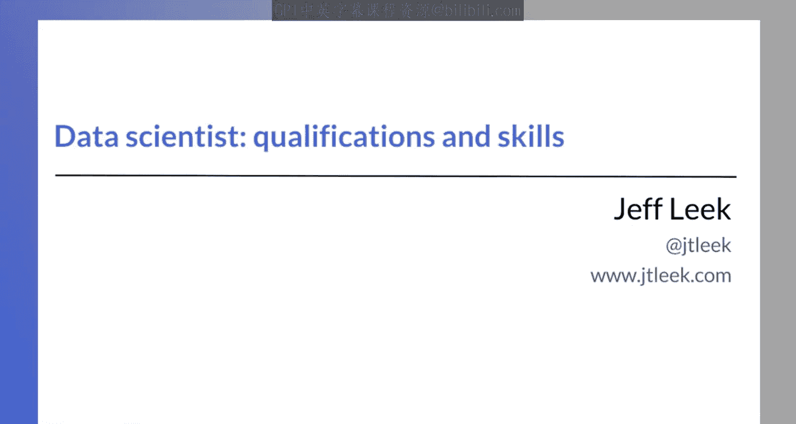
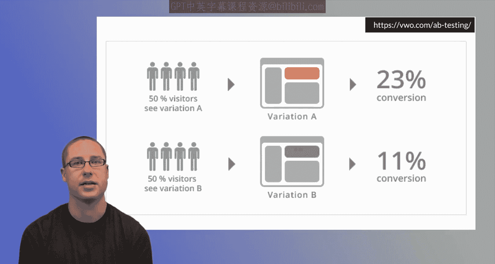
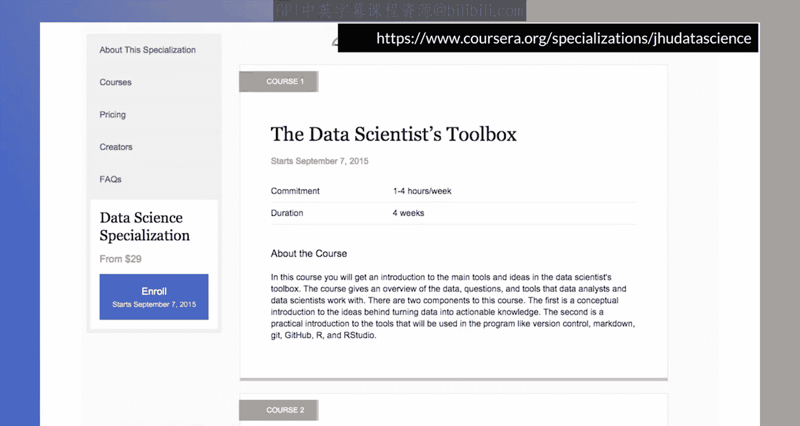
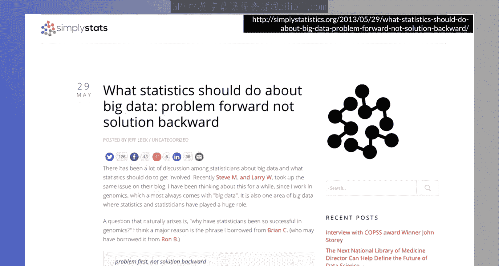
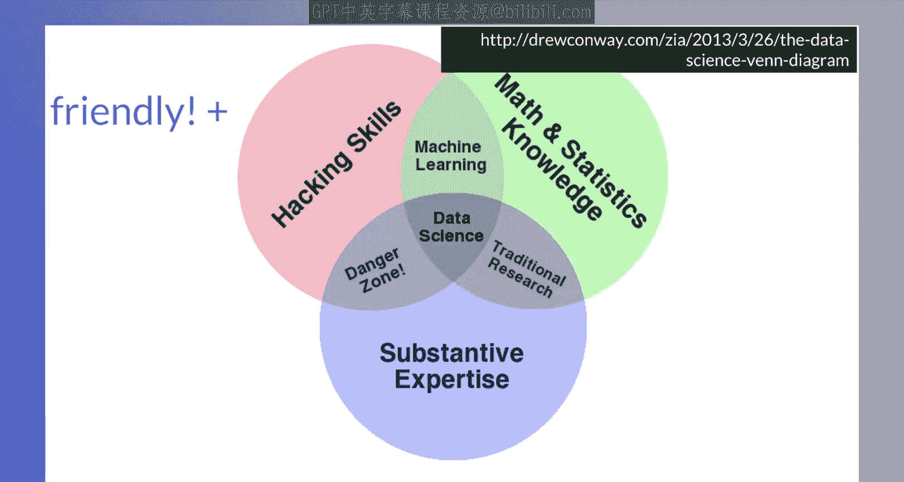

# 高管数据科学：4：数据科学家的资格与技能 🔍

在本节课中，我们将探讨如何为数据科学团队招聘数据科学家，并详细说明数据科学家应具备的核心技能与特质。我们将从基本职责入手，分析所需的技术能力，并讨论评估候选人的关键因素。

上一节我们介绍了数据科学团队的角色构成，本节中我们来看看数据科学家这一核心角色的具体要求。

## 数据科学家的职责

数据科学家的典型职责是设计实验、提取与清理数据、分析数据，并将结果传达给相关人员。他们需要一套完整的技能来执行所有这些活动。

## 核心技能要求

以下是数据科学家为完成其基本任务所需具备的核心技能。

*   **统计学知识**：数据科学家需要掌握统计学。这通常通过正规课程获得，例如拥有统计学学位、修读大量相关课程或完成在线课程。
*   **预测与机器学习**：他们需要了解预测和机器学习相关知识。这些知识可以从统计学课程或专注于机器学习的计算机科学课程中学习，同样也可以通过在线途径获取。**推断**和**预测**是两项不同的任务，其重要性因组织需求而异。如果组织侧重于构建预测工具，则可能需要更强的机器学习能力；如果目标是进行实验并提出新假设，则可能需要更强的统计推断能力。
*   **完整的数据分析能力**：这意味着他们需要能够从数据库中提取数据集、分析并清理这些数据、执行所需的统计推断或预测，最后将结果进行有效传达。
*   **数据沟通技能**：这包括分析数据、创建清晰的可视化图表，并以既能说明情况又能准确表达不确定性的方式，将可视化结果和结论传达给他人。这样，决策者就能清楚了解数据对决策的支持力度。

## 常见技术能力

除了核心技能，数据科学家通常还具备以下几项具体技术能力。

*   **编程语言**：他们通常知道如何使用 **R** 或 **Python** 这类通用的数据科学语言来分析数据。
*   **数据可视化**：他们知道如何进行某种形式的数据可视化，有时会使用像 **D3.js** 这样的工具进行交互式可视化。
*   **数据库操作**：他们至少对一种数据库（如 **SQL**、**MongoDB** 等）有经验，实际进行过从数据库提取数据的操作。

## 常见背景与来源

数据科学家通常来自以下几种背景，了解这些有助于根据组织需求寻找合适人选。

*   **统计学或生物统计学背景**：他们来自统计学或生物统计学系，学习过大量应用知识，处理过许多真实数据集，并掌握了一些软件工程技能（如版本控制、其他语言编程），这使他们能够与公司其他成员协作，但其主要专长和训练仍在统计学领域。
*   **定量背景转型**：另一种常见途径是拥有物理学或工程学等定量背景，然后通过在线课程（如数据科学专项课程）或其他转型项目过渡到数据科学领域。他们具备定量或实验背景，并为此做好了准备。
*   **软件工程背景**：最后一类常见背景是接受过软件工程培训或本身就是软件工程师，然后自学或通过课程掌握了一些统计学知识。

组织应根据自身需求选择：如果需要更多基础设施开发并辅以少量统计工作，那么具有软件工程加统计学背景的人可能更合适；如果主要需要进行实验并从中推断结论，那么来自生物统计学系等背景的候选人可能是更强有力的选择。

## 评估候选人的关键特质

在寻找数据科学家时，关注他们解决问题的能力比关注特定的编程语言更重要，否则可能会错过大量优秀人才，尤其是在数据科学领域相对较新、培训课程尚未标准化的当下。

以下是评估数据科学家时值得关注的关键特质。

*   **主动寻找答案的能力**：数据科学家通常需要自己寻找数据集，与组织内人员协作以确定要解决的正确问题。他们需要能够独立跟进，不能总是需要手把手指导。你可以通过他们过往的领导经验、参与开源项目或撰写博客等证据来考察这一点。
*   **不畏惧新数据**：在面试中，可以向候选人提出一种他们从未接触过的数据类型（可以是来自你组织的，甚至是虚构的），观察他们的反应。积极的反应（如提出想法、思考解决方法）是好的迹象；如果他们对这种数据类型感到畏惧，并试图强行套用已知的数据处理模式，那么当组织变化、数据科学任务变更时，他们可能会面临挑战。
*   **敢于说“我不知道”**：这一点在面试中可能难以考察，但很重要。你可以问一个他们不可能知道的、关于你组织的具体问题，看他们是否能够坦然地说“我不知道”。在数据科学中，实验可能得不出明确结论，诚实地承认不确定性并如实沟通至关重要。
*   **友善而执着**：数据科学需要极大的专注力以确保所有细节正确，并且需要以推动事情前进的方式与人互动，即使得到的回应并不总是那么友善。因此，他们需要非常友善，具备人际交往能力。这些“软技能”在数据科学团队中极其关键，因为他们需要与其他人合作，并可能成为与外部部门的联络点。可以说，人们通常高估了技术成分（如是否掌握某编程语言），而低估了沟通与协作能力。

## 总结

本节课中，我们一起学习了数据科学家的核心职责、必备的技能组合（包括统计学、机器学习、完整的数据分析流程与沟通能力）、常见的技术工具（如R/Python、数据库操作），以及评估候选人时应关注的关键特质（如主动性、适应性、诚实与协作精神）。理解这些要点，将帮助您更有效地为组织招募到合适的数据科学家。