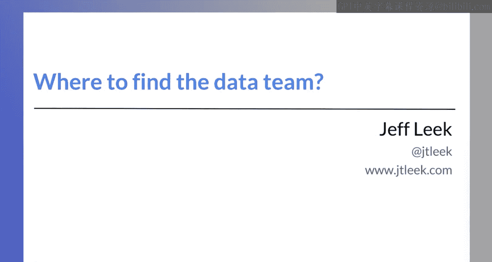
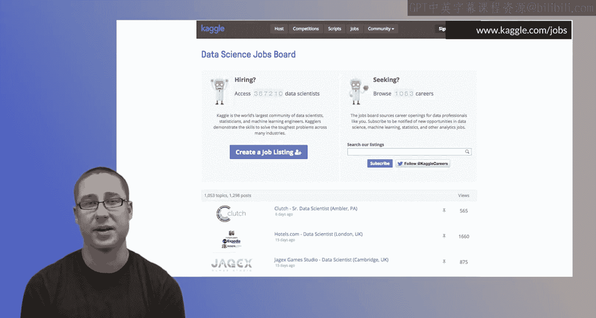
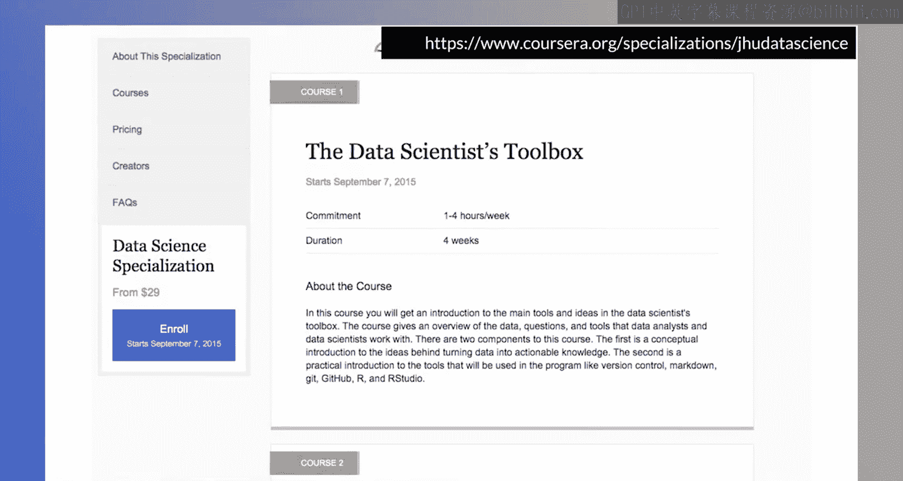

# 高管数据科学：第6课：在哪里找到数据团队 👥

在本节课中，我们将要学习如何为你的组织寻找和招募数据科学家、数据工程师和数据科学经理。了解这些角色的资质后，下一步就是知道去哪里找到他们。

上一节我们介绍了数据科学团队各成员的资质，本节中我们来看看寻找这些人才的几种主要途径。

## 通用招聘平台

最直接的寻找地点是通用招聘网站，例如 **LinkedIn** 或 **Monster.com**。你可以在这些平台上搜索“数据科学家”等关键词。

然而，这种方法可能有些困难。因为目前数据科学领域非常热门，自称数据科学家的人数众多，难以仅凭头衔区分真正优秀的人才和普通求职者。

但这并非不可能。你可以通过以下方式进行筛选：
*   寻找掌握特定编程语言（如 **Python**、**R**、**SQL**）的候选人。
*   审查他们的过往经验。
*   理想情况下，候选人应在线上展示过项目成果，例如通过 **GitHub** 个人资料展示其软件或硬件背景。

这样，在接触之前，你就能对他们的能力有一个初步的了解。

## 专业数据科学平台

另一个途径是前往更专业的网站。例如，**Kaggle.com** 主办数据科学竞赛，同时也拥有一个庞大的求职板块。

在那里，你更有可能找到至少具备一些数据科学经验的人，因为他们参与过竞赛。通过他们在竞赛中的表现，你可以了解其技能水平和实战能力。

此外，你还可以去 **indeed.com** 或 **Hired.com** 这类专注于数据科学人才招聘的平台。这些网站对候选人的资质有更深入的了解，筛选过程可能更高效。

选择哪种平台取决于你的具体需求。如果你的机构需要的人才类型比较传统，专业网站可能更合适。如果你在寻找技能组合独特、不那么“标准”的人才，那么在通用平台上进行更深入的搜索或许更好。

## 在线课程与项目作品集

你也可以关注那些完成在线课程的人才。例如，完成 **Coursera** 数据科学专项课程、**Udacity** 数据科学纳米学位或其他在线数据科学项目的人。

寻找这些人才的最佳方式，通常是查看他们在 **GitHub** 等代码托管平台上的个人资料。他们通常会将课程项目作品集发布在那里。

在面试之前，你就能通过他们的项目代码、文档和成果，直观地感受他们的工作方式和能力。大多数在线课程项目都要求学员建立并发布在线作品集，这为你发现人才提供了便利。

因此，通过关注这些拥有在线课程认证和项目作品集的人群，是寻找数据科学人才的另一个有效渠道。

---

本节课中我们一起学习了寻找数据科学团队的三种主要途径：通用招聘平台、专业数据科学社区以及在线课程毕业生与作品集。每种渠道各有特点，你可以根据组织对人才技能和经验的具体需求，选择最合适的招聘策略。