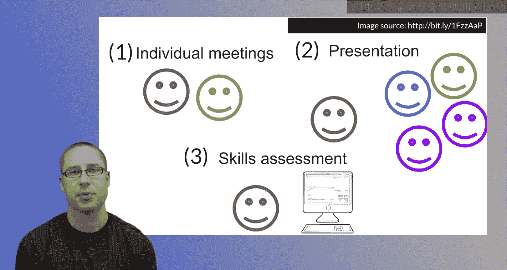
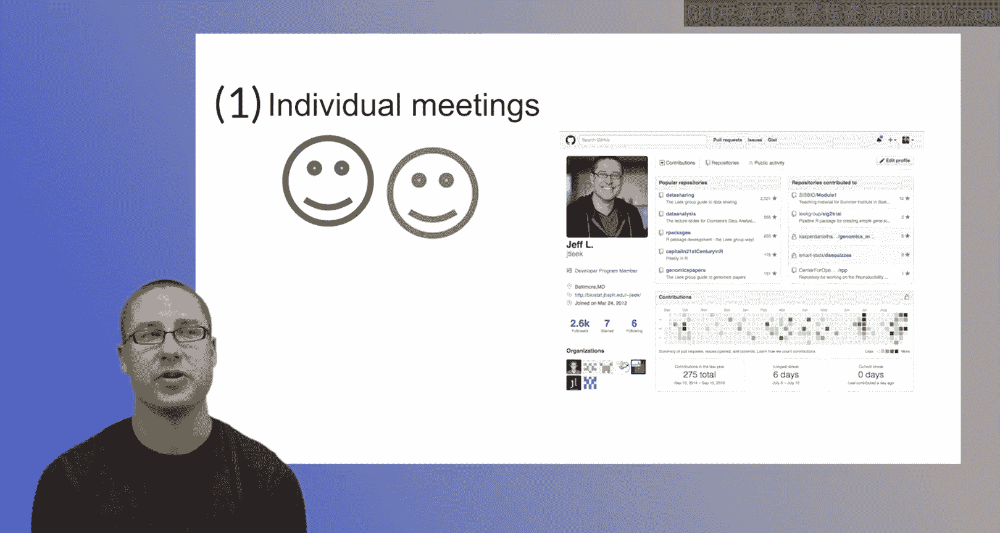
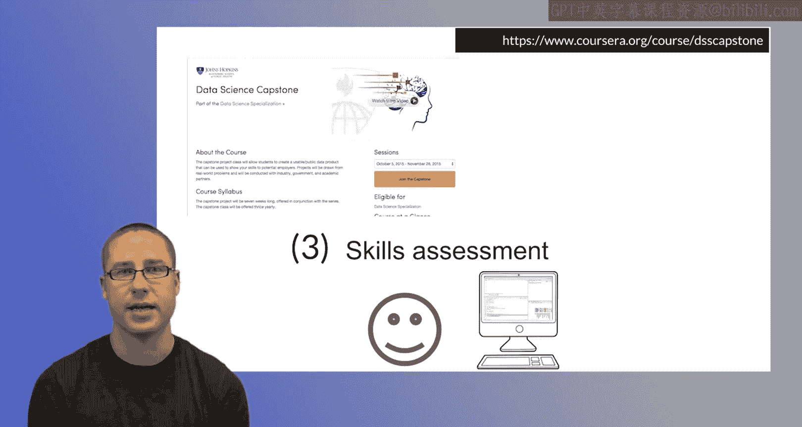

# 高管数据科学：5：数据科学面试

在本节课中，我们将要学习如何构建一个有效的数据科学面试流程。面试是组建优秀团队的关键环节，我们将介绍面试的三个核心组成部分，并探讨如何通过它们全面评估候选人的能力。

## 个体或小组会议

上一节我们介绍了面试的总体框架，本节中我们来看看第一个核心环节：个体或小组会议。这个环节通常涉及候选人与团队内部及外部成员进行一对一或小组交流。

以下是该环节的关键要点：
*   **聚焦项目经历**：深入探讨候选人过去参与的项目，了解他们的工作方式、主动性和独立解决问题的能力。
*   **评估人际技能**：简历能展示技术能力，但无法体现人际交往能力。此环节是评估候选人能否与团队内外成员顺畅合作的关键。
*   **考察沟通韧性**：数据科学家的工作可能涉及提出不受欢迎的结论。理想的候选人应能在坚持己见的同时，以友好的方式进行沟通。

## 技能演示或报告

在评估了候选人的基本合作与沟通能力后，下一步是考察他们的专业技能展示。让候选人进行一次演示或报告至关重要。

以下是该环节的主要目的：
*   **展示创造力与独特性**：候选人可以通过展示其完成的数据分析、构建的基础设施、开发的软件或分享的管理理念，来体现他们能为组织带来的独特价值。
*   **检验沟通能力**：数据科学家、工程师或管理者经常需要向他人汇报成果。这是一个评估他们现场展示技术信息、回答提问能力的绝佳机会。
*   **扩大评估范围**：相比有限的个别会议，一场面向更广泛听众的报告能让更多团队成员参与评估，判断候选人是否适合组织文化。

## 技术技能评估

最后，我们需要对候选人的技术硬实力进行检验。目前存在两种主流方法，而其中一种通常更为有效。

关于技术评估，核心在于模拟真实工作场景：
*   **避免谜题式问题**：传统的脑筋急转弯或数学谜题类问题已逐渐被淘汰，因为它们更多考察的是是否见过类似题目，而非实际解决问题的能力。
*   **采用小型实战项目**：更有效的方法是提供一个与组织日常业务相关的小型但真实的问题。例如，给数据科学家候选人一个小数据集，要求其在一小时内完成分析并报告。这能让你深入了解他们的思维过程和技术应用能力。
*   **评估概念理解**：在后续讨论中，应关注候选人解决问题的整体思路、所使用的技术语言以及他们是否具备解决你所在组织常见问题的经验。

## 总结与决策

本节课中我们一起学习了数据科学面试的三个核心组成部分：个体/小组会议、技能演示报告以及技术技能评估。完成所有这些环节后，你需要收集所有面试官的反馈信息，综合判断候选人是否是你的数据科学团队的合适人选。通过这样结构化的流程，你可以更全面、更准确地找到既能胜任技术工作，又能融入团队文化的优秀人才。