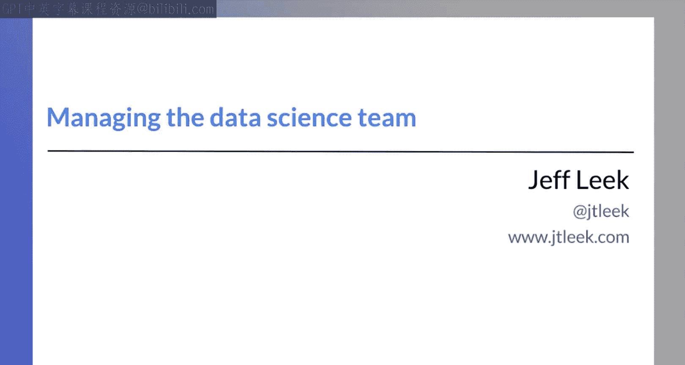
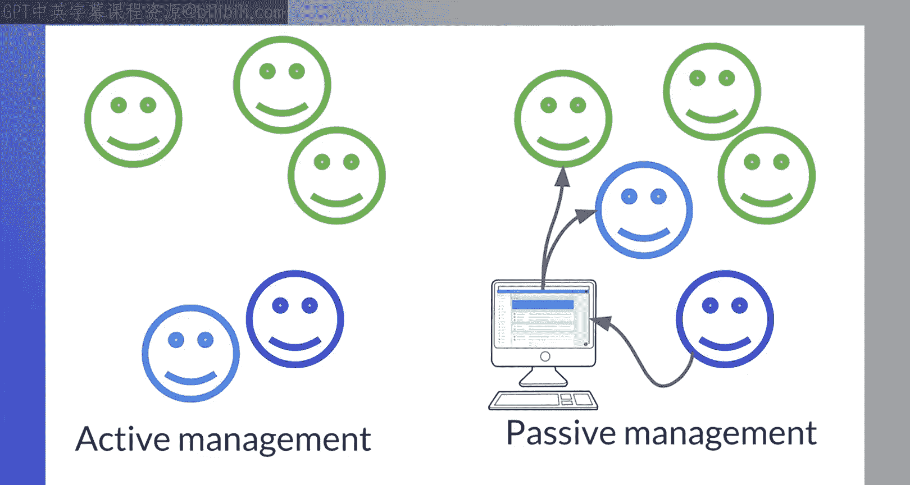
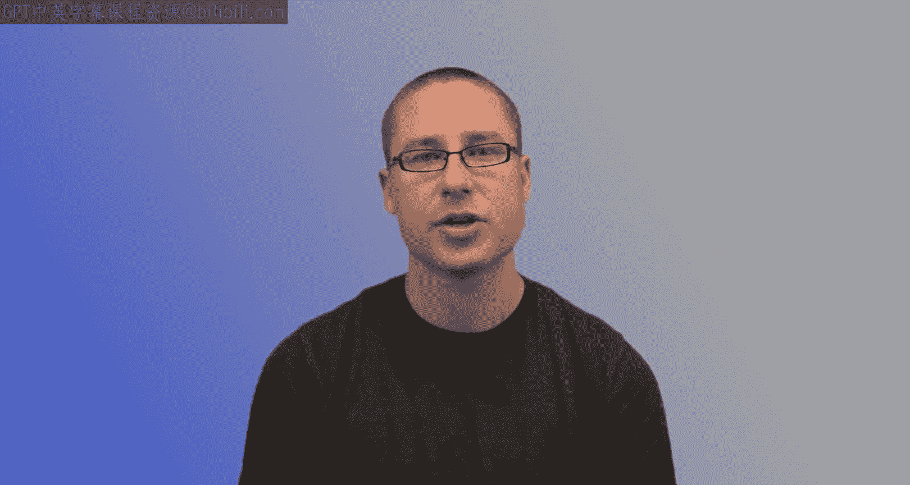
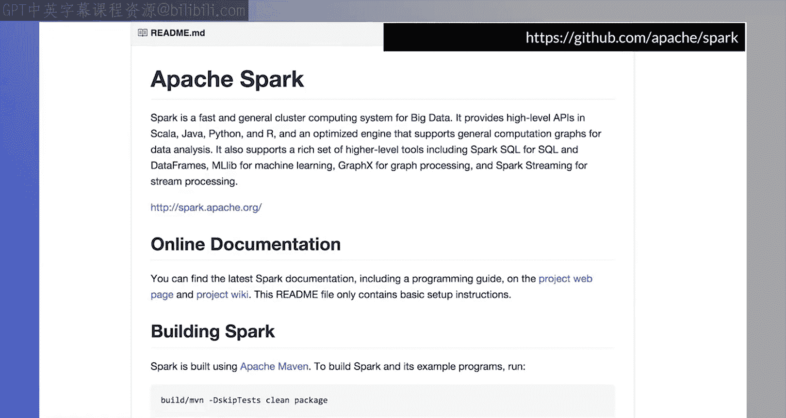
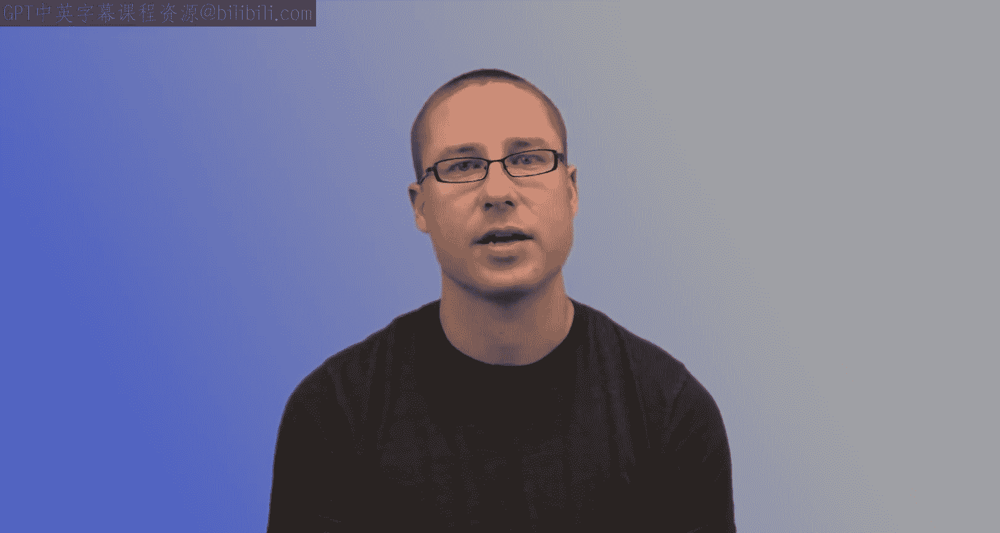

# 高管数据科学：9：管理数据科学团队 🧑‍💼

在本节课中，我们将要学习如何有效地管理一个已经组建完成并正在运行的数据科学团队。团队管理是数据科学经理的核心职责，它涉及维持团队运作、解决问题并推动团队持续发展。

## 概述

当你的团队开始运作后，管理或维持团队、并引导其解决数据科学问题，便成为数据科学经理的关键角色。本节将介绍几种核心的管理实践，包括个人会议、团队会议、监控互动、保持沟通畅通以及管理团队成长。

## 个人会议 🤝

上一节我们介绍了团队组建，本节中我们来看看日常管理。首先，与团队每位成员定期进行个人会议是至关重要的。这在管理初期尤其重要，当你只管理少数人时，每周与每个人会面是很好的做法。

以下是个人会议的主要目的：
*   **汇报进展**：成员可以展示正在进行的工作、已完成的任务和取得的成就。
*   **解决问题**：成员可以提出遇到的任何问题。在数据科学工作中，人们常常会卡在某个细节上，而旁人往往能迅速发现问题所在。这是帮助成员摆脱困境、保持进度的最有效方式。
*   **设定目标**：讨论成员本周的目标和计划。

虽然个人会议会占用大量时间，但如果运用得当，它们能带来巨大优势。

## 团队会议 👥

除了个人会议，定期举行整个数据科学团队的会议也很有意义。这是一个让所有人聚在一起交流的固定会议。

以下是团队会议的关键作用：
*   **分享更新**：成员分享工作进展和遇到的问题，特别是那些可能涉及其他团队（如数据工程团队）的问题。
*   **同行评审**：团队可以进行同行评审。数据科学或数据工程团队可以做演示，其他人则可以提出意见和建议。
*   **设定优先级与激励**：经理可以借此设定团队优先级并激励成员。数据科学工作有时会陷入繁琐细节，经理需要阐明大局、解释工作意义，以保持团队的热情和专注。

关键在于营造一种氛围，使成员能够在不失礼的情况下，客观地对他人工作提出建设性批评。数据科学团队负责人需确保讨论基于数据、保持客观，并允许表达真实意见。

## 监控互动 🔍

在理想的团队架构中，数据科学团队既独立运作、内部沟通，其成员也会有一段时间嵌入到其他部门工作。每位成员通常负责与一个特定的外部组织单元互动。

作为经理，你的职责是监控这些互动的状况：
*   **主动监控**：通过被抄送邮件、加入Slack频道或参加外部会议来实现。
*   **被动接收反馈**：同时从外部组织和被嵌入的成员那里获取反馈。

你需要确保沟通顺畅，避免中断。常见问题是沟通速度“过快”或“过慢”：
*   **沟通过慢** (`沟通频率 < 需求频率`)：会导致信息交换不足，进度放缓。
*   **沟通过快** (`请求频率 > 处理能力`)：可能导致外部单位对数据科学家提出过多要求。经理需要调节这些请求，并为团队成员分担压力。

## 保持沟通畅通 🚪

保持一切顺畅运行的最佳方式是实行“开放政策”。这意味着成员可以随时找你，而不仅限于正式会议时间。这样他们能快速解决卡住的问题。

其他方法包括：
*   **快速响应**：通过邮件或聊天快速回复那些能迅速解决的问题。
*   **减少正式会议**：数据科学工作需要大量不受干扰的专注时间。过多的正式会议会拖慢工作进度。因此，应鼓励快速的非正式沟通，避免事事都升级为正式会议。

## 管理团队成长 📈

管理组织成长也至关重要，这包括几个方面：

以下是管理团队成长的几个关键维度：
*   **团队规模增长**：管理人数增加带来的沟通和协作结构变化。
*   **个人能力成长**：确保成员有学习新工具的机会，例如提供在线课程，或在团队会议中安排介绍新想法、新工具的演示。
*   **拓展新联系**：作为经理，你需要主动识别并促成团队与外部组织或个人的有益连接。
*   **提供晋升机会**：一个关键职责是为团队成员寻找发展机会。无论是获得新的头衔、承担能丰富简历的新职责，还是在会议或聚会上提升行业影响力，经理都需要留意这些机会，帮助成员在组织内外成长。

## 总结

本节课中我们一起学习了管理数据科学团队的核心实践。我们探讨了通过个人会议和团队会议进行有效沟通与协调的方法，了解了监控内外互动、保持沟通渠道畅通的重要性，并强调了管理团队与个人成长是经理的持续职责。这些实践有助于维持团队高效运行，激励成员，并推动整个团队向前发展。