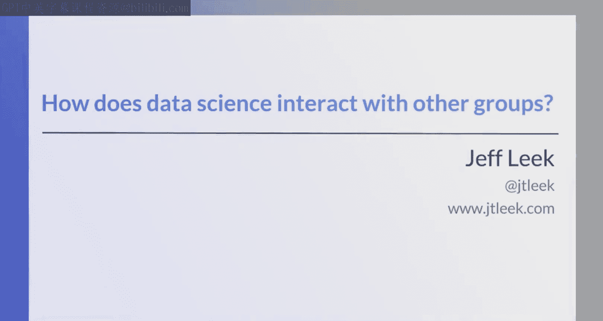
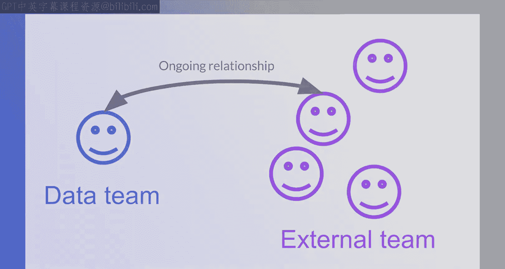
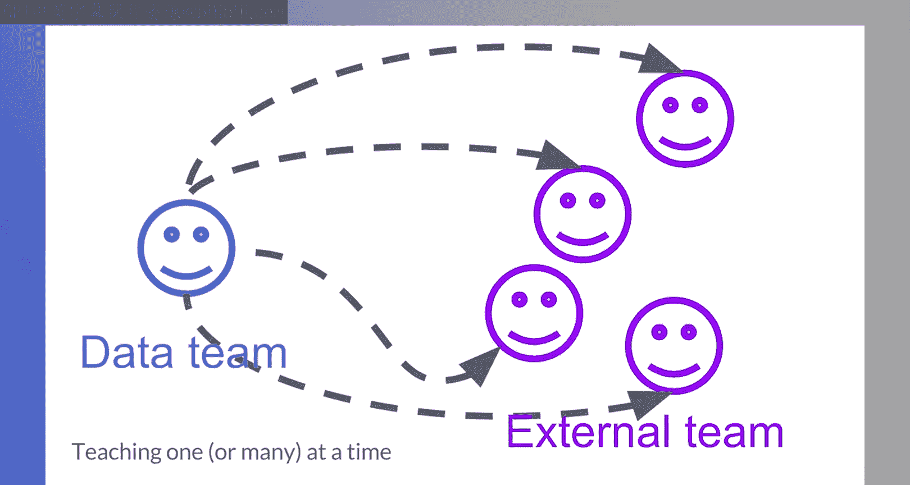
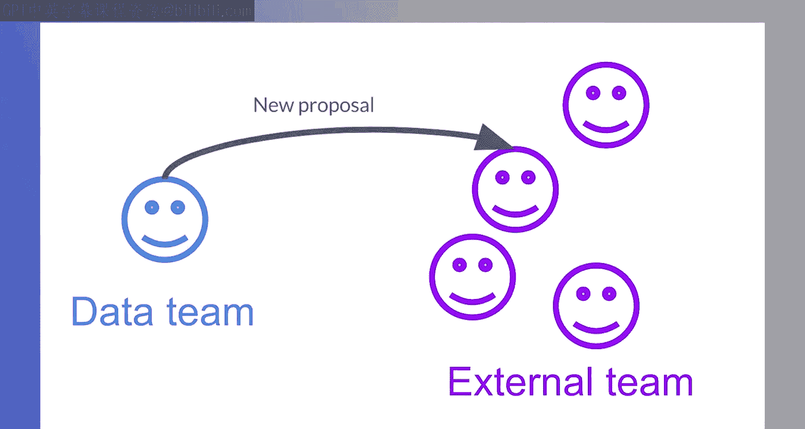

# 高管数据科学：第5课：数据科学团队如何与其他团队互动 👥

在本节课中，我们将探讨数据科学团队组建完成后，如何与组织内的其他团队进行有效互动。我们将介绍四种主要的互动模式，并分析每种模式的特点与适用场景。

---

组建数据科学团队后，你需要思考该团队如何与组织内的其他团队互动。

团队互动可以通过几种不同的模式进行。接下来，我将逐一介绍这些模式，并说明数据科学团队如何与外部人员在这些角色中进行互动。

## 咨询模式 🤝

第一种模式是**咨询**。在这种模式下，你的团队有机会与其他部门的人员合作。其他团队会带着他们希望解决的问题前来寻求帮助。

这些问题可能包括预测某个网站的访问量、识别广告点击量，或是任何他们工作中遇到的、认为机器学习、预测或推断分析能提供帮助的问题。这是一种咨询模式，由外部团队主动提出需求。

> 咨询模式：外部团队带着具体问题前来，数据科学团队提供解决方案。

## 协作模式 🤲

另一种选择是**协作**。在协作模式下，数据科学团队会与你的某个团队紧密合作，共同完成整个项目。

这种合作可能是长期的。例如，一名数据科学家可能与市场团队或某位协作者长期合作。在这种情况下，数据科学家能更深入地了解外部团队的具体职能或角色，这对数据科学过程大有裨益。

相比之下，在单纯的咨询关系中，你只能对要解决的问题有一个表面的了解。数据科学虽然仍有帮助，但缺乏那种深入探究的效果，即数据科学家无法在其工作领域积累深厚的专业知识。

> 协作模式：数据科学团队与业务团队长期、深度绑定，共同推进项目。

## 教学与赋能模式 🧑‍🏫

数据科学团队与组织外部社区互动的另一种方式是通过**教学**。

几乎所有的数据科学组织都可以通过教育他人来发挥有益作用，包括解释什么是数据科学、数据科学可以用于哪些方面，以及该团队如何帮助组织内所有不同的团队或其他协作团体。

因此，教学职能对数据科学部门来说始终是一个非常有益的组成部分。

以下是实现教学的两种方式：
*   组织一次性活动，讲授特定主题，例如如何可视化数据或如何与数据交互。
*   建立固定的教学承诺，例如为新入职员工开设数据科学训练营，讲解数据科学如何帮助他们。

> 教学模式：数据科学团队通过培训和教育，提升整个组织的数据素养和能力。

## 创新与驱动模式 💡

最后，你可以让数据科学团队发挥**创造性**，提出新想法，并真正推动组织前进。

有一种观点认为，你可以做到数据驱动，即走出去收集数据，并基于收集到的数据智慧做出所有决策。但这实际上还不足以真正基于数据实现变革。

为了利用数据实现变革，你需要提出新的假设，然后测试这些假设，看看它们是否真的有效。这可能包括创造新产品，然后运行实验来验证产品是否有效；或者以新的方式、在新的应用中，基于机器学习预测消费者行为或任何你感兴趣的行为。

这类创造性的想法通常可以来自数据科学团队，特别是当他们参与到那种紧密的协作关系中，真正理解了我们要解决的问题时。他们可能会产生新的想法，或者知道可以在组织内部或外部收集哪些新数据来回答这个问题。

因此，给予你的数据科学团队一定的自由去发挥创造力和提出自己的想法，总是非常有益的。

---

在本节课中，我们一起学习了数据科学团队与组织内其他团队互动的四种核心模式：**咨询**、**协作**、**教学**与**创新**。每种模式都有其独特的价值和适用场景。一个成功的数据科学团队通常会灵活结合多种模式，在解决具体业务问题的同时，赋能整个组织，并成为推动变革的创新引擎。