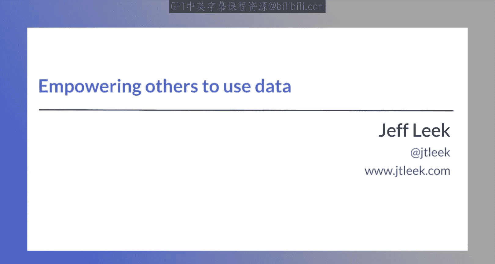
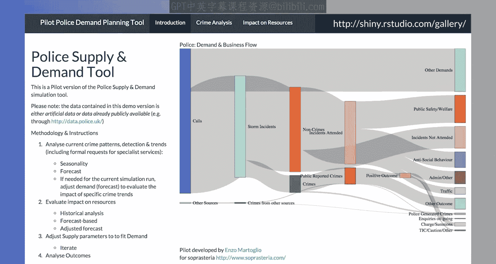
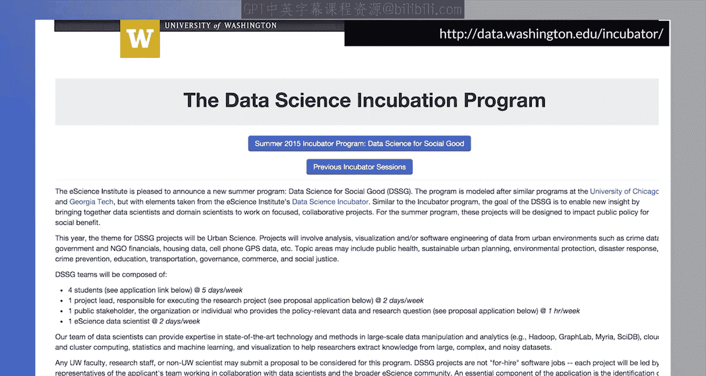

# 高管数据科学：第5课：赋能他人使用数据

在本节课中，我们将学习数据科学管理者或高管如何赋能组织内的其他成员使用数据。这不仅是数据科学团队的工作，也是管理者的重要职责。我们将探讨多种方法，包括培训、工具构建和建立沟通渠道，以帮助非技术背景的同事也能有效地与数据互动。

## 数据科学培训 📚

上一节我们介绍了赋能他人的重要性，本节中我们来看看具体方法。数据科学培训是赋能他人的核心方式之一。作为管理者，你可以通过多种途径提供培训。

以下是几种可行的培训方式：

*   **引导至现有资源**：收集并整理网络上可用的在线课程或材料，这些资源应与同事们希望实现的目标相关。
*   **编写内部教程**：亲自撰写教程，使人们能够直接与数据进行交互。
*   **举办内部讲座**：组织面向所有人的内部讲座，由数据科学团队讲解如何从数据库提取数据、如何制作图表、如何有效地可视化数据，以及什么是机器学习。这些讲座若能同时传达团队内部的实际能力，将非常有用。

## 沟通团队能力与激发新想法 💡

数据科学团队的能力因人员构成、任务分配和问题难度而异。因此，向整个组织客观地传达哪些事情可行、哪些不可行，常常能激发新的想法。

你可以举办关于数据科学团队工作方式的培训会或信息分享会。这些都是赋能他人、鼓励他们接触并与数据科学团队合作的有效方式。

## 构建共享工具与产品 🛠️

另一种方式是构建文档、工具或产品，并与那些不一定受过数据科学或数据工程培训、但希望与数据交互的同事分享。

一个常见的例子是**仪表盘**，即一组可视化图表。用户可以通过点击按钮与可视化界面交互，提出自己的问题、验证假设并与数据互动，即使这仅是数据的一个子集。

另一个例子是**交互式可视化**。它能让人们以一种引人入胜的方式与数据互动，提出特定问题并观察不同选择带来的结果。这里的关键在于设计元素：如何设计界面，让人们能够在不被复杂语法或底层编程语言吓倒的情况下，自主地与数据交互、提出问题。

## 自动化与效率提升 ⚙️

除了培训，还有一些方法可以直接将人们与数据连接起来。理想情况下，你可以将这个过程自动化。

许多报告生成工具，例如基于 **iPython Notebooks** 或 **Shiny** 文档的工具，都可以实现自动生成。你也可以设置一个仪表盘，它能从数据库自动更新，始终为人们提供最新鲜的数据。

通过这种方式实现自动化，最常见的问题可以由数据科学团队以外的成员自行解答。这使得数据科学团队能够腾出精力进行创新，专注于新的想法和任务，或者巩固组织内已有的数据科学流程基础设施。

## 建立数据科学想法评估机制 💬

另一种促进人们与数据科学团队互动的方式是建立数据科学想法评估机制。同事们常常会有关于如何利用数据解决特定问题的想法，但有时这些想法并不可行，原因可能是缺乏合适的数据、基础设施或规模。

尽管如此，提供一个渠道、格式或论坛，让人们可以提出他们想用数据实现的想法，并获得批判性但积极的反馈，是非常有益的。你不应立即否定任何想法，否则将再也听不到新建议。但这有助于调整期望，让大家了解我们现有的数据究竟能做什么。

当他人提出想法时，你可以告知他们：“这个我们可以做”、“那个不行”、“这个可以做，但需要在服务器端建立全新的基础设施”、“那个也可以，但需要我们在此开发一套全新的机器学习框架”。这能让人们对数据科学团队的工作范围和能力边界有清晰的认识。

你可以组织数据团队对这些想法进行同行评审，这也是与组织互动的一种方式。

## 总结 📝

本节课中我们一起学习了赋能组织内其他成员使用数据的多种策略。核心思想是尽可能多地将其他人引入数据科学流程中。这通常需要一些教育工作，如果方式不当，可能会感觉像是在浪费时间。但如果你将其视为对组织未来数据科学能力的一项投资，这将是一种非常积极且能创造巨大价值的数据科学实践方式。通过培训、工具构建、自动化流程和建立开放的沟通渠道，你可以有效提升整个组织的数据素养和协作效率。