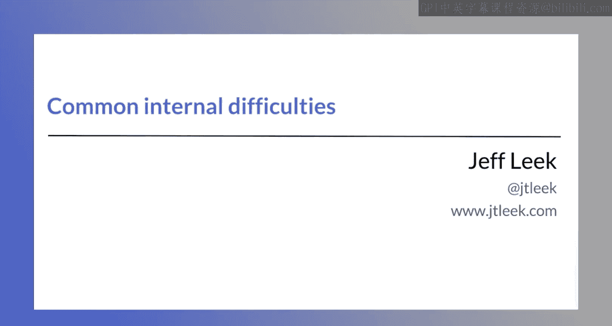
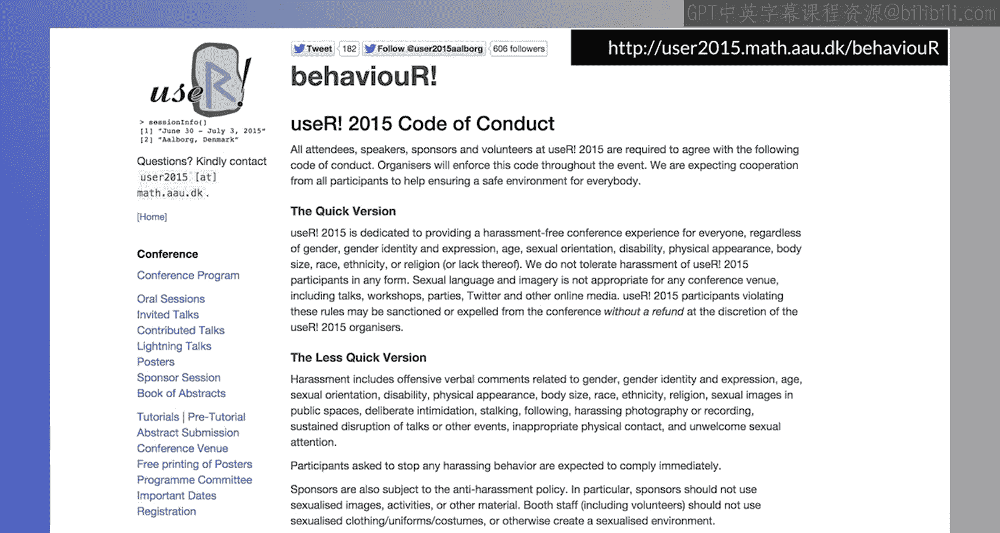

# 高管数据科学：5：常见的内部困难

在本节课中，我们将探讨数据科学团队在运作过程中可能遇到的常见内部困难。无论团队组建得多好，成员性格多友善，这些挑战都可能出现。我们将学习如何通过建立明确的政策和营造积极的环境来最小化这些问题，确保团队高效、顺畅地运作。

## 建立行为准则

上一节我们介绍了内部困难的存在，本节中我们来看看如何通过建立明确的行为准则来预防人际冲突。在任何组织中，人际冲突都可能发生。数据科学团队成员通常专注于定量分析，可能较为内向，与其他部门的互动较少，这有时会导致沟通困难。

因此，提前制定并公布一套行为准则政策至关重要。该政策应涵盖所有重要事项。

以下是行为准则应包含的核心内容：
*   **禁止基于性取向、种族、性别等的贬低行为。**
*   **明确代码审查的规范**，例如：如何提出建议、是否直接修改他人代码、是否需与原作者沟通。
*   **规定团队会议中的互动方式**，例如：如何进行批评、如何保持公正、如何彼此交流。

提前制定这些看似繁琐的规则，最终能避免许多麻烦。明确告知团队成员组织的运行期望，这非常有帮助。在数据科学领域，我们常会通过数据发现一些令人不安的事实，无论是意料之外的结果，还是失败的产品或算法。因此，建立行为准则以防止个人感情受伤，是其关键组成部分。

在该准则中，明确定义成功与失败也很有意义。如果仅将成功定义为“机器学习算法有效”或“软件没有漏洞”，那么失败会很多。但如果将成功定义为“发现问题、解决问题”，而不总是得到人人期待的答案，就能减轻每次分析的压力，让人们更公正地行事，真正让数据自己说话。

## 确保开放沟通与执行机制

除了制定政策，还需要确保开放的沟通渠道。允许成员直接与你或彼此沟通，讨论政策是否得到执行，并确保他们感到有权进行此类对话。这一点至关重要。

具体到数据科学领域，必须建立一种政策，即公开批评彼此的数据分析或数据基础设施是被接受和鼓励的。但同时，批评不应旨在让人感觉糟糕或伤害他人，而应用于改进整个过程。如果以这种方式组织，人们将乐于接受批评，并愿意做出改变，而不会觉得这会危及他们的工作和职业前景。

另一个要点是，在极端情况下，如果有人因普遍原因或数据科学特定原因不遵守行为准则，预先明确将要采取的步骤非常有用。

以下是关于执行机制的要点：
*   **明确违规处理步骤**，例如：在代码审查中指出不当行为，或在特定阶段禁止参加某次会议一段时间。
*   **预先说明优于临时制定政策**，尤其是在处理拥有不同专业知识和期望的多元化数据科学团队时。

## 识别与解决进度停滞

另一个常见的内部问题是会议间的进度放缓。特别是当你建立了定期的个人会议和团队会议后，你希望每次会议都能看到进展，看到问题被解决或至少被处理。但有时进度会放缓。

关键是要识别核心问题。真正的问题是什么？是这个人缺乏自我驱动力吗？是他们不知道去哪里寻找正确答案吗？还是数据工程师与数据科学家之间，或数据科学家与外部人员之间的互动没有发生？

你可以通过增加互动、更直接地参与、发邮件询问进展来处理。但这需要微妙的平衡，因为数据科学家和数据工程师需要长时间不受干扰才能解决这些技术挑战性强的问题。同时，检查人员的动机也很有用。例如，一位数据科学家可能在与市场团队合作，但他并不喜欢市场营销，他更希望参与产品团队，开发能对外使用的数据科学产品。如果你不能快速识别出其动机正在减弱，鉴于数据科学和数据工程本身令人沮丧的特性，他们很难重新振作起来。对于执行者来说，动机至关重要。因此，识别并解决动机问题，是数据科学管理者的关键职责之一。

## 管理挫折感与保持积极性

这引出了挫折感的问题。挫折感总会出现在数据科学团队中，既有外部人员因未得到想要的答案而对团队感到沮丧，也有内部人员因“愚蠢的软件不按预期工作”而感到沮丧。

解决或缓解这个问题的方法是，记住在取得成功时给予大量积极反馈。你需要庆祝成功，帮助人们保持前进的动力，对进来处理数据科学问题感到兴奋。同时，也要给予公正的反馈。关键是要讨论代码、讨论硬件，而不是讨论个人。始终专注于问题本身以及如何解决问题。

再次强调，不要将问题或我们的议题说成是会导致你就业困难的事情。例如，机器学习算法不工作，并不意味着你完蛋了，而是意味着我们将尝试不同的算法、获取不同的数据或尝试解决不同的问题。这将保持人们的积极性，而不会让他们害怕如果不用某种方式进行分析就会丢掉工作。因此，积极性是维持内部数据科学团队持续运转的巨大组成部分。

---

本节课中我们一起学习了数据科学团队常见的内部困难及其应对策略。我们探讨了通过建立明确的行为准则来预防人际冲突，强调了开放沟通与预先设定执行机制的重要性。我们还学习了如何识别和解决会议间的进度停滞问题，核心在于找出根本原因并关注成员动机。最后，我们讨论了如何管理团队内外的挫折感，关键在于提供积极与公正的反馈，始终聚焦于问题而非个人，以此保持团队高昂的积极性与持续前进的动力。