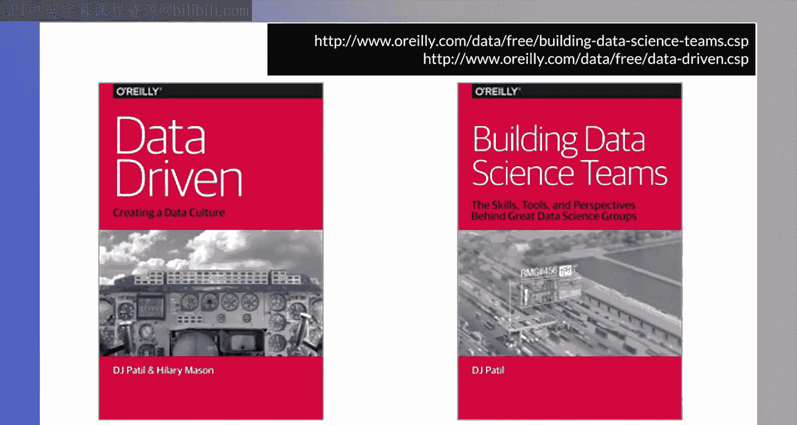
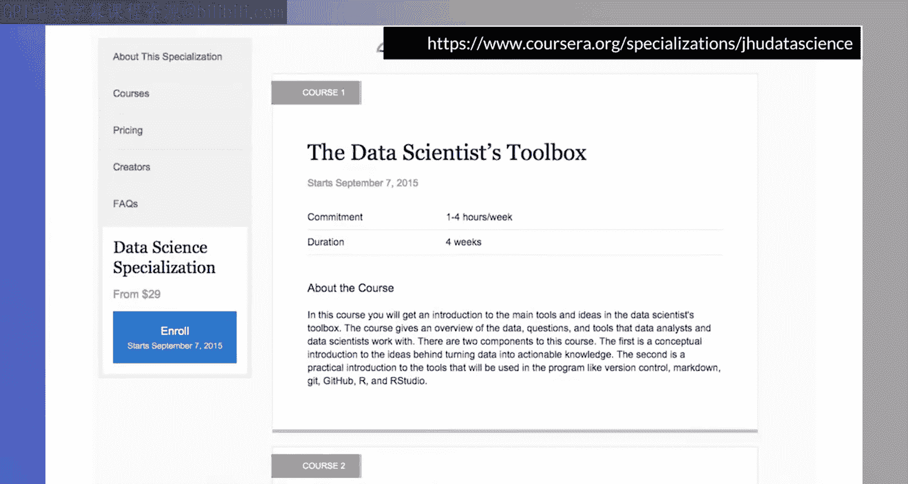
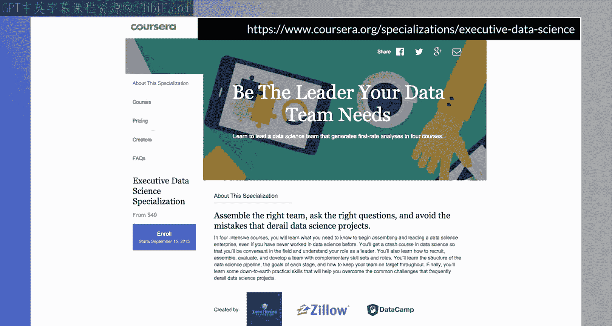

# 高管数据科学：第5课：课程总结与后续资源 🎓

在本节课中，我们将对“构建数据科学团队”这一主题进行总结，并为您提供一系列后续学习资源，帮助您深化理解并拓展在数据科学领域的知识与技能。

恭喜您完成了“构建数据科学团队”课程的学习。出色的工作。

## 推荐书籍 📚

如果您对本课程的内容感兴趣并希望了解更多，以下是一些可供查阅的优质资源。

以下是两本值得推荐的书籍：

*   **《Data-Driven: Creating a Data Culture》**
*   **《Building Data Science Teams》**

这两本书都深入探讨了如何在组织中嵌入数据科学、如何组建团队，并分享了一些成功案例、有效的方法以及需要避免的误区。

## 约翰霍普金斯大学数据科学专项课程 🧠

上一节我们介绍了相关的书籍，本节中我们来看看约翰霍普金斯大学提供的在线课程资源。

我鼓励您探索约翰霍普金斯大学的“数据科学专项课程”。该系列课程侧重于教授如何实际进行数据科学工作，特别是数据分析部分。

该专项课程包含一系列共九门课程，是深入学习数据科学的绝佳途径。如果您即将管理一个数据科学团队，学习这些课程将帮助您更好地理解团队成员的工作内容、他们使用的专业术语等。

## 高管数据科学专项课程的其他内容 💼

除了数据分析专项课程，本“高管数据科学”专项课程还包含其他精彩内容。

最后，我建议您继续学习约翰霍普金斯大学“高管数据科学”专项课程中的其他课程。我们还有关于如何管理数据科学流程、数据科学的本质以及相关流行术语的精彩课程。这些内容将对您大有裨益。

## 总结与祝福 ✨

本节课中我们一起学习了课程总结，并为您梳理了后续的学习路径。

总之，很高兴您能参与本课程的学习。祝您好运。