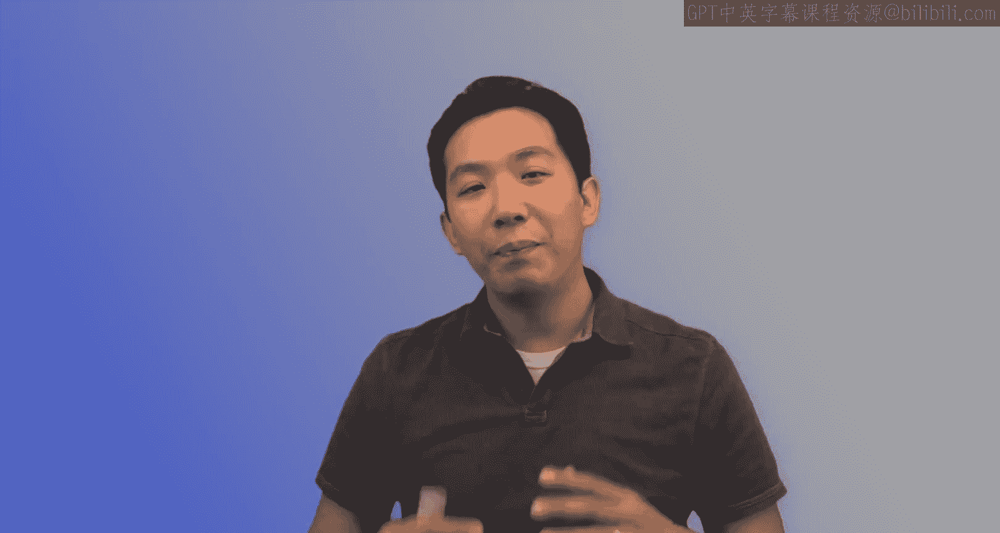
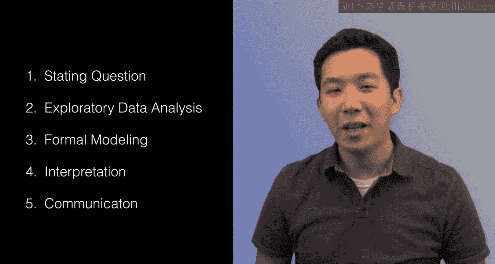
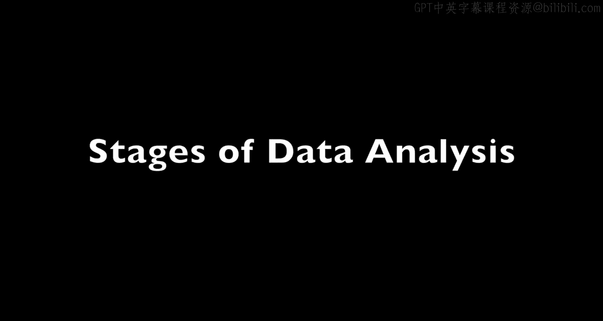

# 高管数据科学：2：数据分析阶段 🧩

在本节课中，我们将学习数据分析过程的五个核心步骤，以及一个贯穿始终的“设定预期-收集信息-匹配与修正”循环。理解这个框架对于系统性地解决数据问题至关重要。

数据分析过程主要包含五个不同的步骤。这些步骤分别是：**提出并精炼问题**、**探索数据**、**构建统计模型**、**解释结果**以及**向合适的受众传达结果**。其中，探索数据这一步尤为重要，它需要你判断手头的数据是否足以回答你在第一步提出的问题。

在每一个步骤中，你都可以进行一个小的循环。这个循环包括：**设定预期**、**收集信息**，以及**将预期与你收集到的数据进行匹配**，然后**根据你所看到的情况修正你的预期**。

在后续的课程中，我们将详细探讨这个三步循环如何应用到数据分析的五个阶段中的每一个阶段。

---

## 数据分析的五个核心步骤 📊

上一节我们介绍了数据分析的整体框架，本节中我们来看看构成这个框架的五个具体步骤。

以下是数据分析过程的五个关键步骤：

1.  **提出并精炼问题**：明确你希望通过数据分析解决的核心问题。
2.  **探索数据**：检查数据，并判断其是否适合回答第一步提出的问题。
3.  **构建统计模型**：建立模型来总结数据，并量化变量之间的关系。这通常涉及公式，例如线性回归模型：`y = β₀ + β₁x + ε`。
4.  **解释结果**：理解模型输出的统计结果和含义。
5.  **传达结果**：将分析结果有效地传达给相关的受众。

---

## 贯穿始终的三步循环 🔄

我们已经了解了数据分析的线性步骤，但实际分析过程并非单向进行。在每个步骤内部，都存在一个动态的调整循环。

这个循环是数据分析的微观引擎，它确保我们的工作始终朝着正确的方向前进。以下是该循环的三个环节：

1.  **设定预期**：在开始具体工作前，先对可能的结果或数据形态有一个初步设想。
2.  **收集信息**：通过查看数据、运行代码或构建模型来获取实际信息。
3.  **匹配与修正**：将收集到的信息与最初的预期进行比较，并根据差异调整你的问题、方法或预期。

本节课中，我们一起学习了数据分析的五个阶段框架以及驱动每个阶段的三步循环。掌握“设定预期-收集信息-匹配与修正”这一思维模式，能帮助你更灵活、更系统地进行数据分析，避免在复杂问题中迷失方向。