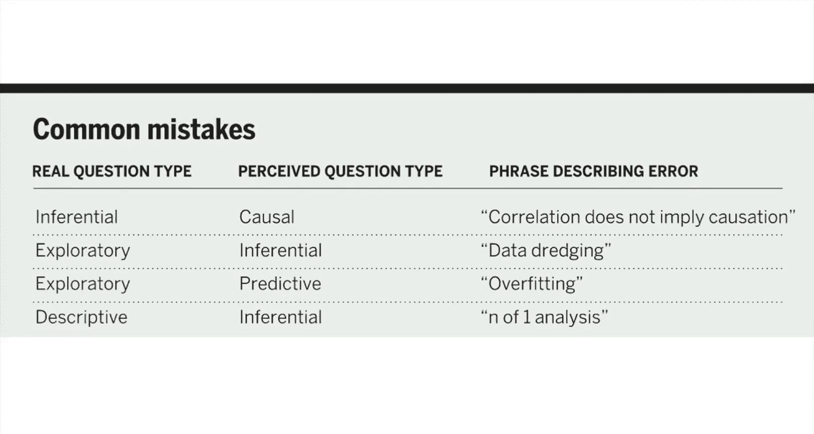

# 高管数据科学：3：六种问题类型 🧠

在本节课中，我们将学习数据分析中可以提出的六种不同类型的问题。理解这些问题的区别对于正确设计和解读分析结果至关重要。我们将逐一探讨每种问题的特点、应用场景以及常见的误用情况。

---

## 描述性问题 📊

描述性问题的核心目标是**总结数据集的特征**。这类问题通常关注你手头已有的数据，旨在通过计算平均值、比例等统计量来概括数据的基本情况。

以下是描述性问题的典型例子：
*   过去24小时内有多少人访问了这个网站？
*   巴尔的摩市的平均空气污染水平是多少？

在描述性分析中，我们主要关注数据本身的汇总，暂时不考虑数据之外的其他因素。

---

## 探索性问题 🔍

上一节我们介绍了如何总结数据特征，本节中我们来看看如何发现数据内部的关系。探索性问题的基本目标是**观察数据中变量之间的趋势或关系**。这类分析有时被称为“假设生成”分析，因为你是在现有数据中寻找可能值得进一步研究的关联。

与描述性问题类似，探索性问题通常也专注于数据内部，旨在总结和刻画数据集内的关系，而非对数据之外的事物做出推断。

---

## 推断性问题 🎯

在探索了数据内部的关系之后，我们常常希望将发现推广到更广的范围。推断性问题的根本特性在于，它旨在**对数据之外的事物做出陈述**。例如，你可能想知道在数据中观察到的某种关系是否在其他数据集或不同群体中同样成立。

推断性问题的关键在于，它试图对你未观测到的事物进行论断。因此，这是一种更为复杂的问题类型，因为你必须关注数据之外的因素，并谨慎选择使用的方法和途径。

---

## 预测性问题 🔮

接下来，我们来看看如何利用已知信息预测未知结果。预测性问题的核心是，**利用一组特征来预测某个个体或分析单元的另一项特征**。从广义上讲，这本质上是寻找数据集中大量特征之间的相关性。

关于预测性问题，有几点需要注意：
*   预测模型的目标通常是基于一组特征，对某个目标特征做出尽可能准确的预测，其首要目的**并非解释事物的工作原理或内在机制**。
*   虽然预测性分析有时可能间接揭示一些解释，但这并非其最终目标。

---

## 因果性问题 ⚖️

预测模型告诉我们“是什么”，而因果性问题则试图回答“为什么”。因果性问题旨在**确定当我们有意改变某个特征时，另一个特征的平均水平会如何变化**。例如，如果我们改变变量X，变量Y平均会受到怎样的影响？

解决因果性问题的方法包括：
*   **直接方法**：如随机对照试验等能直接控制变量的实验。
*   **间接方法**：在许多无法控制实验条件或专门设计实验的观察性研究场景中，我们需要通过多种不同类型的研究积累证据，从而形成表明因果关系存在的模式。

---

## 机制性问题 ⚙️

最后，我们探讨一种在高度受控环境下更常见的问题类型。机制性问题的目标是**揭示两组特征之间确定性的联系**。我们想知道，如果改变一个测量值，是否总是会导致另一个测量值产生特定的结果。

这类关系通常在高度受控的环境（如工程过程）之外很难识别。虽然我们在数据分析中不常处理纯粹的机制性问题，但了解它仍然很重要。

---

## 为何区分问题类型至关重要 ❓

我们之所以详细讨论这六种问题类型，是因为**明确你所提问题的类型对于正确解读数据分析结果至关重要**。混淆问题类型是一种非常常见的错误，这会导致对结果的错误解读，或不当权衡来自不同分析的证据。

事实上，这类混淆如此常见，以至于我们为一些典型的错误起了“绰号”：
*   **将相关性误认为因果性**：你以为在问一个因果问题，但分析或数据收集方式实际上只允许你做出推断性结论。这就是经典的“相关不蕴含因果”问题。
*   **数据疏浚**：你以为在进行推断性分析，但实际上做的更像是探索性分析。
*   **过拟合**：你试图进行预测，但构建预测模型的方式不当，导致分析更像是在探索数据中的偶然模式。
*   **“N=1”分析**：你以为在进行推断，但样本量过小，导致分析本质上只是描述性的。

因此，请务必明确你所提问题的类型，并据此恰当地解读你的数据分析。

---

本节课中，我们一起学习了数据分析的六种核心问题类型：**描述性**、**探索性**、**推断性**、**预测性**、**因果性**和**机制性**。每种类型都有其独特的目标、方法和解读方式。清晰地区分它们，是确保分析工作方向正确、结论可靠的关键第一步。