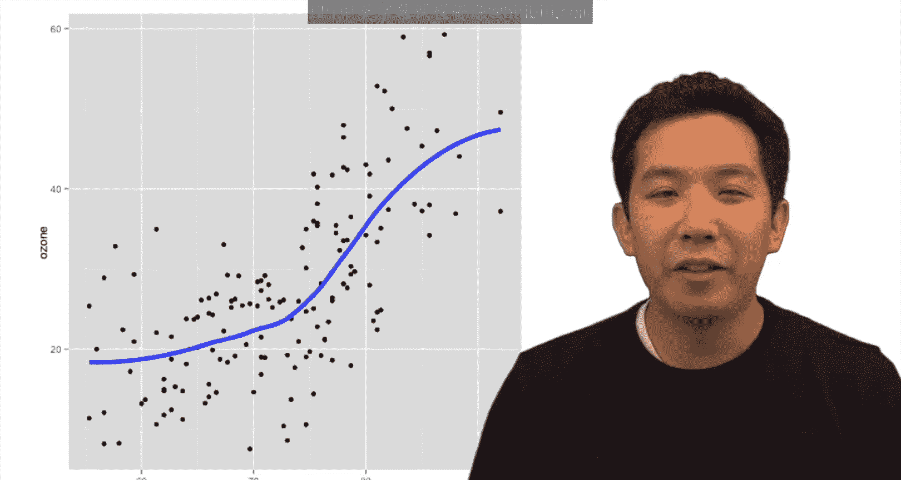
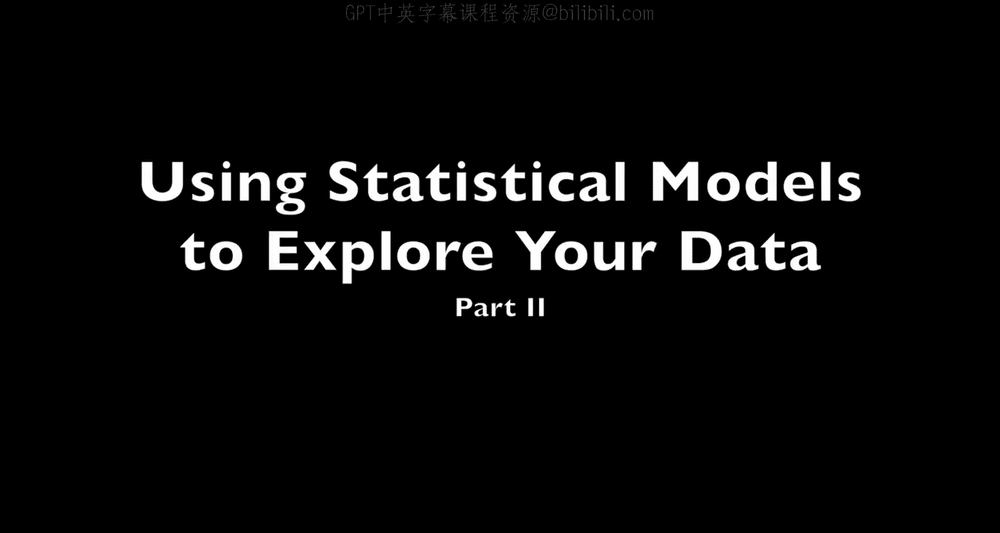
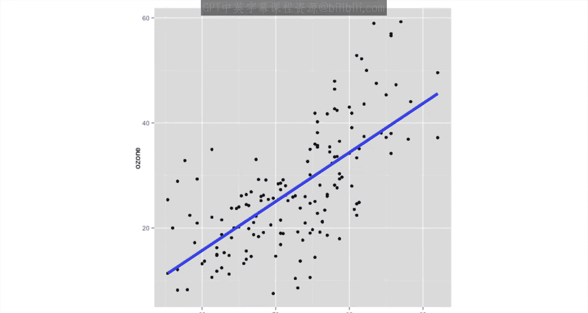
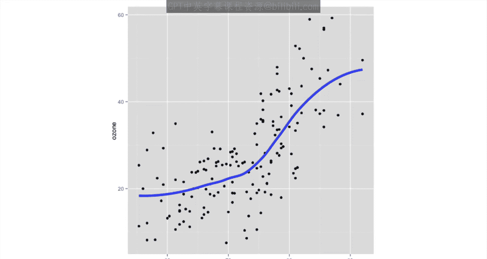
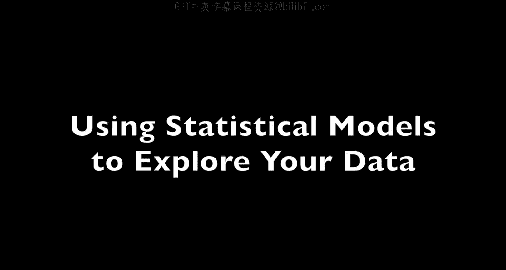

# 高管数据科学：第5课：使用统计模型探索数据（第二部分）

在本节课中，我们将学习如何运用统计模型来探索数据，并初步勾勒出解决方案的草图。我们将通过一个具体的案例——分析纽约市臭氧与温度的关系——来演示这个过程。

上一节我们介绍了使用统计模型探索数据的基本思路，本节中我们来看看一个具体的线性模型应用实例。

## 设定预期与线性模型

在查看任何数据之前，设定对数据关系的预期非常重要。我们使用的数据来自1999年纽约市的“国家发病率与死亡率空气污染研究”，包含每日的24小时平均温度和24小时平均臭氧水平。我们感兴趣的核心问题是：环境温度与环境臭氧水平在纽约市有何关联？

关于臭氧的形成，首先需要了解：空气中臭氧的生成很大程度上取决于可用的日照量。日照充足的日子通常温度更高，臭氧水平也倾向于更高；反之，多云的日子温度较低，臭氧水平也较低。因此，我们预期温度与臭氧水平之间存在正相关关系。这是一种间接关系，我们实际上是用温度作为日照量的代理变量。

描述这种预期关系最简单的模型是线性模型。线性模型的形式可以表示为：

**公式：** `臭氧水平 ≈ β₀ + β₁ * 温度`

为了设定预期，我们可以先构想一个模拟的关系图。下图展示了两组模拟变量之间的线性关系：

图中数据从左到右呈线性增长，但周围存在一些散点。此外，在蓝色直线上的任意一点，其上下的数据点数量大致相等。这意味着直线是“无偏”的，数据点偏离直线的可能性在上方和下方是均等的。这就是我们在查看真实数据前所预期的画面。

## 拟合模型与对比预期

现在，让我们将线性回归模型拟合到1999年纽约的真实数据上，并将拟合线叠加在散点图上：

首先，对比我们之前的预期图。可以观察到，温度与臭氧确实一同上升：温度较高时，臭氧倾向于更高；温度较低时，臭氧倾向于更低。这与我们的基本预期一致。

然而，数据也显示出与预期线性关系的偏差。具体来看：
*   在温度约85华氏度（℉）的区域，蓝色拟合线附近的大多数数据点都位于线上方，线下方的点很少。
*   在温度约70华氏度（℉）的区域，大多数数据点位于线下方，线上方的点很少。

这意味着，在85度左右，我们的线性模型预测值系统性偏低（向下偏倚）；在70度左右，模型预测值系统性偏高（向上偏倚）。线性模型捕捉到了温度与臭氧同向增长的总趋势，但在某些温度范围内存在偏倚，因此它显然不是一个完美的模型。

## 探索非线性关系

观察到的数据模式表明，臭氧与温度的关系在大约70-73华氏度之前实际上较为平缓，之后每增加一度温度，臭氧水平会急剧上升。这暗示两者之间的关系可能是**非线性**的。

因此，我们需要修正最初的预期，从线性关系修正为非线性关系。我们可以使用非线性平滑器来检验这一点。下图展示了使用**LOWESS平滑器**（一种灵活的、能捕捉多种平滑趋势的方法）拟合的结果：

从蓝色曲线可以看出，臭氧水平在大约75华氏度之后急剧上升，而在85华氏度左右，关系似乎有趋于平缓的迹象。这暗示了一种经典的**S形曲线**：起始段关系平缓，中间段急剧上升，末端段再次平缓。

像LOWESS这样的平滑器非常有助于捕捉这类非线性趋势，但它们通常不会揭示其背后的运作机制。因此，我们可能需要基于此处的发现，修正最初的线性模型，尝试捕捉这些趋势，并更深入地了解背后的原理。

## 总结

本节课中，我们一起学习了如何通过统计模型探索数据关系。我们以纽约市臭氧与温度数据为例，经历了以下步骤：
1.  **设定预期**：基于领域知识（臭氧与日照/温度的关系），预期两者存在正相关，并构想线性关系图。
2.  **拟合与对比**：将线性模型拟合到真实数据，通过可视化对比模型预测与预期，发现模型虽能捕捉总趋势，但在局部存在系统性偏倚。
3.  **修正模型**：根据数据中观察到的模式（平缓-陡升-平缓），怀疑存在非线性关系，并使用LOWESS平滑器进行探索性分析，初步确认了S形曲线的趋势。

这个过程的核心在于：**数据探索是一个迭代过程**。我们从简单的假设（线性模型）开始，用数据检验它，发现不足，然后提出更复杂的假设（非线性关系）来更好地描述数据。这为后续构建更精确的模型奠定了坚实基础。