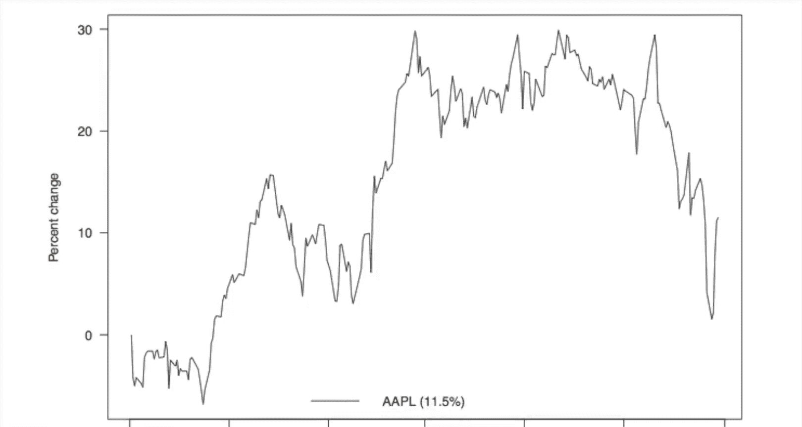
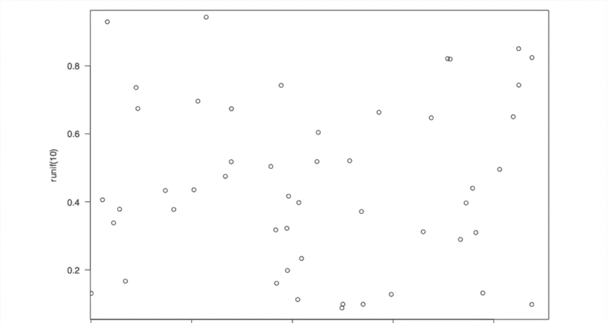
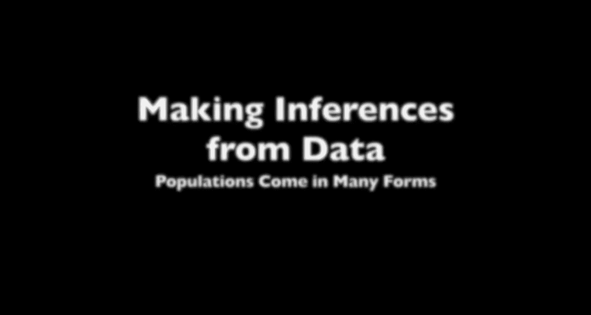

# 高管数据科学：第5课：人群有多种形式

在本节课中，我们将要学习关于“人群”或“总体”的更多概念，特别是它们可能以哪些不同的形式出现。理解这一点对于进行正确的统计推断至关重要。

## 时间序列数据中的总体

上一节我们介绍了总体的基本概念，本节中我们来看看当数据随时间变化时，如何定义总体。例如，假设你观察苹果公司股票一年的每日收盘价数据。

如果你希望从这些数据中做出推断，那么你试图推断的总体是什么？这里有几个可能的候选对象。

以下是两种常见的思考方式：

1.  **从时间维度抽样**：这些数据来自特定的一年。苹果公司已存在多年。因此，你可以认为这些数据代表了从所有过去或未来年份数据中抽取的一个随机样本。即，`样本 = 一年的数据`，`总体 = 所有年份的数据`。
2.  **从横截面维度抽样**：苹果公司是股票市场中的一只股票。因此，你可以将苹果公司视为从股票市场中所有其他股票里抽取的一个随机样本。例如，如果你想估算一个股票指数，苹果公司可以被视为该指数的一个随机元素。即，`样本 = 苹果公司`，`总体 = 所有股票`。

## 空间数据与自然现象中的总体

另一种总体可能难以定义的情况是分析自然现象数据，例如地震、飓风或野火。

这些事件在空间上发生，我们收集数据并建立模型进行分析。但当你想要进行推断时，必须仔细思考你究竟在推断什么。

对于这类自然过程，一个有用的思考方式是假设存在一个**未被观测到的随机过程**，它在背景中运行，并在现实世界中“抛下”这些事件。

例如，可以想象存在一个地震的随机过程，它随机地在我们的世界中产生地震。当你拟合一个模型并从中做出推断时，你实际上是在推断这个未被观测到的随机过程的属性。即，`观测到的数据 = 事件（如地震）`，`推断目标 = 生成这些事件的潜在随机过程`。

## 将数据本身视为总体

最后要讨论的一点实际上与推断无关，它是将数据本身视为总体的一个特例。这里的核心问题是：你是否真的需要进行统计推断？

有时，你可以将手头的数据视为一个完整的总体。可能存在这样的情况：你拥有所有你希望看到的数据，并且你根本不关心数据之外的事物。而统计推断的本质正是谈论数据之外的事物。

如果将数据视为总体，你的分析将有一个特征：**没有不确定性**。因为没有产生不确定性的抽样过程。你无需担心置信区间、标准误或P值，因为只要你确信数据本身没有问题，你就拥有了确定性的信息。

在许多情况下，例如当你分析自己组织内部的数据时，你可能不需要担心组织外部的事物。因此，应始终仔细思考你是否真的需要进行推断，因为在很多情况下可能并不需要。

如果你的分析不需要推断，那么它将大大简化，因为你无需为你未实际观测到的事物做出陈述，你已经观测到了一切。

## 总结

本节课中我们一起学习了统计推断中关于“总体”的深入思考。

*   **推断的本质**：推断是根据数据对你未观测到的事物做出陈述的过程。
*   **总体的多样性**：总体可以以多种形式存在，特别是在处理时间序列数据或空间自然现象数据时，需要仔细定义你试图推断的总体。
*   **一个特例**：存在一种特殊情况，即你可以将数据本身视为总体。在这种情况下，你根本不需要进行任何推断，因为你已经拥有了所需的全部信息。识别你所处的情境，并为任何给定问题一致地定义总体，是至关重要的。