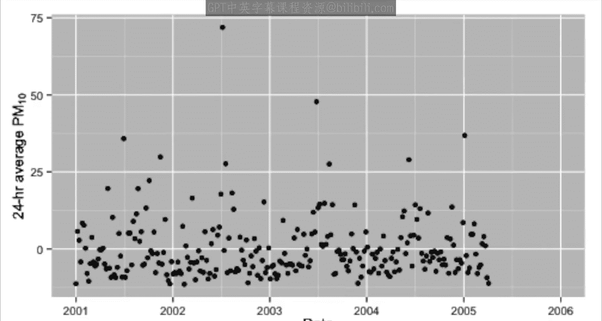
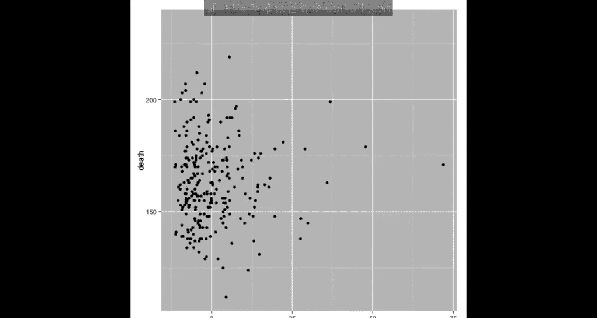
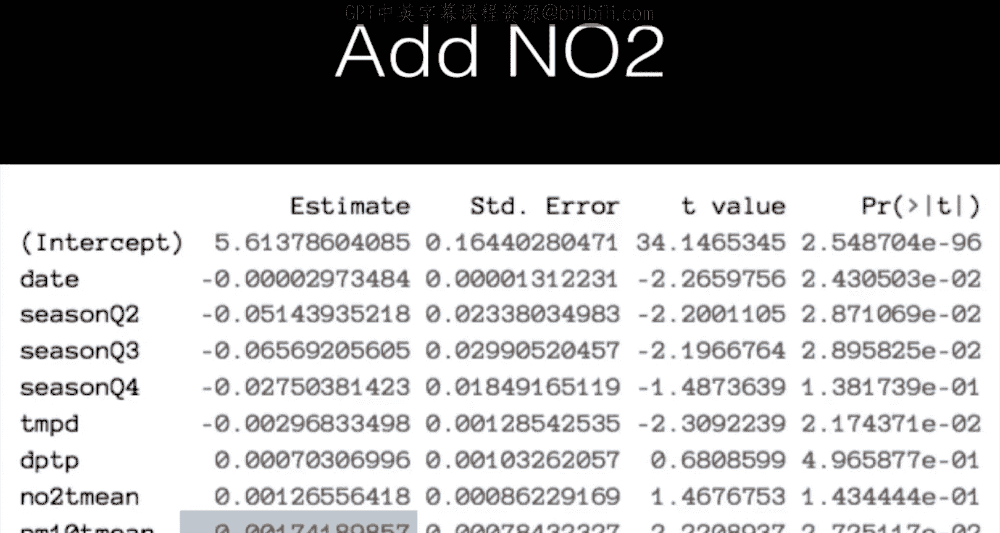
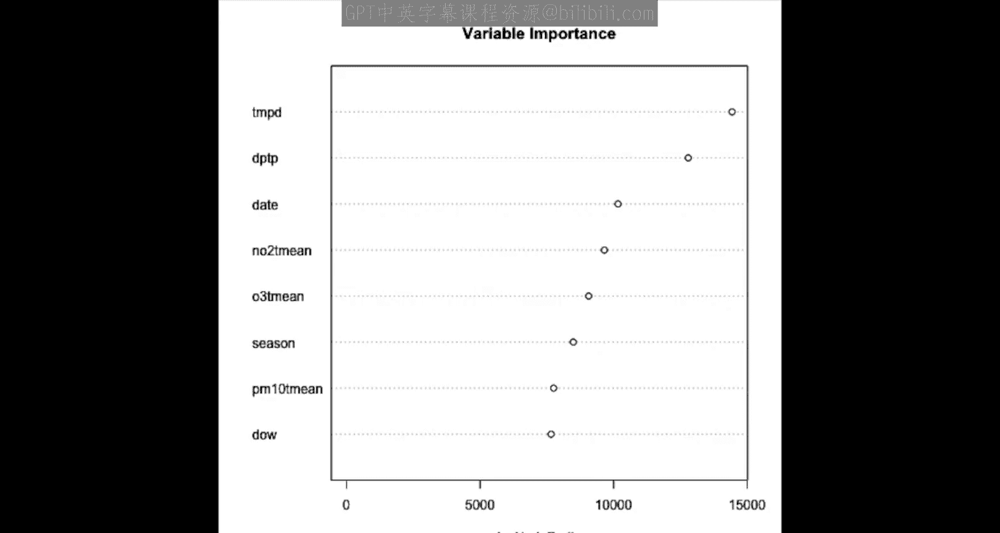
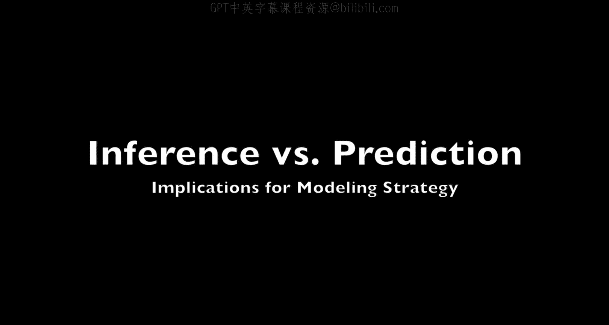

# 高管数据科学：第15课：推断与预测 🎯

在本节课中，我们将学习数据分析中两种核心问题类型：推断性问题和预测性问题。理解它们的区别至关重要，因为问题的类型会极大地影响你在任何数据分析中采取的建模策略。

## 区分推断与预测

上一节我们介绍了问题类型的重要性，本节中我们来看看推断性问题和预测性问题的具体区别。

**推断性问题**的目标是估计一个结果变量与一个关键预测变量之间的关联，同时可能需要调整所有潜在的混杂因素。通常，我们只对一个或少数几个关键预测变量及其与结果的关系感兴趣。建模的关键目标是**估计这种关联**，并确保恰当地调整了其他因素。我们常进行敏感性分析，以观察在其他因素存在时关联如何变化。

**预测性问题**的目标是开发一个模型，利用你手头所有可用的信息来最好地预测结果。通常，你不会预先赋予某个预测变量比其他变量更高的权重。因此，在查看数据之前，没有“关键预测变量”和“混杂因素”之分，所有预测变量可能同等重要。任何好的预测算法都会告诉你哪些预测变量对预测结果更重要或更不重要。最后，我们通常不关心各种预测变量之间关系的机制或具体细节，我们只想找到一种能高精度、低误差地预测结果的模型形式。

## 推断性分析示例：空气污染与死亡率

理解了基本概念后，我们通过一个具体例子来看看这两种问题如何导致不同的结论。首先，我们从一个推断性问题开始。

假设我想知道纽约市的空气污染与死亡率之间的关系。我使用的数据来自“国家发病率、死亡率和空气污染研究”。下图展示了纽约市2001年至2005年的每日死亡率，可以看到其具有高度的季节性，死亡率在冬季较高，夏季较低，每年都有非常特定的模式。

以下是颗粒物（PM10）数据在同一时间段的情况。它同样具有季节性结构，特别是在纽约市，颗粒物在夏季较高，冬季较低，这种模式在各年间重复出现。

第一步，我尝试一个简单的解决方案：绘制死亡率与PM10的散点图（PM10在X轴）。图中关系看起来有很多噪声，因为我们不一定期望颗粒物能解释死亡率的所有变异性。因此，我们可能需要借助一些正式的建模来观察这里是否存在任何关联。

接下来，我们对散点图数据拟合一个简单的线性回归。这基本上是以死亡率为结果变量，PM10为关键预测变量，不包含任何其他因素的基线模型。

以下是该回归模型的结果。PM10的系数约为0.00004，基本上接近0。从其标准误远大于估计值可以看出，这个估计值周围有很大的变异性，因此它实际上为零。所以，两个变量之间的关联为0。这是我们初步分析的结果。

然而，从我们刚刚看到的数据图中可知，污染和死亡率都具有高度季节性。季节在解释死亡率和空气污染的变异性方面都扮演重要角色。死亡率冬季高、夏季低，而污染夏季高、冬季低。因此，季节显然与死亡率和污染都相关，将其作为潜在的混杂因素纳入模型是合理的。

于是，我们拟合第二个模型，该模型包含PM10作为关键预测变量，并加入季节（一年四季，用分类变量表示）作为潜在的混杂因素。

以下是拟合该模型的结果。PM10的系数现在显著增大，为0.00149，并且标准误相对于估计值来说小了很多。这表明PM10的系数远大于零，可能具有统计显著性。加入这个混杂因素后，我们估计的PM10与死亡率之间的关联发生了巨大变化。部分原因在于季节与两者都高度相关，但与死亡率和污染的相关方式不同。这就是为什么当我们不包含季节时看不到关系，而包含时则看到了更强的关系。

还有其他潜在因素可能与死亡率和空气污染都相关，例如天气。天气与死亡率相关，也与各种空气污染物高度相关。我们可以用温度或露点温度来表征天气，并将其纳入模型。

以下是加入温度（变量`TmpDD`）和露点温度（变量`DPTP`）后的结果。现在，PM10的系数甚至比之前更大，标准误相似，因此在某种意义上比之前的模型更具统计显著性。温度和露点是同时与死亡率和污染相关的强相关因素。

最后，另一类可能与死亡率和颗粒物都相关的因素是其他污染物。其他污染物可能影响健康，并且可能与颗粒物相关，因为它们可能有共同的来源。在纽约这样的城市，一个常见来源是交通，交通会产生颗粒物和其他污染物。我们将考察的污染物之一是二氧化氮（NO2），它往往与颗粒物相关。因此，如果你对颗粒物与死亡率之间的关联感兴趣，你可能会想：我们观察到的是否实际上是二氧化氮与死亡率之间的关联，而PM10在其中被混淆了？我们可以将二氧化氮作为潜在的混杂因素纳入模型，看看当我们这样做时，对颗粒物的估计如何变化。

以下是该模型的结果。与之前的模型相比，PM10的系数略有下降。当我们把NO2纳入模型时，效应略有减弱。不过，相对于我们估计的标准误，这仍然是一个相当强的效应，只是不如我们纳入NO2之前的估计那么强。NO2和PM10可能对死亡率共享很多效应，可能难以完全区分它们。然而，即使在模型中包含NO2，我们仍然看到PM10与纽约市死亡率之间存在相当强的关联。

当我们汇总主要模型（仅包含PM10和死亡率）以及我们展示的各种次要模型的结果时，可以看到主要模型实际上关联为零，而其他三个模型则与结果有相对较强的正相关。这里我绘制了每个关联的95%置信区间。这就是我们感兴趣的分析类型：我们关注PM10作为关键预测变量，死亡率作为结果变量，并希望看到在不同场景下、包含不同混杂因素集合的不同模型集合下，这种关联如何变化。我们如何处理这些信息将取决于分析的目标、利益相关者以及我们之后可能采取的行动。现在我想强调的是，为关联性分析所做的分析很大程度上是沿着这些思路进行的。

## 预测性分析示例：预测纽约市死亡率

看过了推断性分析的例子，现在让我们转向一个预测性问题，看看分析策略有何不同。

我们可以提出的另一个问题是：利用我们现有的数据，什么能最好地预测纽约市的死亡率？现在我把问题改成了一个预测型问题，我们想知道什么能最好地预测结果。

我们可以做的一件事是拟合一个复杂的预测算法。我们不需要担心估计关联或调整混杂因素，我们只是把所有可用的数据放进去，看看它能多好地预测结果（死亡率）。这里我将使用随机森林算法来预测纽约市的死亡率。随机森林算法的一个特点是它允许一个称为“变量重要性”的汇总统计量，这可以让你了解一个变量在提高算法预测结果的技能方面有多重要。

下图我绘制了变量重要性图，它根据所有变量对提高算法预测技能的重要性进行了排序。可以看到，最顶端的是温度，被列为最重要的变量，其次是露点温度、日期，然后是NO2、臭氧（O3）、季节，最后是PM10和星期几（DOW）。从这个预测模型可以看出，就提高算法的预测技能而言，颗粒物实际上排在倒数第二。如果你看这个分析，然后问“PM10与死亡率的关系如何？”这个原始问题，你可能会认为它与死亡率无关，对预测不重要。

这没错，但这并不一定意味着从关联性的角度来看，PM10与死亡率没有关联。它可能与死亡率有重要的关联，但这种关联本身可能很弱，因此不一定能很好地预测结果。然而，它可能仍然与结果有重要的关联。因此，区分这些问题类型及其目标非常重要，因为如果你提出一个推断性问题，却做了一个真正为预测调优的分析，你可能会得出错误的结论，认为PM10不重要，与结果没有重要关联。特别是考虑到像污染这样的因素，它可能与结果的关联本身非常小，但由于纽约市的每个人基本上都呼吸并暴露于这种污染空气中，考虑到像纽约这样大的人口规模，这种关联的最终影响可能相当大。

重要的是不要将关联的强度与对感兴趣人群的最终影响混为一谈。因此，对预测性问题使用预测算法，对关联性问题使用关联性分析至关重要，这样才能从数据中得出正确的结论，而不会将一个问题的结果误认为是另一个问题的结果。

## 总结与关键要点

本节课中，我们一起学习了数据分析中推断性问题和预测性问题的核心区别。

*   **推断性问题**关注**估计特定变量间的关联**，通常涉及调整混杂因素以理解因果关系或独立影响。其核心是 `关联强度 = f(关键预测变量 | 调整其他变量)`。
*   **预测性问题**关注**利用所有可用信息最大化预测精度**，不关心变量间的具体关系或机制。其核心是 `预测结果 = 算法(所有可用变量)`。

通过纽约市空气污染与死亡率的案例，我们清晰地看到：
*   在推断性分析中，通过逐步调整季节、温度、其他污染物等混杂因素，PM10与死亡率的**关联从无到有，并逐渐变化**。
*   在预测性分析中，使用随机森林算法时，PM10的**变量重要性排名很低**，因为其他变量（如温度）对预测每日死亡率的贡献更大。

**关键启示**：正确界定问题是选择合适建模策略和得出正确结论的基础。将预测模型的结果直接解释为因果关联，或将弱关联误解为不重要，都可能导致错误的决策。务必根据你的核心目标（是理解“为什么”还是预测“是什么”）来选择相应的分析方法。

