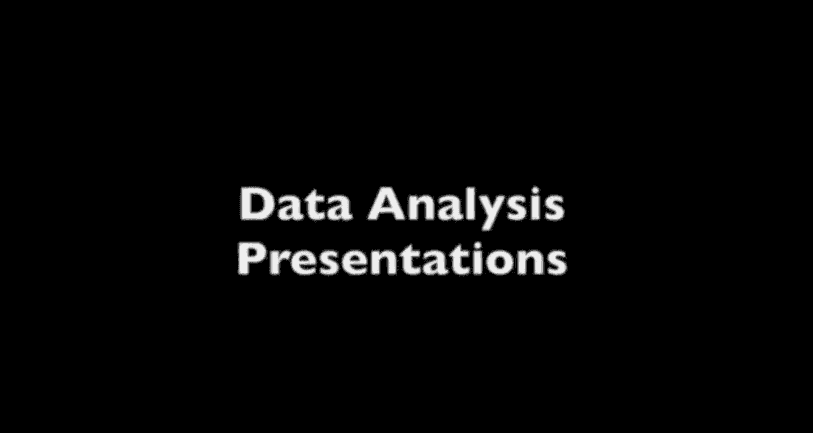

# 高管数据科学：第5课：制作数据分析演示 📊

在本节课中，我们将学习如何制作一个有效的数据分析演示。一个清晰、结构化的演示对于传达分析结果、促进讨论并推动决策至关重要。我们将探讨几个关键组成部分，帮助你提升演示的质量和影响力。

## 陈述核心问题 ❓

上一节我们介绍了演示的重要性，本节中我们来看看第一个关键步骤：清晰地陈述核心问题。在演示开始时，最重要的事情是明确说明你试图回答的问题。很多时候，演示进行了十分钟，听众仍不清楚演讲者的目标。因此，一开始就清晰、简洁地陈述问题至关重要，这能确保所有听众理解目标，并朝着同一方向努力。

## 明确问题类型 🔍

在明确了核心问题之后，接下来需要描述你所处理的问题类型。这有助于听众理解分析的性质和后续讨论的框架。

以下是数据分析中常见的六种问题类型：
*   **描述性问题：** 发生了什么？
*   **探索性问题：** 数据中有什么模式？
*   **推断性问题：** 总体的情况如何？（基于样本）
*   **因果性问题：** A是否导致了B？
*   **预测性问题：** 未来会发生什么？
*   **机制性问题：** 它是如何发生的？

例如，说明你是在进行**推断性分析**（估计总体参数）还是**预测性建模**（预测未来结果），可以帮助听众更好地理解你的方法和结果的局限性。

## 展示原始数据 📈

明确了问题类型，下一步是向听众展示支撑你分析的数据。直接展示数据（或数据摘要）非常有用，尽管这有时是一把双刃剑，因为它可能引发深入的讨论。

以下是关于展示数据的建议：
*   **优先使用图表而非表格：** 图表能直观展示数据摘要和与预期的偏差，更容易激发思考和讨论。
*   **鼓励有益的讨论：** 即使你未必希望引发广泛讨论，但基于数据的深入交流最终可能使分析受益。人们热衷于探讨他们看到的数据。

## 呈现不确定性度量 ⚖️

在展示了数据之后，一个提升分析深度的关键步骤是呈现结果的不确定性。任何基于数据的估计或预测都包含不确定性，展示这一点能使讨论更加丰富。

你可以通过以下方式展示不确定性：
*   展示主要模型的**置信区间**（例如，`估计值 = 5.2， 95% CI: [4.8, 5.6]`）。
*   呈现一系列**替代模型或敏感性分析**的结果。
*   使用图形化表示，如带有误差线的条形图。

## 区分证据、解读与决策 🧩

最后，也是至关重要的一点，是在呈现数据分析结果时，明确区分三个独立的部分：**证据**、**解读**和**决策**。将它们混为一谈会模糊讨论的焦点。

让我们通过一个例子来理解这三者的区别：
1.  **证据：** 这是你分析的直接结果。例如：“我们的模型估计，空气中污染物PM2.5每增加10微克/立方米，人群死亡率将上升5%（95%置信区间：3% 到 7%）。”
2.  **解读：** 这是你对证据含义的理解。例如：“这表明，长期暴露于高水平的PM2.5污染对公共健康构成显著风险。”
3.  **决策：** 这是基于证据和解读建议采取的行动。例如：“因此，我们建议环保部门考虑制定更严格的工业排放标准，并加强空气质量监测。”

将这三者分离，允许听众独立地评估证据的强度、讨论不同的解读方式，并权衡各种可能的决策方案，从而促成更有成效的讨论。

---

本节课中我们一起学习了制作高质量数据分析演示的五个核心要点：首先清晰**陈述问题**，然后**明确问题类型**，接着有效**展示数据**并**呈现不确定性**，最后严格**区分证据、解读与决策**。遵循这些原则，你的演示将更具说服力，并能更好地促进基于数据的深入讨论与决策。