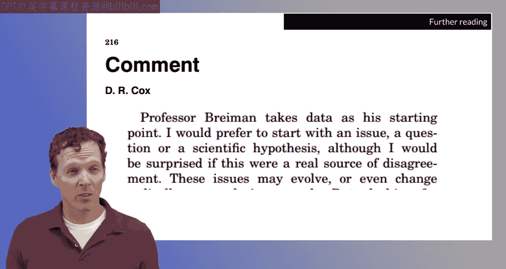
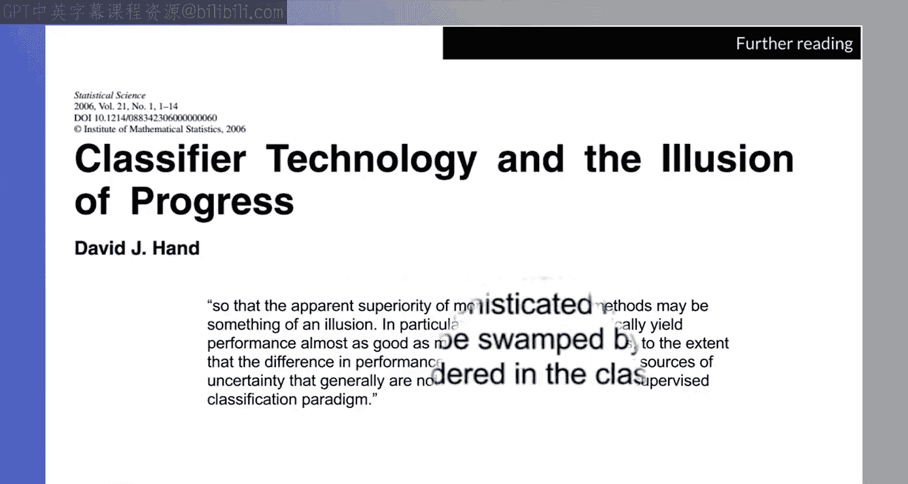

# 高管数据科学：5：机器学习与传统统计学（第二部分）📚

在本节课中，我们将继续探讨机器学习与传统统计学之间的差异，并为您提供一些延伸阅读材料，以帮助您更深入地理解这一主题。

上一节我们介绍了机器学习与传统统计学在目标和方法上的核心区别。本节中，我们来看看几位著名统计学家对这一讨论的见解，并为您推荐几篇重要的文献。

以下是三篇值得深入阅读的文章，它们从不同角度探讨了机器学习与统计学的分野。

*   **《The Rise of the Mach》**：这是著名统计学家Larry Wasserman的一篇博客文章。文章很好地论述了二者的区别，并可以被视为对统计学界的一种呼吁，希望他们能更好地接纳机器学习。
*   **《Statistical Modeling: The Two Cultures》**：这是已故的杰出统计学家Leo Breiman撰写的一篇极具影响力的论文。我的许多思考都源于此文。文章发表在《Statistical Science》期刊上，非常易于理解。Breiman的观点对传统统计学持批评态度，或至少认为传统统计学已经落后。他在文中指出：“我认为统计学界对数据模型的关注，导致了一种不相干的理论，这阻碍了统计学家使用更合适的算法模型，并使他们无法研究激动人心的新问题。”这篇文章对自身所在的统计学界提出了相当多的批评，读起来并不像大多数统计学研究论文那样枯燥，反而非常有趣。
*   **《Classifier Technology and the Illusion of Progress》**：这是另一位伟大的统计学家David Hand的文章。这篇文章对机器学习方法提出了更多批评。文中提到：“……更复杂方法的明显优势可能只是一种错觉。特别是，简单方法通常能产生与复杂方法几乎一样好的性能，以至于性能上的差异可能被经典监督分类范式中通常未考虑的其他不确定性来源所淹没。”他基本上是在说，构建复杂机器学习算法的努力常常是不值得的，其复杂度的增加只能带来边际收益。这是与Leo Breiman论文观点截然不同的另一篇有趣论文。

在Leo Breiman的论文讨论中，另一位备受尊敬的统计学家D.R. Cox（其Cox比例风险模型是被引用最多的统计学论文之一）作为讨论者发表了一个令我印象深刻的评论。他说：“Breiman教授以数据为出发点，而我更倾向于从一个议题、一个问题或一个科学假设开始，尽管如果这成为真正的分歧点，我会感到惊讶。”我非常喜欢这个评论，因为它确实触及了问题的核心。我认为，机器学习最让我感到困扰的一点，就是当你不得不用同一套数据来推导和检验假设时。对我来说，这是最难接受的一点。

这些材料为您提供了足够的基础，以便在后续课程中继续学习。在接下来的课程中，我们将更多地关注传统分析方法，并假设您将使用和管理数据科学家，为您的行业或您试图研究的任何领域，尝试提出简洁的解释。

本节课中，我们一起学习了三位统计学家对机器学习与统计学关系的不同观点，并了解了延伸阅读的方向。感谢您的聆听，期待在下一讲中与您再见。