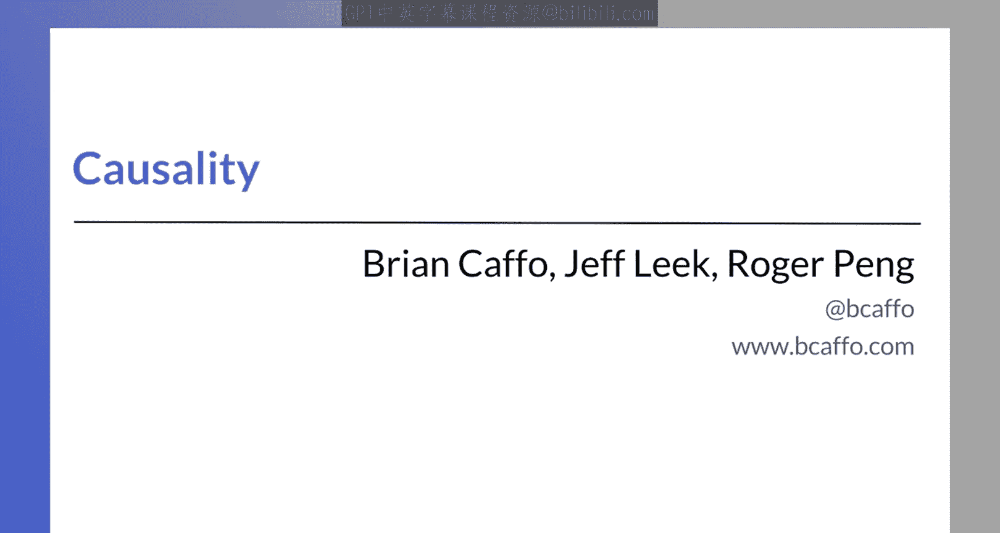
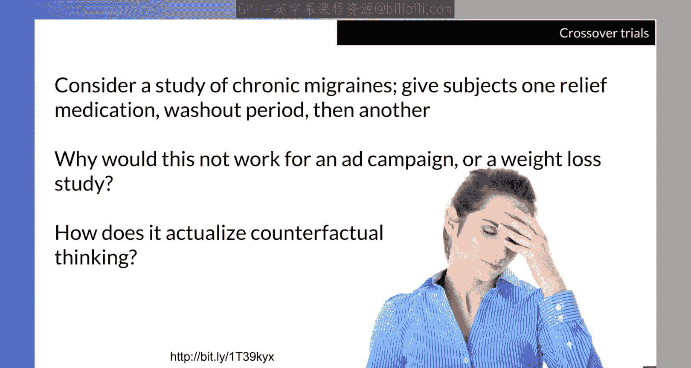

# 高管数据科学：第8课：因果关系（第一部分）

在本节课中，我们将要学习因果关系的核心概念。我们将从哲学基础出发，探讨如何通过统计学方法定义和估计因果效应，并理解不同研究设计在探究因果关系时的优缺点。

## 什么是因果关系？

我们从一个著名的网络漫画开始。漫画中的人物说：“我曾经认为相关意味着因果。后来我上了一门统计课，现在我不这么认为了。”这听起来像是那门课起了作用。漫画接着补充道：“嗯，也许吧。”今天我们要讨论的，正是这个“也许”的部分。

为了定义因果关系，我们需要回溯到哲学家大卫·休谟。他的哲学思想是统计分析中因果关系思考的起点或基础。他有一段著名的论述，其核心思想是：在统计学中定义因果效应（至少是主要思想流派之一）的关键在于思考“反事实”。

换句话说，如果第一个对象不曾存在，第二个对象也绝不会存在。这就是我们现在所说的“反事实”概念。

## 反事实与因果效应

在医学领域，一个反事实的例子是：我们观察一个人在接受治疗后是否产生反应。而反事实则是：如果同一个人没有接受治疗，会发生什么。因此，因果效应就是同一个人在接受治疗与不接受治疗两种情况下结果的差异。

然而，我们只能观察到这两种现实中的一种。所以，反事实是我们观察到的现实与我们无法观察到的现实之间的差异。

重申一下，一个处理对某个对象的因果效应，是该对象实际接受的处理结果与她/他若接受另一种处理将会出现的结果之间的变化。这就是反事实差异。它既需要我们能观察到的东西，也需要我们无法观察到的东西。

## 一个具体例子

让我们通过一个虚构的治疗例子来理解。假设有一种名为“扭扭乐”的70年代古怪健身器材。因果效应（反事实差异）就是同一个人使用“扭扭乐”12周与不使用它，在结果（例如某种健康指标）上的差异。

我们无法同时观察到同一个人在同一时间点既使用又不使用“扭扭乐”的状态。我们或许可以让人使用一段时间，然后经过一段“洗脱期”后再不使用，但这并非同一时间点，观察到的效应可能会与时间因素混杂。因此，我们无法获得个体层面的确切因果效应。

然而，在某些假设下，我们可以估计**平均因果效应**，即跨个体层面的平均效应。

## 平均因果效应与随机化

平均因果效应不是看单个人（比如克里斯蒂安·贝尔）是否使用了“扭扭乐”，而是将一群人随机分成两组：一组使用“扭扭乐”（处理组），另一组不使用（对照组），然后比较两组的结果差异。

如果我们采用**随机化**等方法，就可以在特定假设下估计出真实的平均因果效应，从而从经验上获得对“原因”的真实理解。这就是因果统计推断的思想：理解你所做的假设，并基于一个形式化的因果定义进行分析。

## 这种思考方式的启示与局限

这种思考方式带来一些启示和局限。首先，要谈论因果，我们必须考虑一个**可分配的处理或干预**。例如，我们可以将“扭扭乐”分配给一些人，而不给另一些人。有些情况（如吸烟）在伦理上无法进行随机化实验，但它在概念上是“可随机化”的。然而，有些情况（如大脑结构变化是否导致某种神经疾病倾向）在概念上就无法被视为可随机化的干预，这是采用此处支持的因果统计分析定义时可能面临的一个问题。

其次，我们无法观察反事实，在特定时间点只能观察到一种自然状态。这正是因果推断工作要解决的核心难题。但通过严谨的假设和研究设计，我们可以对平均因果效应做出推断，这才是真正的洞见所在。

就个人而言，我认为存在正式的因果分析，也存在对因果分析足够深入的理解，以便你能思考自己分析的因果含义。我个人并不做太多具体的因果分析，但因果思维是我许多工作的基础。因此，我认为因果思维对于理解统计分析、理解你分析的因果含义至关重要。

## 研究设计与因果思考

现在，既然你知道了这个简单的事实——我们将因果效应定义为一个人接受处理时的观察结果与她/他若未接受处理时的观察结果之间的差异（而我们只能看到其中之一）——我希望你思考以下各种研究设计，它们如何尝试探究这个问题，以及在哪些方面成功或失败。

以下是几种常见的研究设计类型及其与因果思考的关系：

*   **交叉试验**：让一个受试者先接受一种处理，经过合适的洗脱期后，再接受另一种处理。
    *   **例子**：研究慢性偏头痛时，可以先给某人一种缓解药物，洗脱期后再给另一种。
    *   **分析**：这种方法可能适用于慢性偏头痛，因为人们通常在洗脱期后仍会发病，并且可以假设药物效果不会延续到下一阶段。但它不适用于像广告活动这样的研究，因为你无法“撤销”看过的上一个广告。交叉试验试图通过让同一个人实际接受两种处理来获取因果效应。
    *   **另一个例子**：减肥研究就不能采用这种方法。

我希望你思考交叉试验及其在因果和反事实思维下的含义。

## 总结

本节课中，我们一起学习了因果关系的核心定义，即基于**反事实差异**的因果效应。我们了解到，虽然无法直接观测个体层面的反事实，但可以通过**随机化实验**等方法，在特定假设下估计**平均因果效应**。我们还认识到，因果思维对于理解和设计统计分析至关重要，并初步探讨了**交叉试验**这种研究设计如何尝试逼近因果关系及其局限性。理解这些基础概念，是进行严谨数据分析和做出合理推断的关键一步。