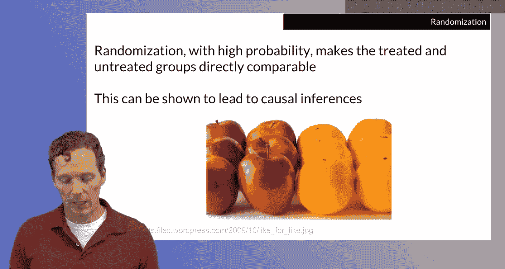
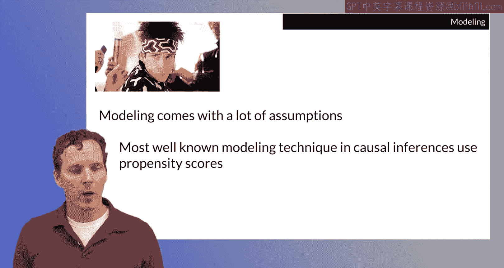

# 高管数据科学：第9课：因果关系（第二部分）🔬

在本节课中，我们将继续探讨因果关系，并介绍几种在无法进行随机化实验时，研究者们试图推断因果关系的常用方法。我们将逐一分析这些方法的核心理念、潜在优势以及它们所依赖的关键假设。

## 自然实验 🌍

上一节我们介绍了因果关系的反事实定义，本节中我们来看看“自然实验”如何作为一种替代方法。

自然实验是指利用现实中发生的、类似实验的外部事件变化来研究因果关系。一个经典的例子是研究吸烟禁令的影响。由于伦理原因，研究者不能随机分配一些人去吸烟而另一些人不吸，因此无法获得随机化实验这种“黄金标准”的因果效应。然而，研究者可以观察某个城市或地区在实施吸烟禁令前后，与吸烟相关的心脏问题发病率的变化。这种“前后对比”的思路试图捕捉因果关系，其逻辑与我们之前讨论的反事实思想类似。

当然，这种方法依赖于一些强假设：
*   你必须在较高的聚合层面（如城市）进行分析，无法获得个体层面的数据，更无法获得个体的反事实结果。
*   从禁令实施前到实施后的这段时间里，任何其他同时发生的变化都可能污染你的结果。例如，如果在通过吸烟禁令的同一选举周期内，还实施了其他可能影响心脏健康的政策，那么你观察到的发病率变化就无法完全归因于吸烟禁令。

因此，自然实验是试图接近因果关系的一种方式，但它伴随着许多强有力的假设。整个因果推断领域都在努力阐明这些假设。

## 匹配法 👥

另一种常见的方法是“匹配法”。其核心思想是为接受处理的个体寻找“替身”。

匹配法的思路是：如果我有一组接受了某种处理（如治疗）的研究对象，我会尽力找到另一组在**所有其他相关方面**都非常相似、但没有接受该处理的对照组个体，并将他们一一配对。这在医学研究中非常常见。例如，如果你回顾性地找到一批死于肺癌的病例，并拥有他们完整的病史和其他信息，你就会尝试找到一些从未患肺癌、但体重、年龄等其他特征都相同的人作为匹配对照。

当你思考匹配法时，请理解研究者为何认为这有助于因果推断：他们试图通过“我无法观察同一个人在两种自然状态下的情况，但我可以观察这个人及其高度相似的替身”来接近反事实的理念。

当然，匹配法存在几个主要问题：
*   匹配的质量完全取决于你能匹配的那些特征。所有你未能匹配的特征（可能是未知或未测量的），都意味着你并未在重要方面找到“同一个人”。
*   寻找匹配对象本身可能存在困难，你的数据集中可能没有足够多特征相匹配的个体。
*   通常，如果你有一个数据集，只为其中一部分人找到了匹配对象，而不得不丢弃找不到匹配的剩余部分，那么你就破坏了原始样本的某些普遍性。这个新的、仅包含可匹配个体的样本，其代表性可能不如原始样本。

在所有试图进行因果推断的情况下，你都必须接受一些妥协。但希望你能看到，当人们进行匹配时，是如何试图从因果和反事实的角度进行思考的。

## 随机化：黄金标准 🥇

随机化是我们估计**平均因果效应**的最佳且最有效的工具。我们有一整门关于随机化和A/B测试的课程，但其核心理念是：通过随机分配，使处理组和对照组在所有其他方面尽可能直接可比。

如果你有一群人，随机分配其中一半使用“扭扭乐”健身器，另一半什么都不做。是的，你并没有为每个接受处理的人找到完全相同的对照个体。但由于随机化，在其他所有方面，两组人**有很大概率**是直接可比的。通过数学可以证明，如果样本量足够大且是随机分配的，你确实能得到平均因果效应。

这并不意味着随机化是万能的，它也可能存在问题。例如，可能存在“中途退出”的情况：有人被随机分配到“扭扭乐”组，但他们觉得做这个很傻，于是停止了。这样，最终完成处理的那部分人，就与最初被随机分配到处理组的那群人不同了。即使在随机化试验这种“黄金标准”中，也会出现许多问题。但迄今为止，这仍是我们获取因果效应的最佳方式。

## 其他方法示例 💡

除了上述方法，还有其他一些巧妙的思路。

**工具变量**是一个非常聪明的想法。我们不会深入细节，但可以想象一下：假设你想了解口服避孕药是否与卵巢癌有关。这是一个非常合理的问题。再假设你观察了“避孕药报销比例”与卵巢癌之间的关系。报销比例本身与卵巢癌没有直接联系（我们通过保险计划决定如何报销避孕药费用，这不可能与卵巢癌有实质关系）。因此，报销比例对卵巢癌的任何影响，**必须**通过影响避孕药使用来实现。基于此，人们利用报销比例作为“工具变量”，来尝试推断因果效应，而无需实际进行随机化。

工具变量法有一个很强的假设：工具变量（报销比例）影响结果（卵巢癌）的唯一途径，必须是通过你感兴趣的那个变量（避孕药使用）。这个假设常常受到质疑，而且很难找到真正符合条件的工具变量。但这仍是一个极其巧妙的想法，构成了许多现代因果思维的基础。

**建模法**也是一种途径。在建模中，你试图建立一个模型来解释人们为何对处理有反应或没有反应。如果这个模型足够全面，某种意义上你就不再需要看到同一个人在两种状态下的情况，因为模型已经为你构建并理解了整个系统。当然，这种方法的好坏完全取决于模型本身，它同样充满了各种假设。

在因果推断中最著名的建模技术之一是使用所谓的**倾向得分**。

## 总结 📝

本节课中我们一起学习了：
*   因果关系的**反事实定义**及其推广——**平均因果效应**。
*   几种试图推断因果关系的统计方法：**自然实验**、**匹配法**、**随机化试验**、**工具变量法**和**建模法**。
*   我们理解了这些统计方法如何试图接近因果效应，但每种方法都伴随着大量的假设和局限性。
*   通常没有完美的方法来获取因果效应，我们目前拥有的最佳工具是**随机化**。

如果你想了解更多关于因果关系的内容，维基百科上关于“因果推断”的页面相当不错。此外，例如唐纳德·鲁宾的任何综述论文都是关于因果推断的精彩读物，他是统计学中重新兴起因果思维研究的现代奠基人之一。

感谢聆听，期待在下一讲中与你相见。