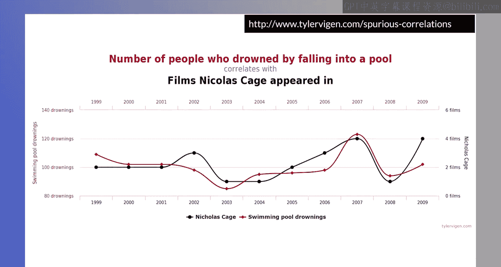
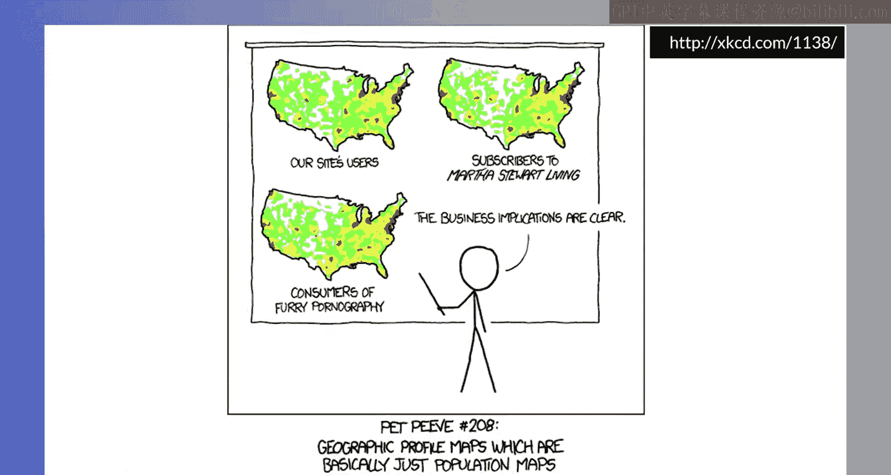

# 高管数据科学：5：混淆

![](img/e129b09e4242data:image/png;base64,iVBORw0KGgoAAAANSUhEUgAAABAAAAAQCAYAAAAf8/9hAAAABHNCSVQICAgIfAhkiAAAAAlwSFlzAAAOxAAADsQBlSsOGwAAACxJREFUOI3t1LENACAMBLE/9N9qBkQoJN1V7e4fAAB4A3gAeAB4AHgAeAB4AHgAeAB4AHgAeAB4AHgAeAB4AHgAeAB4AHgAeAB4AHgAeAB4AHgAeAB4AHgAeAB4AHgAeAB4AHgAeAB4AHgAeAB4AHgAeAB4AHgAeAB4AHgAeAB4AHgAeAB4AHgAeAB4AHgAeAB4AHgAeAB4AHgAeAB4AHgAeAB4AHgAeAB4AHgAeAB4AHgAeAB4AHgAeAB4AHgAeAB4AHgAeAB4AHgAeAB4AHgAeAB4AHgAeAB4AHgAeAB4AHgAeAB4AHgAeAB4AHgAeAB4AHgAeAB4AHgAeAB4AHgAeAB4AHgAeAB4AHgAeAB4AHgAeAB4AHgAeAB4AHgAeAB4AHgAeAB4AHgAeAB4AHgAeAB4AHgAeAB4AHgAeAB4AHgAeAB4AHgAeAB4AHgAeAB4AHgAeAB4AHgAeAB4AHgAeAB4AHgAeAB4AHgAeAB4AHgAeAB4AHgAeAB4AHgAeAB4AHgAeAB4AHgAeAB4AHgAeAB4AHgAeAB4AHgAeAB4AHgAeAB4AHgAeAB4AHgAeAB4AHgAeAB4AHgAeAB4AHgAeAB4AHgAeAB4AHgAeAB4AHgAeAB4AHgAeAB4AHgAeAB4AHgAeAB4AHgAeAB4AHgAeAB4AHgAeAB4AHgAeAB4AHgAeAB4AHgAeAB4AHgAeAB4AHgAeAB4AHgAeAB4AHgAeAB4AHgAeAB4AHgAeAB4AHgAeAB4AHgAeAB4AHgAeAB4AHgAeAB4AHgAeAB4AHgAeAB4AHgAeAB4AHgAeAB4AHgAeAB4AHgAeAB4AHgAeAB4AHgAeAB4AHgAeAB4AHgAeAB4AHgAeAB4AHgAeAB4AHgAeAB4AHgAeAB4AHgAeAB4AHgAeAB4AHgAeAB4AHgAeAB4AHgAeAB4AHgAeAB4AHgAeAB4AHgAeAB4AHgAeAB4AHgAeAB4AHgAeAB4AHgAeAB4AHgAeAB4AHgAeAB4AHgAeAB4AHgAeAB4AHgAeAB4AHgAeAB4AHgAeAB4AHgAeAB4AHgAeAB4AHgAeAB4AHgAeAB4AHgAeAB4AHgAeAB4AHgAeAB4AHgAeAB4AHgAeAB4AHgAeAB4AHgAeAB4AHgAeAB4AHgAeAB4AHgAeAB4AHgAeAB4AHgAeAB4AHgAeAB4AHgAeAB4AHgAeAB4AHgAeAB4AHgAeAB4AHgAeAB4AHgAeAB4AHgAeAB4AHgAeAB4AHgAeAB4AHgAeAB4AHgAeAB4AHgAeAB4AHgAeAB4AHgAeAB4AHgAeAB4AHgAeAB4AHgAeAB4AHgAeAB4AHgAeAB4AHgAeAB4AHgAeAB4AHgAeAB4AHgAeAB4AHgAeAB4AHgAeAB4AHgAeAB4AHgAeAB4AHgAeAB4AHgAeAB4AHgAeAB4AHgAeAB4AHgAeAB4AHgAeAB4AHgAeAB4AHgAeAB4AHgAeAB4AHgAeAB4AHgAeAB4AHgAeAB4AHgAeAB4AHgAeAB4AHgAeAB4AHgAeAB4AHgAeAB4AHgAeAB4AHgAeAB4AHgAeAB4AHgAeAB4AHgAeAB4AHgAeAB4AHgAeAB4AHgAeAB4AHgAeAB4AHgAeAB4AHgAeAB4AHgAeAB4AHgAeAB4AHgAeAB4AHgAeAB4AHgAeAB4AHgAeAB4AHgAeAB4AHgAeAB4AHgAeAB4AHgAeAB4AHgAeAB4AHgAeAB4AHgAeAB4AHgAeAB4AHgAeAB4AHgAeAB4AHgAeAB4AHgAeAB4AHgAeAB4AHgAeAB4AHgAeAB4AHgAeAB4AHgAeAB4AHgAeAB4AHgAeAB4AHgAeAB4AHgAeAB4AHgAeAB4AHgAeAB4AHgAeAB4AHgAeAB4AHgAeAB4AHgAeAB4AHgAeAB4AHgAeAB4AHgAeAB4AHgAeAB4AHgAeAB4AHgAeAB4AHgAeAB4AHgAeAB4AHgAeAB4AHgAeAB4AHgAeAB4AHgAeAB4AHgAeAB4AHgAeAB4AHgAeAB4AHgAeAB4AHgAeAB4AHgAeAB4AHgAeAB4AHgAeAB4AHgAeAB4AHgAeAB4AHgAeAB4AHgAeAB4AHgAeAB4AHgAeAB4AHgAeAB4AHgAeAB4AHgAeAB4AHgAeAB4AHgAeAB4AHgAeAB4AHgAeAB4AHgAeAB4AHgAeAB4AHgAeAB4AHgAeAB4AHgAeAB4AHgAeAB4AHgAeAB4AHgAeAB4AHgAeAB4AHgAeAB4AHgAeAB4AHgAeAB4AHgAeAB4AHgAeAB4AHgAeAB4AHgAeAB4AHgAeAB4AHgAeAB4AHgAeAB4AHgAeAB4AHgAeAB4AHgAeAB4AHgAeAB4AHgAeAB4AHgAeAB4AHgAeAB4AHgAeAB4AHgAeAB4AHgAeAB4AHgAeAB4AHgAeAB4AHgAeAB4AHgAeAB4AHgAeAB4AHgAeAB4AHgAeAB4AHgAeAB4AHgAeAB4AHgAeAB4AHgAeAB4AHgAeAB4AHgAeAB4AHgAeAB4AHgAeAB4AHgAeAB4AHgAeAB4AHgAeAB4AHgAeAB4AHgAeAB4AHgAeAB4AHgAeAB4AHgAeAB4AHgAeAB4AHgAeAB4AHgAeAB4AHgAeAB4AHgAeAB4AHgAeAB4AHgAeAB4AHgAeAB4AHgAeAB4AHgAeAB4AHgAeAB4AHgAeAB4AHgAeAB4AHgAeAB4AHgAeAB4AHgAeAB4AHgAeAB4AHgAeAB4AHgAeAB4AHgAeAB4AHgAeAB4AHgAeAB4AHgAeAB4AHgAeAB4AHgAeAB4AHgAeAB4AHgAeAB4AHgAeAB4AHgAeAB4AHgAeAB4AHgAeAB4AHgAeAB4AHgAeAB4AHgAeAB4AHgAeAB4AHgAeAB4AHgAeAB4AHgAeAB4AHgAeAB4AHgAeAB4AHgAeAB4AHgAeAB4AHgAeAB4AHgAeAB4AHgAeAB4AHgAeAB4AHgAeAB4AHgAeAB4AHgAeAB4AHgAeAB4AHgAeAB4AHgAeAB4AHgAeAB4AHgAeAB4AHgAeAB4AHgAeAB4AHgAeAB4AHgAeAB4AHgAeAB4AHgAeAB4AHgAeAB4AHgAeAB4AHgAeAB4AHgAeAB4AHgAeAB4AHgAeAB4AHgAeAB4AHgAeAB4AHgAeAB4AHgAeAB4AHgAeAB4AHgAeAB4AHgAeAB4AHgAeAB4AHgAeAB4AHgAeAB4AHgAeAB4AHgAeAB4AHgAeAB4AHgAeAB4AHgAeAB4AHgAeAB4AHgAeAB4AHgAeAB4AHgAeAB4AHgAeAB4AHgAeAB4AHgAeAB4AHgAeAB4AHgAeAB4AHgAeAB4AHgAeAB4AHgAeAB4AHgAeAB4AHgAeAB4AHgAeAB4AHgAeAB4AHgAeAB4AHgAeAB4AHgAeAB4AHgAeAB4AHgAeAB4AHgAeAB4AHgAeAB4AHgAeAB4AHgAeAB4AHgAeAB4AHgAeAB4AHgAeAB4AHgAeAB4AHgAeAB4AHgAeAB4AHgAeAB4AHgAeAB4AHgAeAB4AHgAeAB4AHgAeAB4AHgAeAB4AHgAeAB4AHgAeAB4AHgAeAB4AHgAeAB4AHgAeAB4AHgAeAB4AHgAeAB4AHgAeAB4AHgAeAB4AHgAeAB4AHgAeAB4AHgAeAB4AHgAeAB4AHgAeAB4AHgAeAB4AHgAeAB4AHgAeAB4AHgAeAB4AHgAeAB4AHgAeAB4AHgAeAB4AHgAeAB4AHgAeAB4AHgAeAB4AHgAeAB4AHgAeAB4AHgAeAB4AHgAeAB4AHgAeAB4AHgAeAB4AHgAeAB4AHgAeAB4AHgAeAB4AHgAeAB4AHgAeAB4AHgAeAB4AHgAeAB4AHgAeAB4AHgAeAB4AHgAeAB4AHgAeAB4AHgAeAB4AHgAeAB4AHgAeAB4AHgAeAB4AHgAeAB4AHgAeAB4AHgAeAB4AHgAeAB4AHgAeAB4AHgAeAB4AHgAeAB4AHgAeAB4AHgAeAB4AHgAeAB4AHgAeAB4AHgAeAB4AHgAeAB4AHgAeAB4AHgAeAB4AHgAeAB4AHgAeAB4AHgAeAB4AHgAeAB4AHgAeAB4AHgAeAB4AHgAeAB4AHgAeAB4AHgAeAB4AHgAeAB4AHgAeAB4AHgAeAB4AHgAeAB4AHgAeAB4AHgAeAB4AHgAeAB4AHgAeAB4AHgAeAB4AHgAeAB4AHgAeAB4AHgAeAB4AHgAeAB4AHgAeAB4AHgAeAB4AHgAeAB4AHgAeAB4AHgAeAB4AHgAeAB4AHgAeAB4AHgAeAB4AHgAeAB4AHgAeAB4AHgAeAB4AHgAeAB4AHgAeAB4AHgAeAB4AHgAeAB4AHgAeAB4AHgAeAB4AHgAeAB4AHgAeAB4AHgAeAB4AHgAeAB4AHgAeAB4AHgAeAB4AHgAeAB4AHgAeAB4AHgAeAB4AHgAeAB4AHgAeAB4AHgAeAB4AHgAeAB4AHgAeAB4AHgAeAB4AHgAeAB4AHgAeAB4AHgAeAB4AHgAeAB4AHgAeAB4AHgAeAB4AHgAeAB4AHgAeAB4AHgAeAB4AHgAeAB4AHgAeAB4AHgAeAB4AHgAeAB4AHgAeAB4AHgAeAB4AHgAeAB4AHgAeAB4AHgAeAB4AHgAeAB4AHgAeAB4AHgAeAB4AHgAeAB4AHgAeAB4AHgAeAB4AHgAeAB4AHgAeAB4AHgAeAB4AHgAeAB4AHgAeAB4AHgAeAB4AHgAeAB4AHgAeAB4AHgAeAB4AHgAeAB4AHgAeAB4AHgAeAB4AHgAeAB4AHgAeAB4AHgAeAB4AHgAeAB4AHgAeAB4AHgAeAB4AHgAeAB4AHgAeAB4AHgAeAB4AHgAeAB4AHgAeAB4AHgAeAB4AHgAeAB4AHgAeAB4AHgAeAB4AHgAeAB4AHgAeAB4AHgAeAB4AHgAeAB4AHgAeAB4AHgAeAB4AHgAeAB4AHgAeAB4AHgAeAB4AHgAeAB4AHgAeAB4AHgAeAB4AHgAeAB4AHgAeAB4AHgAeAB4AHgAeAB4AHgAeAB4AHgAeAB4AHgAeAB4AHgAeAB4AHgAeAB4AHgAeAB4AHgAeAB4AHgAeAB4AHgAeAB4AHgAeAB4AHgAeAB4AHgAeAB4AHgAeAB4AHgAeAB4AHgAeAB4AHgAeAB4AHgAeAB4AHgAeAB4AHgAeAB4AHgAeAB4AHgAeAB4AHgAeAB4AHgAeAB4AHgAeAB4AHgAeAB4AHgAeAB4AHgAeAB4AHgAeAB4AHgAeAB4AHgAeAB4AHgAeAB4AHgAeAB4AHgAeAB4AHgAeAB4AHgAeAB4AHgAeAB4AHgAeAB4AHgAeAB4AHgAeAB4AHgAeAB4AHgAeAB4AHgAeAB4AHgAeAB4AHgAeAB4AHgAeAB4AHgAeAB4AHgAeAB4AHgAeAB4AHgAeAB4AHgAeAB4AHgAeAB4AHgAeAB4AHgAeAB4AHgAeAB4AHgAeAB4AHgAeAB4AHgAeAB4AHgAeAB4AHgAeAB4AHgAeAB4AHgAeAB4AHgAeAB4AHgAeAB4AHgAeAB4AHgAeAB4AHgAeAB4AHgAeAB4AHgAeAB4AHgAeAB4AHgAeAB4AHgAeAB4AHgAeAB4AHgAeAB4AHgAeAB4AHgAeAB4AHgAeAB4AHgAeAB4AHgAeAB4AHgAeAB4AHgAeAB4AHgAeAB4AHgAeAB4AHgAeAB4AHgAeAB4AHgAeAB4AHgAeAB4AHgAeAB4AHgAeAB4AHgAeAB4AHgAeAB4AHgAeAB4AHgAeAB4AHgAeAB4AHgAeAB4AHgAeAB4AHgAeAB4AHgAeAB4AHgAeAB4AHgAeAB4AHgAeAB4AHgAeAB4AHgAeAB4AHgAeAB4AHgAeAB4AHgAeAB4AHgAeAB4AHgAeAB4AHgAeAB4AHgAeAB4AHgAeAB4AHgAeAB4AHgAeAB4AHgAeAB4AHgAeAB4AHgAeAB4AHgAeAB4AHgAeAB4AHgAeAB4AHgAeAB4AHgAeAB4AHgAeAB4AHgAeAB4AHgAeAB4AHgAeAB4AHgAeAB4AHgAeAB4AHgAeAB4AHgAeAB4AHgAeAB4AHgAeAB4AHgAeAB4AHgAeAB4AHgAeAB4AHgAeAB4AHgAeAB4AHgAeAB4AHgAeAB4AHgAeAB4AHgAeAB4AHgAeAB4AHgAeAB4AHgAeAB4AHgAeAB4AHgAeAB4AHgAeAB4AHgAeAB4AHgAeAB4AHgAeAB4AHgAeAB4AHgAeAB4AHgAeAB4AHgAeAB4AHgAeAB4AHgAeAB4AHgAeAB4AHgAeAB4AHgAeAB4AHgAeAB4AHgAeAB4AHgAeAB4AHgAeAB4AHgAeAB4AHgAeAB4AHgAeAB4AHgAeAB4AHgAeAB4AHgAeAB4AHgAeAB4AHgAeAB4AHgAeAB4AHgAeAB4AHgAeAB4AHgAeAB4AHgAeAB4AHgAeAB4AHgAeAB4AHgAeAB4AHgAeAB4AHgAeAB4AHgAeAB4AHgAeAB4AHgAeAB4AHgAeAB4AHgAeAB4AHgAeAB4AHgAeAB4AHgAeAB4AHgAeAB4AHgAeAB4AHgAeAB4AHgAeAB4AHgAeAB4AHgAeAB4AHgAeAB4AHgAeAB4AHgAeAB4AHgAeAB4AHgAeAB4AHgAeAB4AHgAeAB4AHgAeAB4AHgAeAB4AHgAeAB4AHgAeAB4AHgAeAB4AHgAeAB4AHgAeAB4AHgAeAB4AHgAeAB4AHgAeAB4AHgAeAB4AHgAeAB4AHgAeAB4AHgAeAB4AHgAeAB4AHgAeAB4AHgAeAB4AHgAeAB4AHgAeAB4AHgAeAB4AHgAeAB4AHgAeAB4AHgAeAB4AHgAeAB4AHgAeAB4AHgAeAB4AHgAeAB4AHgAeAB4AHgAeAB4AHgAeAB4AHgAeAB4AHgAeAB4AHgAeAB4AHgAeAB4AHgAeAB4AHgAeAB4AHgAeAB4AHgAeAB4AHgAeAB4AHgAeAB4AHgAeAB4AHgAeAB4AHgAeAB4AHgAeAB4AHgAeAB4AHgAeAB4AHgAeAB4AHgAeAB4AHgAeAB4AHgAeAB4AHgAeAB4AHgAeAB4AHgAeAB4AHgAeAB4AHgAeAB4AHgAeAB4AHgAeAB4AHgAeAB4AHgAeAB4AHgAeAB4AHgAeAB4AHgAeAB4AHgAeAB4AHgAeAB4AHgAeAB4AHgAeAB4AHgAeAB4AHgAeAB4AHgAeAB4AHgAeAB4AHgAeAB4AHgAeAB4AHgAeAB4AHgAeAB4AHgAeAB4AHgAeAB4AHgAeAB4AHgAeAB4AHgAeAB4AHgAeAB4AHgAeAB4AHgAeAB4AHgAeAB4AHgAeAB4AHgAeAB4AHgAeAB4AHgAeAB4AHgAeAB4AHgAeAB4AHgAeAB4AHgAeAB4AHgAeAB4AHgAeAB4AHgAeAB4AHgAeAB4AHgAeAB4AHgAeAB4AHgAeAB4AHgAeAB4AHgAeAB4AHgAeAB4AHgAeAB4AHgAeAB4AHgAeAB4AHgAeAB4AHgAeAB4AHgAeAB4AHgAeAB4AHgAeAB4AHgAeAB4AHgAeAB4AHgAeAB4AHgAeAB4AHgAeAB4AHgAeAB4AHgAeAB4AHgAeAB4AHgAeAB4AHgAeAB4AHgAeAB4AHgAeAB4AHgAeAB4AHgAeAB4AHgAeAB4AHgAeAB4AHgAeAB4AHgAeAB4AHgAeAB4AHgAeAB4AHgAeAB4AHgAeAB4AHgAeAB4AHgAeAB4AHgAeAB4AHgAeAB4AHgAeAB4AHgAeAB4AHgAeAB4AHgAeAB4AHgAeAB4AHgAeAB4AHgAeAB4AHgAeAB4AHgAeAB4AHgAeAB4AHgAeAB4AHgAeAB4AHgAeAB4AHgAeAB4AHgAeAB4AHgAeAB4AHgAeAB4AHgAeAB4AHgAeAB4AHgAeAB4AHgAeAB4AHgAeAB4AHgAeAB4AHgAeAB4AHgAeAB4AHgAeAB4AHgAeAB4AHgAeAB4AHgAeAB4AHgAeAB4AHgAeAB4AHgAeAB4AHgAeAB4AHgAeAB4AHgAeAB4AHgAeAB4AHgAeAB4AHgAeAB4AHgAeAB4AHgAeAB4AHgAeAB4AHgAeAB4AHgAeAB4AHgAeAB4AHgAeAB4AHgAeAB4AHgAeAB4AHgAeAB4AHgAeAB4AHgAeAB4AHgAeAB4AHgAeAB4AHgAeAB4AHgAeAB4AHgAeAB4AHgAeAB4AHgAeAB4AHgAeAB4AHgAeAB4AHgAeAB4AHgAeAB4AHgAeAB4AHgAeAB4AHgAeAB4AHgAeAB4AHgAeAB4AHgAeAB4AHgAeAB4AHgAeAB4AHgAeAB4AHgAeAB4AHgAeAB4AHgAeAB4AHgAeAB4AHgAeAB4AHgAeAB4AHgAeAB4AHgAeAB4AHgAeAB4AHgAeAB4AHgAeAB4AHgAeAB4AHgAeAB4AHgAeAB4AHgAeAB4AHgAeAB4AHgAeAB4AHgAeAB4AHgAeAB4AHgAeAB4AHgAeAB4AHgAeAB4AHgAeAB4AHgAeAB4AHgAeAB4AHgAeAB4AHgAeAB4AHgAeAB4AHgAeAB4AHgAeAB4AHgAeAB4AHgAeAB4AHgAeAB4AHgAeAB4AHgAeAB4AHgAeAB4AHgAeAB4AHgAeAB4AHgAeAB4AHgAeAB4AHgAeAB4AHgAeAB4AHgAeAB4AHgAeAB4AHgAeAB4AHgAeAB4AHgAeAB4AHgAeAB4AHgAeAB4AHgAeAB4AHgAeAB4AHgAeAB4AHgAeAB4AHgAeAB4AHgAeAB4AHgAeAB4AHgAeAB4AHgAeAB4AHgAeAB4AHgAeAB4AHgAeAB4AHgAeAB4AHgAeAB4AHgAeAB4AHgAeAB4AHgAeAB4AHgAeAB4AHgAeAB4AHgAeAB4AHgAeAB4AHgAeAB4AHgAeAB4AHgAeAB4AHgAeAB4AHgAeAB4AHgAeAB4AHgAeAB4AHgAeAB4AHgAeAB4AHgAeAB4AHgAeAB4AHgAeAB4AHgAeAB4AHgAeAB4AHgAeAB4AHgAeAB4AHgAeAB4AHgAeAB4AHgAeAB4AHgAeAB4AHgAeAB4AHgAeAB4AHgAeAB4AHgAeAB4AHgAeAB4AHgAeAB4AHgAeAB4AHgAeAB4AHgAeAB4AHgAeAB4AHgAeAB4AHgAeAB4AHgAeAB4AHgAeAB4AHgAeAB4AHgAeAB4AHgAeAB4AHgAeAB4AHgAeAB4AHgAeAB4AHgAeAB4AHgAeAB4AHgAeAB4AHgAeAB4AHgAeAB4AHgAeAB4AHgAeAB4AHgAeAB4AHgAeAB4AHgAeAB4AHgAeAB4AHgAeAB4AHgAeAB4AHgAeAB4AHgAeAB4AHgAeAB4AHgAeAB4AHgAeAB4AHgAeAB4AHgAeAB4AHgAeAB4AHgAeAB4AHgAeAB4AHgAeAB4AHgAeAB4AHgAeAB4AHgAeAB4AHgAeAB4AHgAeAB4AHgAeAB4AHgAeAB4AHgAeAB4AHgAeAB4AHgAeAB4AHgAeAB4AHgAeAB4AHgAeAB4AHgAeAB4AHgAeAB4AHgAeAB4AHgAeAB4AHgAeAB4AHgAeAB4AHgAeAB4AHgAeAB4AHgAeAB4AHgAeAB4AHgAeAB4AHgAeAB4AHgAeAB4AHgAeAB4AHgAeAB4AHgAeAB4AHgAeAB4AHgAeAB4AHgAeAB4AHgAeAB4AHgAeAB4AHgAeAB4AHgAeAB4AHgAeAB4AHgAeAB4AHgAeAB4AHgAeAB4AHgAeAB4AHgAeAB4AHgAeAB4AHgAeAB4AHgAeAB4AHgAeAB4AHgAeAB4AHgAeAB4AHgAeAB4AHgAeAB4AHgAeAB4AHgAeAB4AHgAeAB4AHgAeAB4AHgAeAB4AHgAeAB4AHgAeAB4AHgAeAB4AHgAeAB4AHgAeAB4AHgAeAB4AHgAeAB4AHgAeAB4AHgAeAB4AHgAeAB4AHgAeAB4AHgAeAB4AHgAeAB4AHgAeAB4AHgAeAB4AHgAeAB4AHgAeAB4AHgAeAB4AHgAeAB4AHgAeAB4AHgAeAB4AHgAeAB4AHgAeAB4AHgAeAB4AHgAeAB4AHgAeAB4AHgAeAB4AHgAeAB4AHgAeAB4AHgAeAB4AHgAeAB4AHgAeAB4AHgAeAB4AHgAeAB4AHgAeAB4AHgAeAB4AHgAeAB4AHgAeAB4AHgAeAB4AHgAeAB4AHgAeAB4AHgAeAB4AHgAeAB4AHgAeAB4AHgAeAB4AHgAeAB4AHgAeAB4AHgAeAB4AHgAeAB4AHgAeAB4AHgAeAB4AHgAeAB4AHgAeAB4AHgAeAB4AHgAeAB4AHgAeAB4AHgAeAB4AHgAeAB4AHgAeAB4AHgAeAB4AHgAeAB4AHgAeAB4AHgAeAB4AHgAeAB4AHgAeAB4AHgAeAB4AHgAeAB4AHgAeAB4AHgAeAB4AHgAeAB4AHgAeAB4AHgAeAB4AHgAeAB4AHgAeAB4AHgAeAB4AHgAeAB4AHgAeAB4AHgAeAB4AHgAeAB4AHgAeAB4AHgAeAB4AHgAeAB4AHgAeAB4AHgAeAB4AHgAeAB4AHgAeAB4AHgAeAB4AHgAeAB4AHgAeAB4AHgAeAB4AHgAeAB4AHgAeAB4AHgAeAB4AHgAeAB4AHgAeAB4AHgAeAB4AHgAeAB4AHgAeAB4AHgAeAB4AHgAeAB4AHgAeAB4AHgAeAB4AHgAeAB4AHgAeAB4AHgAeAB4AHgAeAB4AHgAeAB4AHgAeAB4AHgAeAB4AHgAeAB4AHgAeAB4AHgAeAB4AHgAeAB4AHgAeAB4AHgAeAB4AHgAeAB4AHgAeAB4AHgAeAB4AHgAeAB4AHgAeAB4AHgAeAB4AHgAeAB4AHgAeAB4AHgAeAB4AHgAeAB4AHgAeAB4AHgAeAB4AHgAeAB4AHgAeAB4AHgAeAB4AHgAeAB4AHgAeAB4AHgAeAB4AHgAeAB4AHgAeAB4AHgAeAB4AHgAeAB4AHgAeAB4AHg