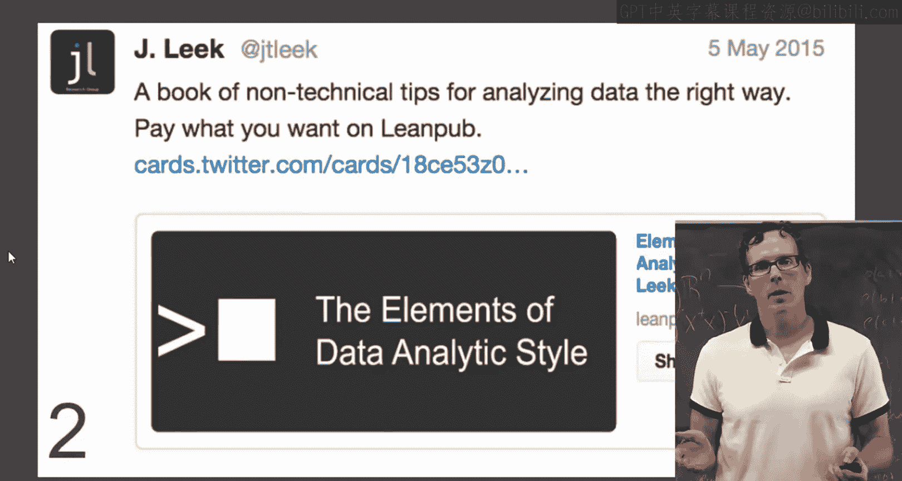
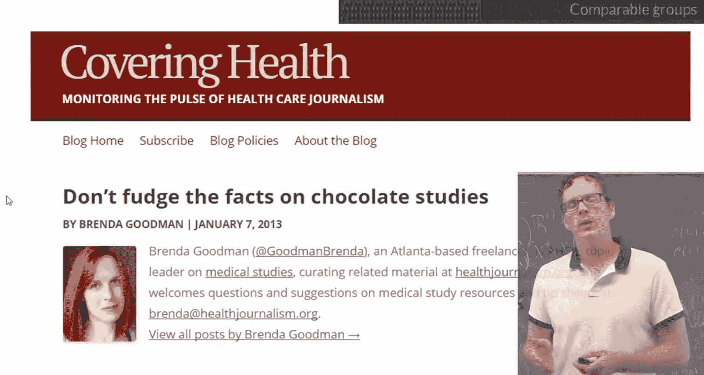
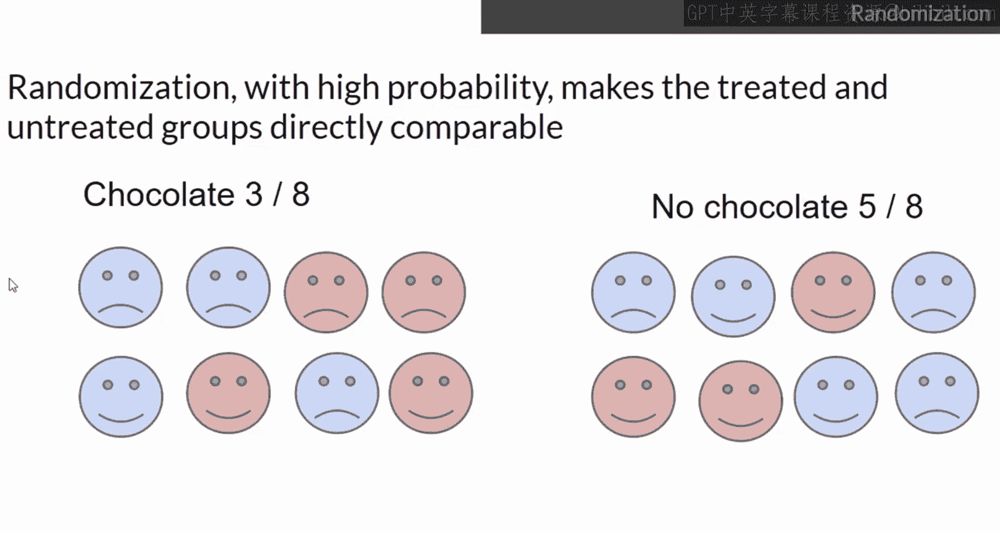
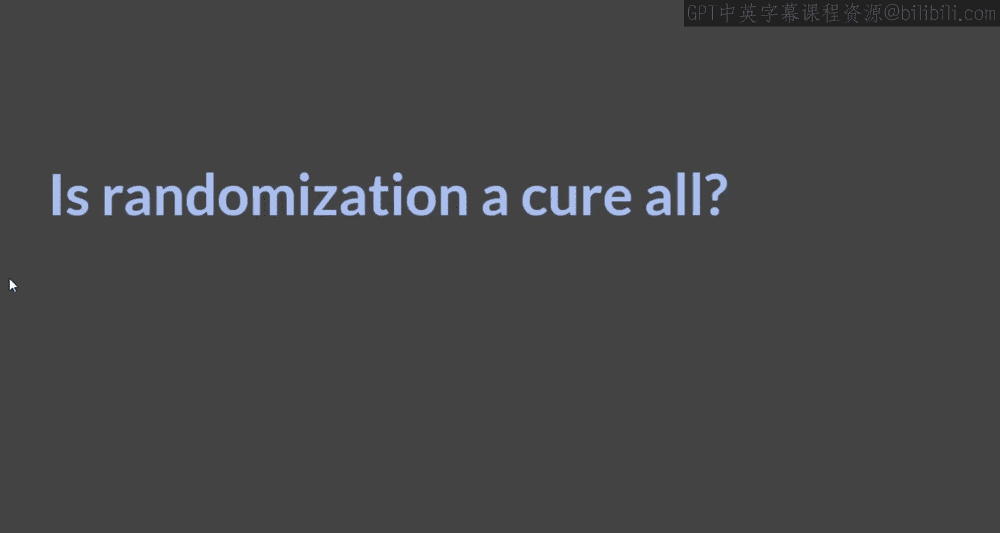
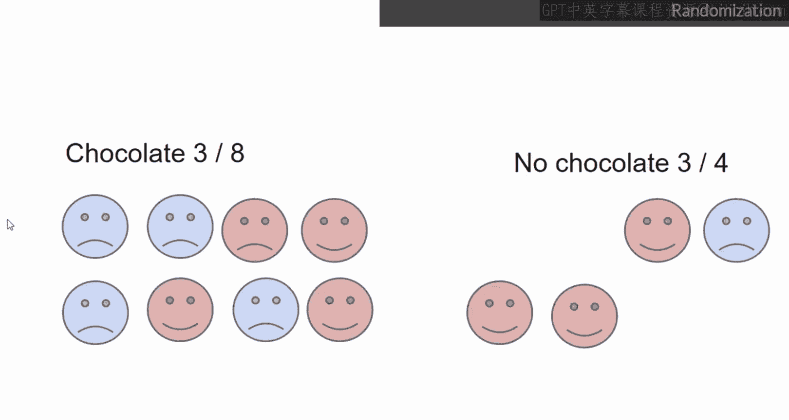

# 高管数据科学：第5课：A/B测试 🧪

在本节课中，我们将学习A/B测试的核心概念，特别是如何通过随机化来避免观察性研究中常见的混杂因素问题。我们将通过一个关于巧克力的虚构例子来理解这些概念。

---

大家好，我是Brian Caffo，欢迎来到A/B测试讲座，这是我们高管数据科学专业课程的一部分。

我将以一个我们这个时代最基本的问题开始本次讲座。

这个问题是：杰夫如何才能卖出更多的书？杰夫是我们专业课程的另一位讲师，他写了一本名为《数据分析风格要素》的书。这是一本很棒的书，可以在Leanpub上买到。

想象一下，如果杰夫有两个推特广告活动，他想比较哪个更有效。

第一个广告说：“一本实用但非技术性的数据分析指南，随你付钱，等等。”另一个广告说：“一本关于如何正确分析数据的非技术性技巧书，等等。”他想比较这两个广告活动，他可能使用哪些策略？

一种策略是他可以按顺序投放广告。他可以先投放第一个广告几周，然后经过一段“清洗期”后，再投放第二个广告几周。然后比较两个广告投放期间的转化率。这种方法的问题是，他发现的任何效果（无论是广告类型的效果还是无效果）也可能归因于他所研究时间段内发生的其他事情。例如，想象一下，如果第一个广告在圣诞节或重大节假日期间投放。那么，人们在那段时间的购买模式当然会与没有重大节假日的时间不同。因此，他无法断定差异或没有差异是由于广告活动造成的，因为存在这个潜在的混杂变量。

这就是我们今天要研究的内容。我认为，潜在变量和混杂的概念是许多观察性研究问题的根源，尤其是在营养学研究中，我们经常看到相反的结果。例如，巧克力这周对我们有益，下周又对我们有害。我看到一篇很棒的文章，标题是“不要捏造事实：对巧克力研究采取行动”，它实际上涵盖了我们今天要讨论的许多主题，比如混杂。巧克力就是这样一个例子，经常与癌症有关或无关。因此，我想用巧克力来讨论混杂问题，以及A/B测试和随机对照试验中使用的随机化如何帮助解决这些问题。

我创建了一个小数据集，它有点刻意设计，但目的是让我们可以专注于概念。

在这个案例中，我们有两组人：左边是吃巧克力的人群，右边是不吃巧克力的人群。我们想确定巧克力是否会降低血压。

每个笑脸代表血压正常的人，每个哭脸代表血压高的人。如果你只看这个数据集，仅仅观察人们的巧克力食用模式并比较两组，你会发现巧克力组8人中有5人血压正常，非巧克力组8人中有3人血压正常。你可能会得出结论，如果有足够多的此类受试者，也许每个笑脸代表一千人左右，那么你会得出结论，巧克力与血压正常之间存在显著关联。

然而，想象一下，如果这里存在一个潜在的混杂变量。假设这个潜在的混杂变量是受试者是否正在服用降压药，这显然与血压有关。在这个案例中，自然吃巧克力的那组人中，服用降压药的比例要高得多。如果你计算一下，服用降压药的人（红脸）中，7人有5人血压正常；未服用降压药的人（蓝脸）中，9人有3人血压正常。服用降压药的人群中血压正常的比例更高，这很可能是由于药物的作用。因此，在这种情况下，你无法确定这种效果是由于巧克力还是由于降压药。对于这个虚构的例子，我想我们可能都会得出结论，这很可能是由于降压药。

那么，我们如何解决这个问题？理想情况下，我们希望比较两组具有相同比例的服药与不服药人群的组。或者，我们可以固定服药状态，只比较服药人群中的巧克力食用习惯，以及不服药人群中的巧克力食用习惯。当然，后一种策略要求我们知道需要控制哪些变量并已经测量了它们。

另一方面，随机化是一种尝试平衡可能污染我们结果的已观测和未观测变量的方法。在随机化中，我们只是简单地随机分配每个受试者。在这个案例中，你随机分配一组人说“去吃很多巧克力”，随机分配另一组人说“不允许吃巧克力”。当然，随机化的根本问题在于，在许多像这样的案例中，你无法在伦理上或实际上进行随机试验。

随机化的目标再次是比较相似的事物，即“苹果对苹果，橙子对橙子”。换句话说，你比较的组在所有通常与预测变量和结果变量相关的潜在混杂变量上，具有大致相等比例的混合。通过随机化，你打破了这些变量与治疗（如吃巧克力）之间的关联。

我想给你引用一句很棒的话，它很好地总结了这个想法。这句话来自R. Fisher，他是随机化主题的早期先驱之一。他说：“正确实施的随机化，使实验者免于考虑和估计可能干扰其数据的无数原因的大小的焦虑。”顺便说一下，我是在Armitage关于Fisher、Bradford Hill和随机化的一篇精彩论文中找到这句话的，该文讨论了关于随机化的一些早期思考。

让我们回到我们的例子，看看如果我们进行了随机化，可能会发生什么。至少在高概率下，它会使治疗组和未治疗组在服用降压药和未服用降压药的人群比例上大致相等。在这个案例中，我们得到了相反的结果：巧克力组8人中有3人血压正常，非巧克力组8人中有5人血压正常。因此，作为一个例子，当我们进行随机化时，效果实际上发生了逆转。

我想通过提出一个问题来结束本次讲座：随机化是万灵药吗？它是我们解决观察性研究问题所需要考虑的全部吗？当然，提出这个问题本身就意味着答案是否定的。

一种特别的偏见可能重新潜入随机化研究的方式是通过数据缺失。我构思了一个例子，在这个案例中，对于巧克力组，和之前一样，8人中有3人血压正常，笑脸和哭脸的组合与之前相同。但对于非巧克力组，几乎所有未服用降压药的人都退出了研究。无论出于何种原因，他们中的大多数是哭脸，所以他们可能说：“我血压高，我想吃点巧克力”等等，他们退出了研究。因此，现在的比较再次受到污染，因为两组不再直接可比，两组中服用降压药的人群比例不同了。

因此，再次强调，A/B测试或随机试验可能失败的所有不同具体方式可能超出了本课程的范围。但我只想强调一个事实：仅仅因为你进行了随机化，必要的考虑事项并不会就此结束。

无论如何，我想总结一下本次讲座。本次讲座的基本要点是：A/B测试的主要特征，也是医学文献中随机试验的主要特征，是使用随机化来平衡这些混杂因素和潜在变量，否则它们会污染你的结果。其好处是，它们有望（至少在高概率下）平衡已知和未知的混杂因素。

希望你喜欢今天的讲座，期待在下节课见到你。

---

**本节课总结**：在本节课中，我们一起学习了A/B测试的核心思想。我们了解到观察性研究可能因混杂变量而产生误导性结果。通过引入随机化，我们可以创建可比较的组别，从而更可靠地评估干预措施（如广告或食用巧克力）的真实效果。同时，我们也认识到随机化并非完美无缺，例如数据缺失等问题仍可能引入偏差。理解这些原理是设计和解释有效A/B测试的基础。