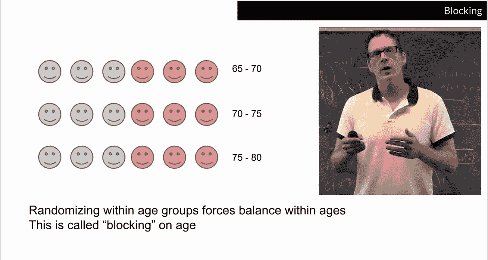
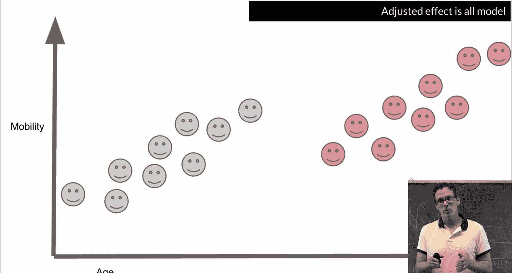

# 高管数据科学：第13课：分组和调整 📊

在本节课中，我们将学习两种处理数据中混杂变量的重要策略：**分组**和**调整**。分组是一种实验设计方法，而调整则是在数据收集后用于分析的方法。我们将通过简单的例子来理解它们的原理和应用场景。

## 分组：实验设计中的控制策略 🧪

上一节我们介绍了混杂变量的概念，本节中我们来看看如何在实验设计阶段就对其进行控制。

想象一下，你正在研究如何改善老年人的活动能力，并计划使用健身追踪器（如Fitbit）作为激励工具。你设计了一项临床试验，将一半受试者随机分配到接收Fitbit的组（处理组），另一半作为不接收任何设备的对照组。理想情况下，年龄等重要因素在处理组和对照组中应大致均匀分布。

然而，如果研究规模较小，可能会出现一种“不幸”的安排：例如，年轻组中对照组人数较少，而年长组中对照组人数较多。这样，年龄就和对照状态产生了混淆。如果你直接分析健身追踪器与活动能力的关系，结果可能会受到年龄差异的干扰。

为了解决这个问题，我们可以在实验设计阶段就进行**分组**。具体做法是：首先，根据年龄将受试者分成不同的区块（例如65-70岁、70-75岁等）。然后，在每个年龄区块内，再随机分配一半人到处理组，另一半到对照组。这种方法确保了在每个重要的混杂变量（这里是年龄）的各个水平上，处理组和对照组都具有可比性。

以下是分组的核心思想：
*   **目的**：在实验开始前，主动控制已知的重要混杂变量。
*   **做法**：先按混杂变量分层，再在各层内随机分配。

## 调整：数据分析中的补救措施 📈

上一节我们介绍了如何在设计时控制变量，本节中我们来看看当实验已经完成或我们无法控制实验时，如何在分析阶段进行调整。

现在考虑一个观察性研究：你只是观察那些**自我选择**使用健身追踪器的人和不使用的人，并比较他们的活动能力。你担心年龄会混淆这种关系，因为年轻人可能更倾向于使用新技术。

这时，最常用的解决方法是**调整**。调整的核心思想是：在**固定混杂变量水平**的情况下，考察我们感兴趣的关系。例如，我们只比较“中年组”内使用和不使用Fitbit的人的活动能力差异。这样，在比较时年龄这个变量是固定的，其影响就被排除了。

进行“调整”有多种方法，最常见、最直接的是**回归调整**。具体做法是：在我们分析“是否使用Fitbit”对“活动能力”影响的回归模型中，**把年龄作为另一个自变量加入进去**。这个加入年龄变量的模型，就能在“调整了年龄影响后”估计Fitbit的效果。

接下来，我们通过几个图示例子来理解调整如何工作，以及为什么在回归模型中添加新变量有时会导致奇怪的结果。

### 调整效果示例分析

以下是几种典型情况，展示了调整前后估计效果的变化：

**情况一：调整影响不大**
*   **描述**：未调整时，处理组（灰点）的平均活动能力高于对照组（红点）。调整年龄后，拟合出的两条平行线（代表不同组）的差距与未调整时的均值差大致相同。
*   **原因**：在每个年龄层，处理组和对照组的数据都有大量重叠，有足够的数据进行直接比较。调整主要是为了确认结果并非完全由年龄分布差异导致。

**情况二：效应发生反转**
*   **描述**：未调整时，对照组的平均活动能力更高。但调整年龄后，拟合的平行线显示处理组的活动能力反而更高。效应方向发生了反转。
*   **原因**：数据中几乎没有重叠——年轻人几乎都使用Fitbit，而老年人几乎都不用。调整后的结果高度依赖于回归模型的假设（如线性、平行），缺乏直接的数据比较支持。

**情况三：效应消失**
*   **描述**：未调整时，两组间存在显著差异。调整年龄后，两条拟合线基本重合，效应消失了。
*   **原因**：所有数据点大致落在同一条与年龄相关的趋势线上。一旦控制了年龄，组间差异就不复存在。

**情况四：从无到有的效应**
*   **描述**：未调整时，两组均值几乎相同，没有显著效应。调整年龄后，两条拟合线呈现出明显的差距，产生了显著效应。
*   **原因**：两组数据随年龄变化的趋势线不同，但它们在年龄分布上错开，导致未调整的均值被拉平。

**情况五：完全依赖模型的推断**
*   **描述**：调整后模型显示两组间存在巨大差异。但关键在于，**没有任何一个年龄点上同时存在处理组和对照组的数据**。
*   **原因**：我们得出的比较结果完全是通过将处理组的趋势线向上外推、将对照组的趋势线向下外推得到的。这完全是模型的推断，**没有任何实际数据重叠来支持这个结论**。当混杂变量（如年龄）可以完美预测处理状态时，就会出现这种问题。

## 总结与要点 🎯

本节课中我们一起学习了处理混杂变量的两种核心策略。

*   **分组**是一种**预防性**策略，在**实验设计阶段**使用。当我们事先知道某个变量（如年龄）非常重要时，通过按该变量分层并随机化，可以确保它在各组间平衡，从而避免混淆。
*   **调整**是一种**分析性**策略，在**数据收集后**使用。通过统计模型（如回归分析）将混杂变量纳入考虑，可以在控制该变量的条件下，估计我们感兴趣的主要关系。

需要特别注意的是，调整（尤其是回归调整）的效果高度依赖于数据本身。**当处理组和对照组在混杂变量上重叠很少时，调整后的结果可能几乎完全依赖于模型的假设，而非实际数据**。因此，在解读调整后的分析时，管理者应要求查看基本的数据分布图，检查关键变量之间是否存在高度相关性或缺乏重叠区域，以评估结论的可靠性。