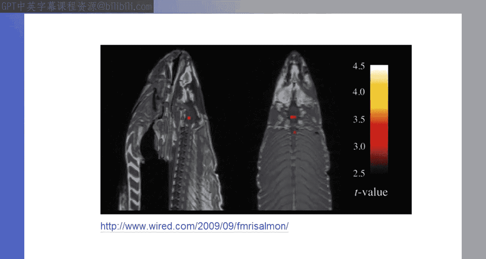

# 高管数据科学：5：多重性

在本节课中，我们将学习多重性（Multiplicity）与多重比较（Multiple Comparisons）的概念。我们将探讨其产生的原因、潜在问题，并介绍一种简单有效的校正方法。

## 什么是多重比较？

多重比较是指反复进行假设检验，直到得到一个显著结果的行为。这听起来可能带有负面意味，但有时它是在良好意图下无意中发生的。多重性问题可能以意想不到的方式出现。

为了说明这一点，我所在领域有一个著名的例子：研究人员将一条死鲑鱼放入功能性磁共振成像扫描仪中。

他们进行了逐个体素（三维像素）的分析，检查每个体素是否存在大脑活动的统计显著性，并且确实发现了显著结果。他们发现显著结果的原因，正是因为没有对多重比较进行校正。当然，死鲑鱼不可能有大脑活动。

## 多重性问题的根源

多重性基本上源于进行了大量检验，并只关注那些显著的结果。即使所有检验的原假设都为真，仅凭随机性，你也可能得到一些拒绝原假设的“显著”结果。

以下是多重性问题可能出现的几种情况：
*   拟合了过多模型。
*   查看了过多感兴趣的变量，就像鲑鱼例子中查看了过多体素。
*   最负面的情况是“钓鱼式探索”（Phishing Expeditions），即没有预先设定假设，而是在大量数据中测试所有可能的变量和组合，然后只报告那些碰巧显著的结果，假装没有查看过其他所有结果。

需要强调的是，进行大量假设检验本身并非坏事。问题在于进行了大量检验，却没有公开承认并为此做出调整。这正是本节课要讨论的核心。

## 邦费罗尼校正法

现在，我们来看看多重比较问题最简单的解决方案。关于多重比较有大量文献，但最简单的修正方法是使用以数学家邦费罗尼（Bonferroni）命名的不等式，称为**邦费罗尼校正**。

执行邦费罗尼校正最简单的方法是：如果你有一系列P值，只需将每个P值乘以你进行的检验次数。

**公式**：`校正后P值 = 原始P值 × 检验次数`

例如，如果你进行了10次检验，其中一个原始P值是0.01，那么校正后的P值就是 `0.01 × 10 = 0.1`。

邦费罗尼校正非常稳健，适用于所有情况。唯一的问题是它相当保守。你可以想象，如果你进行了1000次检验，所有P值都要乘以1000，那么你几乎不可能得到任何显著结果。因此，邦费罗尼校正的结果往往是声明更少的事物为显著。

## 邦费罗尼校正的局限性

关于邦费罗尼校正，有一点需要指出：它没有指导你应该乘以哪个“检验次数”。例如，如果你进行了一组10个相关的检验和另一组10个不相关的检验，你是应该将所有20次检验合并计算，还是分别对每组乘以10？邦费罗尼校正无法解决这个问题。

对此，我能给出的最好建议是：成为你自己研究的批评者。考虑一下，你的批评者会认为你应该为查看了多少数据而受到惩罚，并据此包含所有相关的检验次数。

## 总结与建议

本节课我们一起学习了多重性与多重比较。我们了解到，即使所有原假设都为真，进行大量检验也可能仅凭偶然性得到“显著”结果。我们介绍了一种简单有效的校正方法——邦费罗尼校正，其核心是将P值乘以检验次数。

最后，我再次强调，虽然存在许多其他处理多重比较的技术，但邦费罗尼校正是最简单、最直接的一种。如果你在管理一个进行了大量检验或拟合了大量模型的项目，最简单的做法是：在查看输出结果时，根据他们拟合的模型数量和查看的参数数量，做一个粗略的计算，取一个便于相乘的整数，然后应用这个校正。