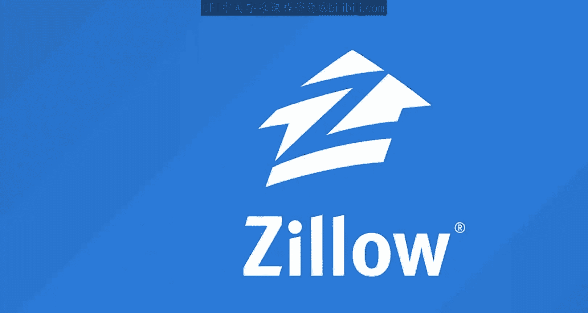

# 高管数据科学：课程5：顶点项目欢迎信息 🎓

在本节课中，我们将介绍《高管数据科学》专项课程的最终环节——顶点项目。我们将概述项目的目标、合作伙伴以及它如何评估你在整个专项课程中所学的管理技能。

---

欢迎来到《高管数据科学》顶点项目。此时，你已经完成了所有课程。我们希望评估你作为高管管理一个小型数据科学项目的能力。作为高管，你可能不会直接参与数据分析或处理具体细节，但你很可能需要管理那些执行这些任务的人员。因此，在这个顶点项目中，我们希望评估你运用专项课程所涵盖主题进行决策的技能。

---

上一节我们介绍了顶点项目的总体目标，本节中我们来看看项目的具体合作伙伴和背景。

我们与 Zillow 合作设计了本次顶点项目。Zillow 是领先的房地产和租赁市场平台，在全美范围内提供关于购房和租房的关键数据。在这个顶点项目中，你将管理一个基于 Zillow 在日常运营中经常处理的问题而设计的小型数据科学项目。

---

以下是项目执行过程中的评估方式：

在整个顶点项目期间，我们将评估你的表现并跟踪你的进展，观察你如何应对出现的各种挑战。

---

我们希望你能享受这次顶点项目的体验，并感到从整个专项课程中学有所获。

我们期待看到你的表现。

---

本节课中我们一起学习了《高管数据科学》顶点项目的引入信息，包括其评估目标、与 Zillow 的合作背景以及项目的基本执行框架。