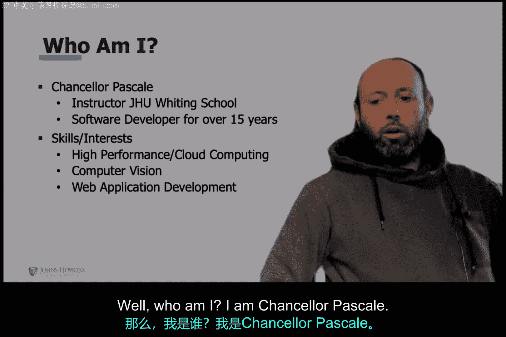
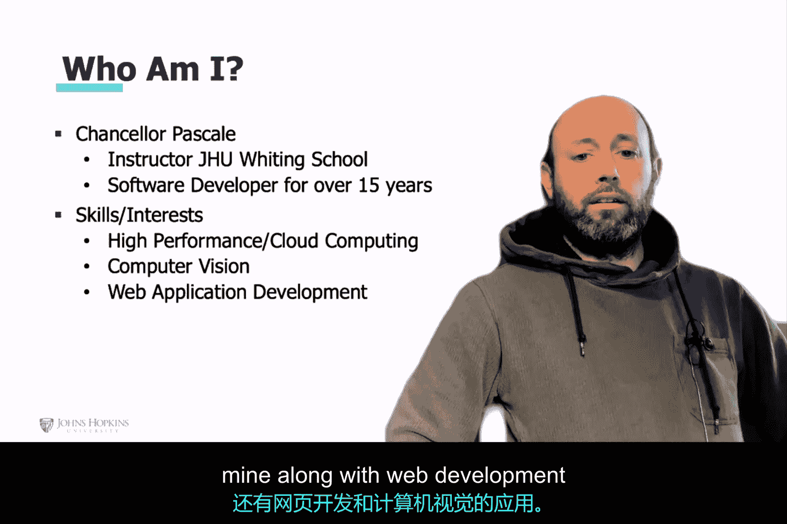
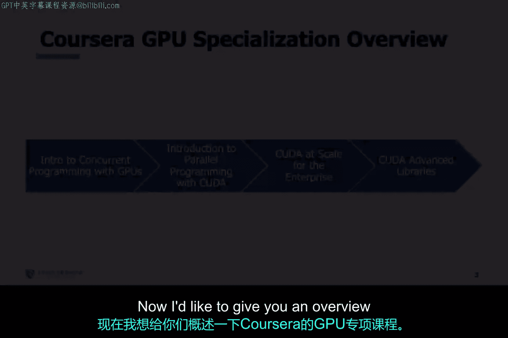
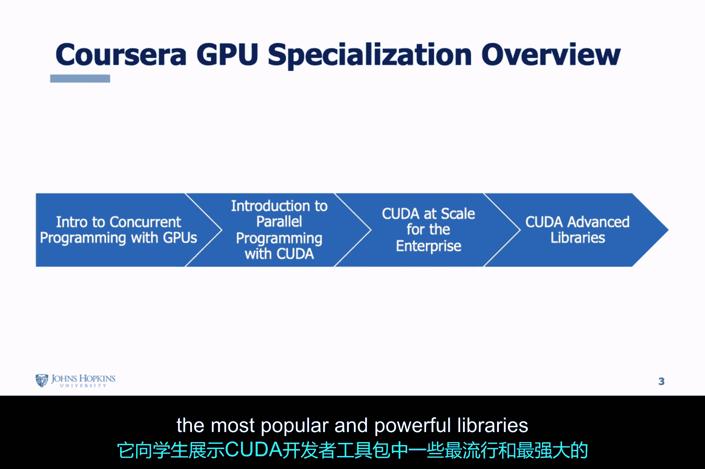
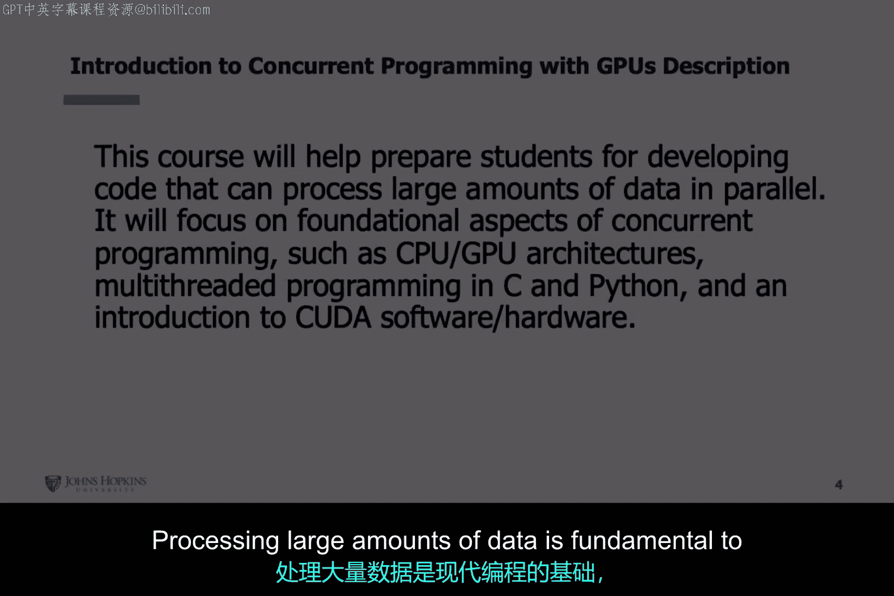
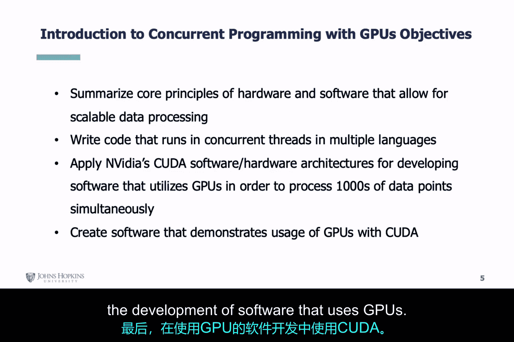

# 001：课程综述 🚀

在本节课中，我们将对约翰霍普金斯大学的GPU编程专项课程进行整体介绍。我们将了解课程结构、讲师背景以及本专项课程的核心学习目标。

---

欢迎来到《GPU并发编程导论》课程，这是GPU编程专项课程的一部分。

我是讲师帕斯卡·钱塞勒。我在约翰霍普金斯大学怀廷工程学院任教已有10年，同时也是一名拥有15年经验的软件开发人员。高性能计算、云计算、Web开发以及计算机视觉的应用都是我的兴趣所在。

接下来，我将为您概述Coursera平台上的GPU编程专项课程。

该专项课程包含四门循序渐进的课程。

以下是四门课程的简要介绍：

*   **第一门课程**：您当前所在的《GPU并发编程导论》。我将在下一张幻灯片中更详细地描述它。
*   **第二门课程**：《CUDA并行编程导论》。本课程重点介绍NVIDIA GPU和CUDA编程框架提供的基本硬件和软件功能。
*   **第三门课程**：《面向企业的规模化CUDA》。本课程深入探讨CUDA更复杂的功能，以及如何将其应用于超越程序员个人机器的企业级硬件上进行规模化计算。
*   **第四门课程**：《CUDA高级库》。本课程向学生介绍CUDA开发工具包中附带的一系列最流行且功能强大的库。

上一节我们了解了整个专项课程的框架，现在让我们聚焦于您即将开始的第一门课程。

处理海量数据是现代编程的基础，学生将在本课程中学习相关技术。课程的主要焦点是并发、并行或多线程编程，学生将接触到这类软件开发的基本方面。

CPU和GPU（也称为通用图形处理单元或GPGPU）允许多个线程同时运行。为了专注于CPU并行编程的挑战，学生将学习如何使用C++和Python 3来并发处理多个数据片段。

最后，学生将接触到领先的GPU编程硬件和软件架构：NVIDIA和CUDA。

本课程的学习目标如下：

*   **理解核心原理**：总结可扩展数据处理所需的硬件和软件核心原则。
*   **掌握多线程开发**：使用多种编程语言，开发能够在众多并行线程上运行的软件。
*   **应用GPU与CUDA**：利用GPU，应用NVIDIA CUDA软硬件架构，创建能够同时高效处理数千个数据点的代码。
*   **进行GPU软件开发**：最终，在软件开发中使用CUDA和GPU。

---

本节课中，我们一起学习了GPU编程专项课程的整体结构和第一门课《GPU并发编程导论》的核心内容。希望本次介绍能帮助您思考自己在本课程乃至整个专项课程中的学习目标。