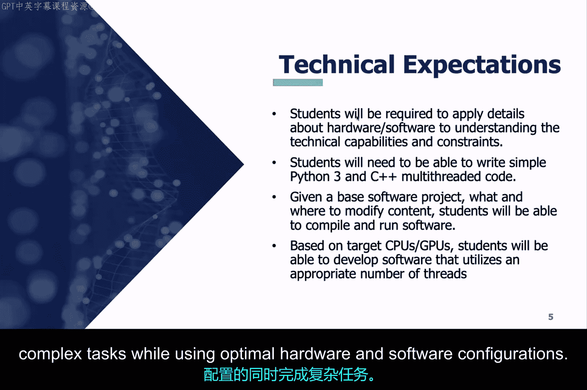

# 002：课程期望 🎯

在本节课中，我们将介绍《GPU编程入门》课程的整体期望，涵盖课程材料、时间投入和技术要求三个方面。

---

## 课程材料与结构 📚

课程内容以模块形式组织。每个模块包含4到7节课。每节课将综合使用多种形式的教学材料。

以下是每节课可能包含的内容类型：

*   **视频**：以幻灯片或屏幕录制的形式呈现。
*   **资源**：例如，配有旁白的幻灯片视频会提供对应的PowerPoint文件；包含屏幕录制内容的视频会提供相关的操作命令。
*   **讨论**：鼓励学生协作并分享想法与经验。
*   **测验**：用于评估学生对课程内容的理解。
*   **实验活动**：在真实环境中探索技术主题。
*   **作业**：具有挑战性的编程任务。

---

## 时间投入预期 ⏱️

了解课程的时间安排有助于你更好地规划学习。对于每个模块，建议的时间分配如下。

以下是每个模块大致的耗时估算：

*   **观看视频**：最多30分钟。
*   **非计分工作**（包括讨论和实验活动）：15到30分钟。
*   **计分作业**：30分钟。如果花费更长时间，这完全正常。

接下来，我们详细看看每项学习活动的具体时长。

### 各类学习活动时长

每节课都包含讲座和技术应用视频，这是深入理解课程主题所必需的。

*   **视频**：时长通常在5到7分钟之间。
*   **实验活动**：允许学生在实际环境中探索技术主题，通常需要10到15分钟来掌握其核心内容。
*   **测验**：用于评估理论或特定技术知识，每个模块的测验预计需要3到5分钟完成。
*   **编程作业**：每个模块建议预留15到30分钟来完成。

---

## 技术要求与实践应用 💻

本课程要求学生具备一定的编程基础，并将理论知识应用于实践。

学生关于硬件和软件能力及限制的实践知识将通过多种方式得到应用。通常，这些知识将应用于编程活动和作业中。

### 编程语言与库

课程中的编程任务将使用 **C++** 和 **Python** 语言完成。挑战难度将从简单逐步过渡到复杂。

这些任务通常需要应用**多线程库**。

### 任务形式与目标

实验活动和作业将包含以下形式：

*   提供一个程序的基本框架，要求学生修改它以演示预期效果。
*   要求学生完成代码以实现一个经典算法。

通过完成这些实践，学生将能够利用CPU和GPU来完成复杂任务，同时学会在最优的硬件和软件配置下进行工作。

---

## 总结 ✨

本节课中，我们一起学习了《GPU编程入门》课程的总体期望。我们明确了课程材料的结构与形式，了解了需要投入的大致时间，并清楚了技术上的要求——即使用C++和Python，通过实践编程活动来掌握利用CPU与GPU进行并发编程的核心技能。准备好开始你的GPU编程学习之旅了吗？