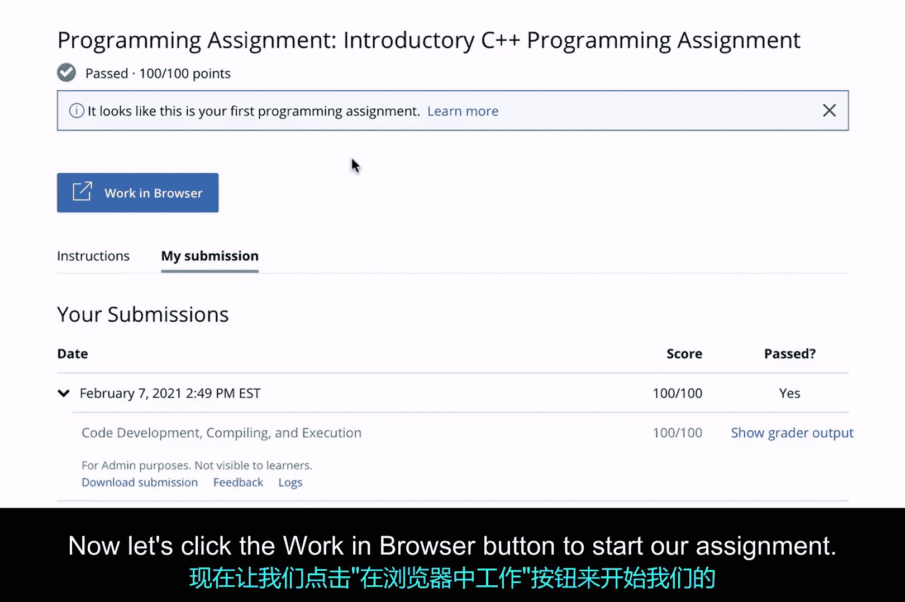
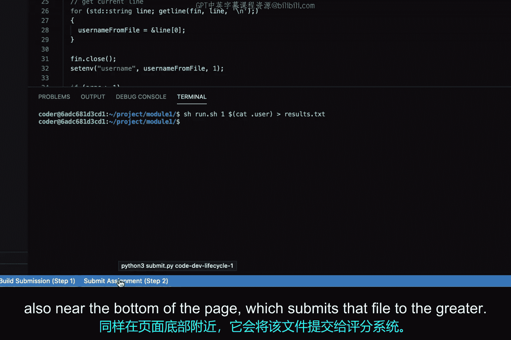
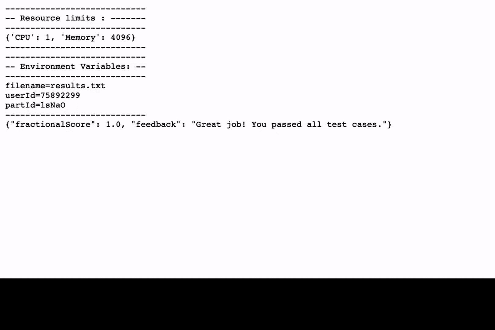

# 003：Coursera实验作业总览 🖥️

## 概述
在本节课中，我们将学习如何在Coursera平台上完成GPU编程课程的实验活动和编程作业。课程将详细介绍从开始作业到最终提交的完整流程，确保你能够顺利地在浏览器环境中完成所有编程任务。

## 实验与作业完成步骤
以下是完成编程实验和作业所需的六个基本步骤，所有操作均在浏览器内完成。

1.  **选择作业**：首先，确定你想要完成的实验或作业。
2.  **启动环境**：点击名为“在浏览器中工作”的按钮，这将在Coursera实验环境中启动Visual Studio Code编辑器。
3.  **打开目录**：如果需要，打开与你当前模块关联的目录。例如，本模块的目录可能名为 `module1`。
4.  **阅读说明**：阅读该目录下的任何 `README.md` 文本文件，以获取实验或作业的具体说明。
5.  **编辑代码**：编辑适用的代码文件，这些文件通常具有 `.cpp`、`.hpp` 或 `.py` 等扩展名。
6.  **编译运行**：打开终端，使用命令行工具（如 `sh` 或 `make`）来清理、构建和运行你的代码，直到你对结果满意为止。

## 作业提交专项步骤
上一节我们介绍了完成实验的通用步骤，本节中我们来看看针对编程作业的额外提交步骤。

对于作业，还有第六个也是最后一个步骤：
*   **修改用户信息**：编辑 `.user` 文件和主代码文件（例如 `assignment.cpp`），确保其中的用户名变量值相同。
*   **提交作业**：然后，你可以通过屏幕底部的按钮提交作业。这些按钮会标明完成所有必需步骤的按压顺序。

## 作业页面详解
现在，让我们深入了解作业页面的具体布局和功能。

这是模块1编程作业的页面。我们将逐步讲解完成作业所需的所有步骤。页面上包含进度通知区域、启动实验活动的按钮、完成作业的说明以及提交结果。

现在，让我们点击“在浏览器中工作”按钮来开始我们的作业。

## 在VS Code中操作
接下来，你需要在VS Code中打开与活动或作业关联的目录。

如果你在页面顶部附近没有看到模块编号和名称，你需要从菜单栏中点击“文件”菜单选项，然后从下拉菜单中选择“打开”。这将在编辑器顶部附近弹出“打开文件或文件夹”对话框。

在对话框中，你可以通过点击“..”（双点号）来向上导航目录结构。对于本项目，你需要导航到 `/home/coder/project/module1`。

在对话框中找到需要打开的文件夹或文件后，点击“打开”按钮。文件或文件夹将在编辑器的左侧打开。现在，你将拥有开始当前模块实验或作业所需的所有文件。

## 阅读文件与修改代码
你应该做的下一件事是阅读 `README.md` 文本文件，其中包含背景材料和一系列作业说明。

你可以查看 `run.sh` 文件，这是一个用于执行作业所有步骤的脚本。`Makefile` 用于清理、构建和运行你的工作。你通常不需要修改这两个文件，而应该只修改代码和其他相关文件。

如果你正在处理作业，接下来应确保 `.user` 文件反映了你的用户名。用户名可以是任何名称或登录名，只要不包含特殊字符。

在开始编写作业其余部分的代码之前，另一个需要添加用户名的地方是你的主代码文件中。在本例的 `assignment.cpp` 中，你需要修改 `user_name` 字符串常量，使其与你在 `.user` 文件中放置的名称相同。

通过编辑这两个文件，你将确保你的提交满足作业的第一个要求：用户名验证。当你执行代码（无论是直接执行还是通过 `run.sh` 或 `make` 命令）时，都需要传递相同的用户名。

## 构建与提交作业
下一步是提交你的代码。点击页面底部的“构建提交（步骤1）”按钮。

你将在页面底部看到一个终端窗口，它会清理、构建并执行你当前的代码，并将输出到一个文件中，该文件用于作业评分。请注意终端中的任何输出。

然后，点击同样位于页面底部的“提交作业（步骤2）”按钮。

该按钮将提交该文件给评分器。然后，你可以在作业页面查看提交结果。在评分器运行完成之前，结果将显示为琥珀色。

当你打开提交结果时，可以看到分数、是否通过以及任何反馈信息。

如果遇到问题，你真的需要进一步查看，可以进入日志。

## 总结
本节课中，我们一起学习了在Coursera平台上完成GPU编程实验和作业的完整流程。我们从选择作业开始，逐步讲解了启动开发环境、阅读说明、编辑代码、编译运行，直到最后构建和提交作业的每一个关键步骤。掌握这个流程将帮助你高效地完成后续的所有编程任务。