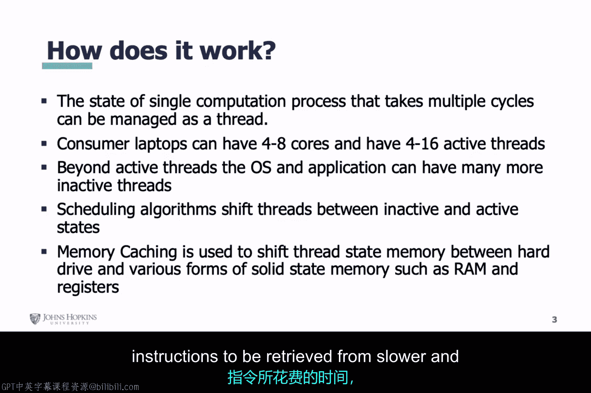
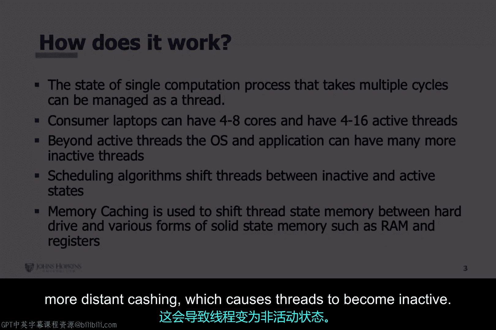
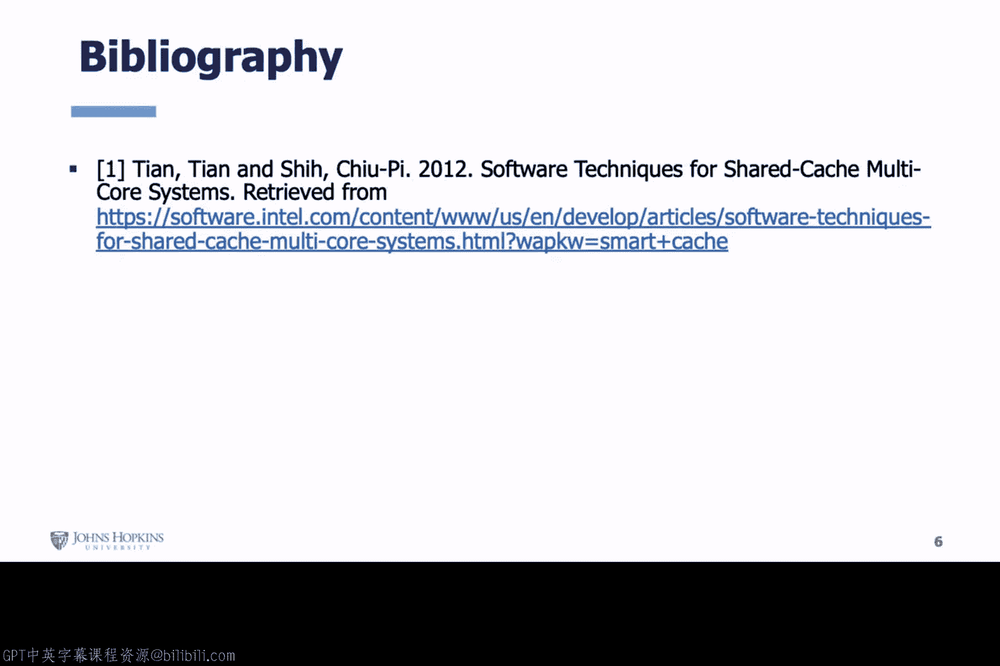

# 004：现实世界并行编程实践

## 概述
在本节课中，我们将要学习现实世界中的并发编程实践。我们将探讨多处理、并发、并行和线程化编程这些核心概念，理解它们在现代计算中的作用，并了解操作系统如何管理线程与内存，以实现计算资源的最大化利用。

## 多处理、并发、并行与线程化编程
多处理、并发、并行和线程化编程这几个术语本质上是同义的。现代编程的核心目标在于最大化利用现代计算机的多处理器和多核心。实现这一目标的最佳途径就是运行多个进程和线程。

操作系统会在无需开发者干预的情况下自动完成这一过程。然而，通过编写能够独立处理数据的高质量线程代码，开发者有能力进一步提升软件效率。

一些高度复杂的任务，例如人工智能、音视频处理和信号处理，都可以在设计时就考虑到多处理。但请注意，如果处理不当，也可能适得其反。并行处理不仅是需要大量计算能力的软件基础，同时也允许与用户进行异步交互。

## 什么是线程？
线程是一系列独立、按顺序执行的编程指令集合。你可以将一个拥有多个独立线程的程序想象成多条火车轨道，它们在特定点分离，又在特定点汇合。

当轨道分开时，多列火车可以全速前进；但当轨道合并时，每列火车的速度都会受到其前方火车速度的限制。

## 现代CPU与线程调度
对于现代CPU（例如笔记本电脑或消费级台式机），通常拥有4到8个核心，每个核心可以由调度器管理1到4个线程。

任何操作系统多线程能力的核心都是**调度器**。它负责在不同的程序（包括操作系统任务）之间进行切换，将它们置于活动或非活动状态，并在核心之间移动它们，以及在缓存之间移动数据等。

## 计算机内存层次结构
计算机拥有从硬盘到核心间共享寄存器等多级内存。它们允许线程之间共享公共数据，甚至是同一程序中多个线程所执行的指令。

内存缓存的目标是减少因从速度更慢、距离更远的存储中检索数据或指令而导致的等待时间，这种等待会导致线程变为非活动状态。

## 线程调度与缓存失效
在上图中，我们看到一个CPU调度器在不同核心的线程之间进行切换。在此案例中，假设所有四个核心位于同一处理器上，并至少共享一个L2缓存。当线程因缓存未命中而状态改变时，调度器不希望浪费CPU周期等待数据或指令，因此它会寻找需要运行的任务并将其激活。

当然，在线程间切换会损失时间。因此，频繁切换本身也会带来成本。

## 内存缓存层次结构与原理
内存缓存本质上是层次化的。它们的工作原理基于一个事实：物理上更近的内存性能更高。

缓存不仅用于为CPU存储本地化的数据和/或指令，还用作核心之间的共享机制，以及作为一种存储数据和/或指令的方式，以限制访问RAM甚至硬盘空间的请求次数。

还存在L3缓存，但在我们讨论GPU时其应用会略有不同，此处不进行详细讨论。

## 总结
本节课中，我们一起学习了现实世界并行编程的基础。我们明确了线程作为独立指令序列的概念，了解了现代多核CPU如何通过调度器管理线程。我们还探讨了计算机的内存层次结构，特别是缓存对于减少数据访问延迟、提升多线程程序性能的关键作用。理解这些底层机制是编写高效并发与并行代码的重要前提。