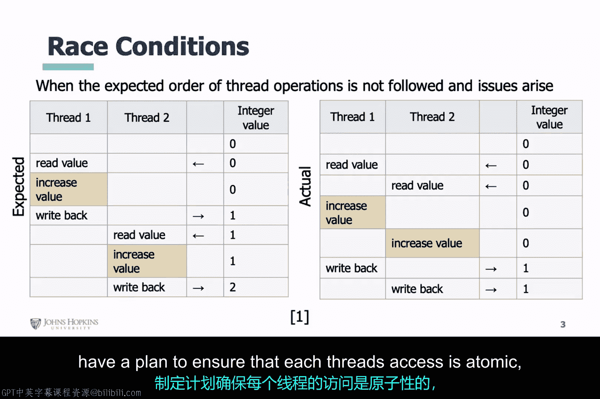
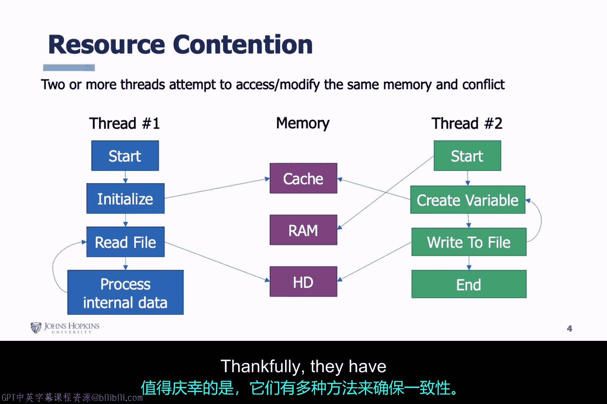
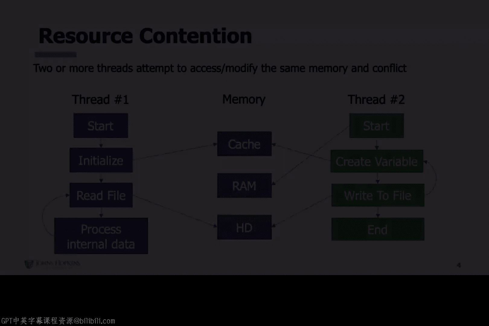
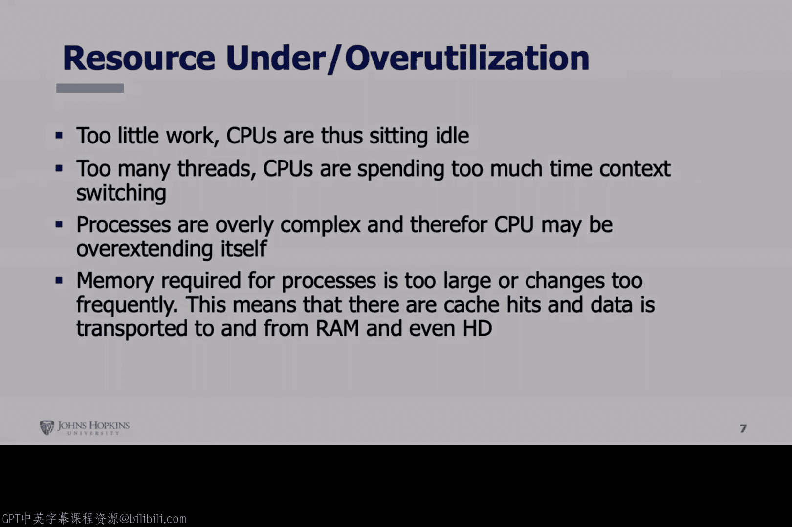

# 005：并发编程陷阱解析 🔍

在本节课中，我们将探讨编写多线程程序时可能出现的各种问题。理解这些陷阱对于编写正确、高效且稳定的并发程序至关重要。

## 概述

多线程编程能显著提升程序性能，但若处理不当，也会引入一系列复杂问题。本节我们将逐一解析**竞态条件**、**资源争用**、**死锁**、**活锁**以及**资源利用不充分**等常见陷阱。了解这些问题及其成因，是构建健壮并发系统的第一步。

---

## 竞态条件 🏁

上一节我们概述了并发编程的挑战，本节首先来看看最常见的陷阱之一：竞态条件。

竞态条件发生在多个线程的执行顺序与程序员的预期不符时。这可能导致严重的、非预期的后果。例如，程序员可能希望线程A先完整执行其三条指令，然后线程B再执行。但如果指令被交错执行，共享变量的最终值就可能不是开发者所期望的。

需要明确的是，在这种情况下，每个线程对共享变量的操作本身可能是“有效”的，但交织在一起的整体执行顺序导致了错误结果。因此，最终值本身没有对错之分，而是程序逻辑被破坏。

**核心概念**：竞态条件的本质是**非确定性的指令交错执行**导致程序状态错误。

为了避免竞态条件，最佳实践是尽量减少共享或全局变量的使用。如果必须使用，则需要确保每个线程对共享资源的访问是**原子性**的（我们将在后续课程中详细讨论原子操作）。

---

## 资源争用 ⚔️

与竞态条件类似，但更侧重于内存而非执行顺序的问题是资源争用。

线程和共享资源越多，如果程序员未充分考虑，资源争用发生的频率就越高。这是竞态条件的一种更异步的版本，其范围可以从线程扩展到完全独立的机器。

问题在于，不同的独立线程需要以不同方式访问同一资源（如内存、文件等），这会导致冲突和对值的不断重写。

考虑数据库的例子：多个线程需要递增同一个计数器。当一个线程从数据库读取值、准备更新时，另一个线程可能也在访问同一行数据。在第一个线程读取和更新之间，可能有N个线程做了同样的事情，导致许多递增操作没有被计入，因为只有最后一个写入的值被保存。这是数据库中一个非常重要的问题，幸运的是，数据库系统提供了多种机制来确保一致性。

**核心概念**：资源争用是多个执行实体**异步地、冲突地访问同一共享资源**。

---

## 死锁与活锁 🔒

死锁与资源争用相似，但情况更为棘手：一个或多个线程或进程需要**多个**共享资源，并且只有在获得其所需的全部资源后才会执行操作。同时，它们不会释放已持有的资源。

在死锁中，每个参与者都持有一部分资源，同时又在等待其他参与者释放它们所需的资源。没有任何一个参与者能脱离这种僵局。简单的解决方法是让线程放弃已持有的资源，但这可能导致线程不断丢弃并疯狂重试获取所有资源，反而可能使情况恶化。

活锁类似于死锁，但每个线程都在“积极”地执行某些操作（例如不断重试），却永远无法完成需要多个资源的整体流程。

这种情况可能发生在一个编程循环中：它在进行最终修改前先测试资源访问权限，然后只休眠极短时间或不休眠。考虑一个`do-while`循环，它在能将值保存到资源之前，不会更新外部可见的显示。多个执行相同循环的线程可能同时通过测试，却都无法访问必要的变量，从而导致不断递增另一个变量。

这可能引发缓冲区或堆栈溢出，或者将一条指令执行数百万次甚至无限次，或者递归执行同一段代码并锁死程序。即使错误地使用某些编程语言的异步功能，也可能导致活锁，因此需要格外小心。

**核心概念**：
*   **死锁**：线程相互等待对方持有的资源，**所有线程都被阻塞**。
*   **活锁**：线程不断重试失败的操作，**所有线程都在运行但无法推进**。

---

## 资源利用不充分 📉

一个稍令人担忧但同样重要的问题是过度或不足地利用机器的计算能力。如果在强大系统或大型计算集群上发生，这可能造成巨大的资源浪费。

顾名思义，这发生在你创建了过多或过少的线程时。
*   **线程过多**：大量线程可能因无工作可做而在活跃与休眠状态间频繁切换。上下文切换的开销可能会抵消使用多线程带来的速度优势。
*   **线程过少**：少量线程可能持续处于高负荷状态。微小的内存泄漏或效率低下的问题会叠加放大，CPU利用率可能飙升，进而影响所有运行线程的性能。此外，如果一个线程需要处理大量数据或指令，缓存未命中的情况会更频繁发生，系统将因在缓存、内存甚至硬盘之间的数据传输而变慢。

解决这个问题的关键在于根据数据量或CPU利用率动态调整线程数量。

**核心概念**：线程数量需要与**工作负载**和**硬件资源**相匹配，以实现最佳性能。

---

## 总结

本节课我们一起学习了并发编程中的几个核心陷阱：
1.  **竞态条件**：由非预期的指令交错执行引发。
2.  **资源争用**：多个实体冲突地访问同一共享资源。
3.  **死锁与活锁**：线程因资源依赖而无法推进，区别在于前者被阻塞，后者在空转。
4.  **资源利用不充分**：线程数量与任务不匹配，导致性能下降或资源浪费。

理解这些问题是设计正确并发算法和数据结构的基础。在后续课程中，我们将探讨如何使用同步原语（如锁、信号量、屏障）和原子操作来避免这些陷阱，从而编写出安全高效的多线程程序。