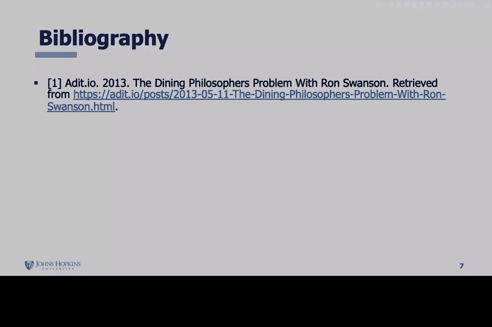

# 006：并发编程问题与算法展示

在本节课中，我们将学习并行编程中的四个经典挑战及其对应的算法。这些挑战是理解并发编程核心问题的关键，掌握其解决方案有助于应对众多类似的编程场景。

## 🍽️ 哲学家就餐问题

上一节我们介绍了并发编程的概述，本节中我们来看看第一个经典问题：哲学家就餐问题。

每个哲学家需要两把叉子才能进食。他们一次只能执行一个动作：拿起一把叉子、进食或放下叉子。在一个简单的实现中，如果每位哲学家都先尝试拿起左边的叉子，再尝试拿起右边的叉子，然后进食，最后依次放下叉子，这很可能会导致失败。因为最终可能每位哲学家都持有一把叉子，从而陷入僵局。

这听起来是否熟悉？它与之前视频中遇到的几个问题有些相似。

*   **资源竞争**：叉子就是被竞争的资源。
*   **死锁**：如果哲学家们坚持持有叉子而不放下，就会发生死锁。
*   **活锁**：如果每位哲学家都放下已持有的叉子，转而去尝试获取另一把叉子，则可能发生活锁。

考虑解决此问题的方法：哲学家们可以相互沟通，或者由一个中央机构决定顺序。此问题存在多种解决方案，但并非总是简单易行。因此，在编写代码前请仔细思考。

## 📦 生产者-消费者模式

在了解了资源竞争问题后，我们来看看一个非常常见的工具：生产者-消费者（或称读者-写者）模式。

这是一种在现代编程中广泛使用的模式，常见于消息队列的实现。消息队列允许数据以流式或批处理的方式顺序或非顺序地添加。然后，用户拉取或订阅消息队列，数据将按照放入的顺序或可用性被返回。

一个或多个进程（称为生产者）可以添加数据，供消费者使用。如果数据量超过队列的处理能力，则根据数据的使用方式有多种策略。

以下是几种处理策略：
*   如果最新数据更重要，队列可以丢弃旧数据。
*   如果只需要数据子样本，可以从队列中随机丢弃数据。
*   如果所有数据都重要，则新数据可以暂存，待队列有空间时再存入。这可以视为速度较慢但成本较低的方式，并且可以告知消费者暂停处理。

如果数据结构或队列允许覆盖值，或者生产者的指针索引超过了消费者的索引，则可能发生竞态条件，导致生产者可能永远无法获得新数据。

## 💈 睡眠理发师问题

生产者-消费者模式关注数据流，而睡眠理发师问题则关注服务线程的调度优化。

睡眠理发师问题与生产者-消费者模式类似，但服务的顺序并不重要。线程（理发师）试图优化其工作。等候室就像上一张幻灯片中的队列或数据结构，但理发师一次只能服务一位顾客，并且等候室大小有限。

可能发生两种主要情况：
1.  **过度利用**：如果理发师剪发慢且健谈，同时有大量潜在顾客，则可能发生类似活锁或过度利用的情况。顾客探头发现等候室已满后便会离开。
2.  **利用不足**：如果没有顾客，理发师们就会闲坐、睡觉，谈论过去的日子。这是利用不足的情况。

此问题存在针对一个或多个理发师的解决方案。但思考此问题时，可以考虑将问题反转：让等候室中的顾客数量来决定活跃理发师的数量。

## 🔒 数据与代码同步

讨论了具体的并发问题后，我们来看看一个基础的并行编程机制：数据与代码同步。

许多（即使不是大多数）编程语言都提供了同步数据或代码的机制。这通常通过锁定对数据或代码的访问来实现，因此请谨慎使用。如果同步所有数据，最终可能导致死锁或活锁。

如果一个线程尝试访问一段同步数据，任何需要该数据的其他线程都必须等待。这在票务系统中很有用，你希望锁定对代码或数据的访问，直到前一个持有“调用票”的线程完全使用完毕。

信号量使用锁实现，但通过有限数量的状态来更间接地管理对数据或代码的访问，并允许并发多次访问。

可以将其类比为航班的座位等级。头等舱（1A）的乘客可以在经济舱（2）乘客之前登机。多个个体可以同时登机，这应能最大限度地减少被其他乘客阻塞的可能性。

这里的主要注意事项是，对于多线程问题，很少存在万无一失的解决方案。但你可以根据对数据一致访问的优先级以及对利用不足或过度利用的可接受程度，提出一个合理的解决方案。

---

本节课中，我们一起学习了并行编程中的四个经典问题：哲学家就餐问题、生产者-消费者模式、睡眠理发师问题以及数据与代码同步机制。理解这些问题及其解决方案的模式，是设计和编写健壮并发程序的重要基础。