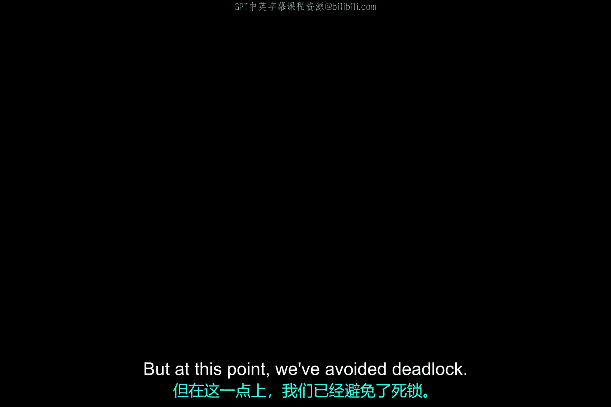

# 007：可选课题-饥饿小鸡问题 🐔

在本节课中，我们将通过一个生动的“饥饿小鸡”比喻，来理解多进程环境中的资源竞争、调度和死锁避免等核心概念。

## 概述

我们将观察两种不同的场景：代表充足计算资源的“驴子”场景，以及代表资源受限、多进程竞争的“小鸡”场景。通过对比，我们将直观地理解进程调度、资源争用以及如何避免死锁和活锁。

---

上一节我们概述了本节课的核心对比。首先，让我们来看看资源充足的情况。

## 资源充足场景：两只驴子 🐴

这里展示的食物代表计算资源。两只大驴子代表两个大型进程。在CPU中，它们就像是两个核心。

以下是驴子场景的关键点：
*   两只驴子（进程）交替从不同位置获取食物（资源）。
*   它们有时会过来争夺你的注意力（资源），但关键在于存在两个核心和两只驴子。
*   理论上，应该有足够的处理能力让它们完成所需任务。

---

看完了资源相对充足的场景后，我们转向一个更为复杂和常见的情况：资源受限下的多进程竞争。

## 资源竞争场景：饥饿的小鸡 🐥

现在我们将看到小鸡的场景，这里有许多小鸡，但资源更为紧张。

在左侧是小鸡饲料，右侧是谷物。小鸡需要饲料生存，但它们真正喜欢的是高糖分的谷物。谷物被用来分散它们的注意力，防止它们互相伤害。

这一群小鸡，代表着一组等待获取某些资源的进程。

---

理解了场景设定后，我们来看看当资源分配不当时会发生什么。

### 资源分配不均与争用

当我走动时，你会看到不同类型的喂食器或资源访问点，以及水。

我现在所做的，是只在喂食器的特定槽位中放入少量资源。因此，每只扮演进程的小鸡都试图立刻获取资源集。一些小鸡看到可能随之而来的争斗不值得费力，便选择等待更多资源出现。

接下来，我将资源放入红色喂食器的其中一个槽位并关闭顶部。小鸡们随后会尝试从任何槽位获取资源，并且正如你看到一只压在另一只身上那样，它们将开始陷入实际的资源争用。

---

为了避免上述争用情况，我们需要改变资源分配策略。

### 增加资源点以避免死锁

现在，我在喂食器的每个槽位都放置了资源。你可能会认为这将有更多的进食机会，但并没有。从小鸡的视角看，资源仍然不足。

因此，我们需要进一步分散饲料，使得小鸡减少互相注视和争夺资源。此时，它们将继续寻找开放的槽位（例如绿色或红色的喂食器）。注意，因为它们必须彼此靠近，所以资源更易获取，但在此刻，我们已经避免了**死锁**。

---

避免了死锁并不意味着系统高效。为了优化整体性能，我们需要处理活锁或过度争用。

### 使用“诱饵”资源优化进程调度

为了避免**活锁**、对资源的过度争用，甚至进程的次优使用，我将把谷物撒在地上。这进一步分散了小鸡，使它们彼此接触更少，并且给了它们最想要的东西。

---

## 总结

本节课中，我们一起学习了多进程编程中的核心挑战。通过驴子与小鸡的比喻，我们直观地理解了：
1.  **资源充足时**，多进程可以相对顺畅地交替执行。
2.  **资源受限时**，进程间会发生激烈的争用，导致性能下降。
3.  通过**增加资源访问点**（更多槽位）可以避免死锁。
4.  通过引入“诱饵”或**分散注意力机制**（撒谷物），可以优化调度，减少不必要的争用（活锁），提升整体效率。

希望我的小鸡和驴子能帮助你以一种新的方式思考多进程处理。