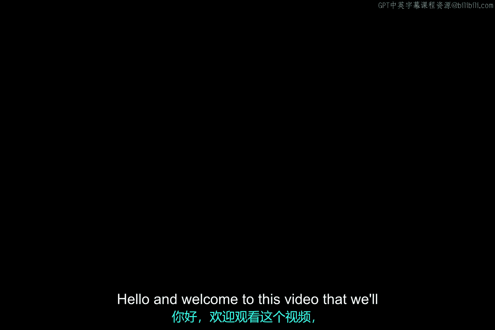
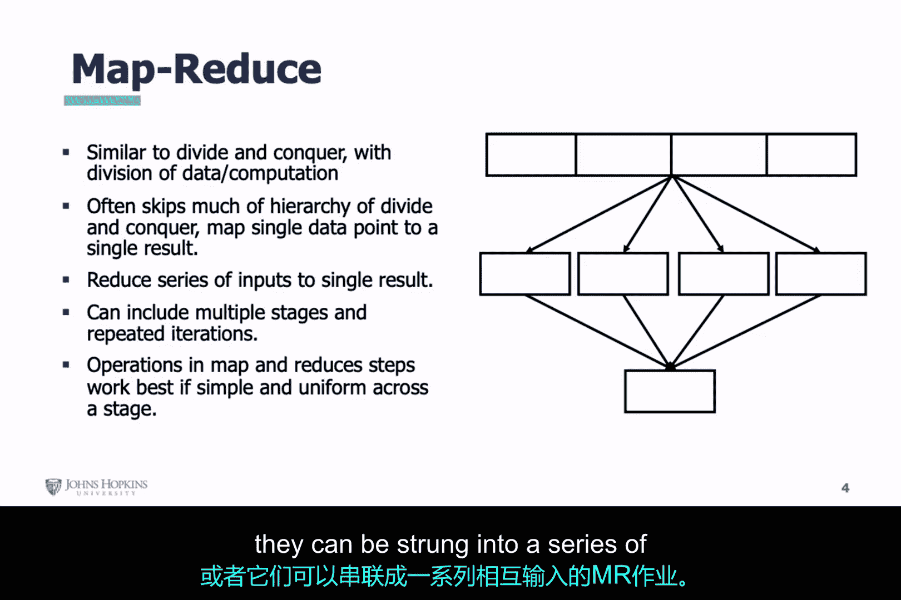
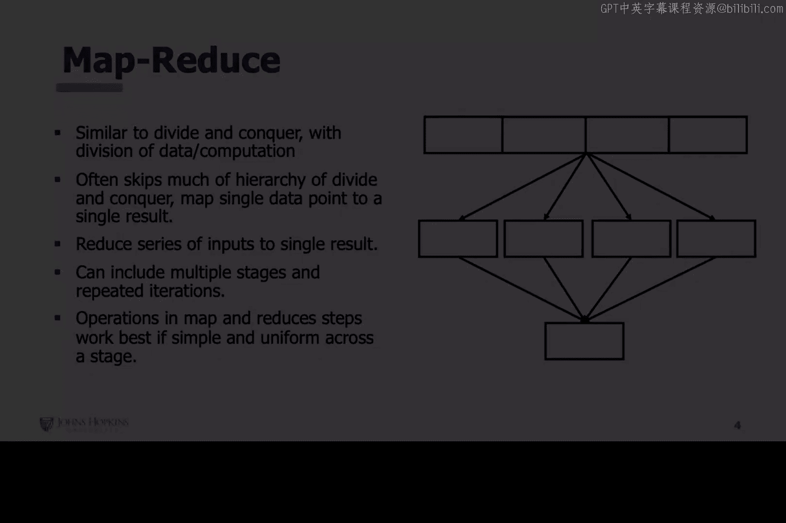
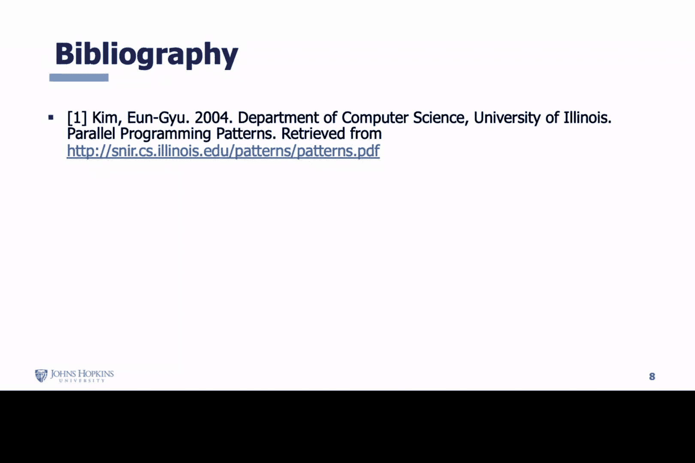

# 008：并发编程模式解析 🧩



在本节课中，我们将学习并行编程中几种核心的设计模式。理解这些模式能帮助你更高效地设计程序，避免重复造轮子。

## 概述

并行编程的许多挑战都可以通过五种核心模式来解决：分治法、映射归约法、仓库模式、流水线与工作流，以及递归。识别并应用这些模式，可以显著提升程序的效率和可维护性。

---

## 分治法

上一节我们介绍了课程概述，本节中我们来看看第一种模式：分治法。

分治法是解决计算机科学问题最常用的方法之一，即使在不涉及并发的情况下也是如此。你可能在搜索和排序算法中见过它的应用。

其基本思想是将数据不断拆分，直到数据量足够小，可以轻松回答关于排序或相等性等更大规模的问题。每个线程处理小数据集并得到答案后，会将答案返回给调用者。调用者汇总所有小数据集的响应，从而以更少的工作量得出最终答案。这种方法最终将结果传回主调用上下文，其耗时通常少于进行两两比较的暴力方法。

但它并非总是最佳选择。例如，在一个未排序的集合中查找特定值可能需要N次比较。如果数据本身未排序，那么拆分和重组的过程会带来额外开销。此外，在CUDA等不支持或递归效率低下的环境中，应谨慎使用此模式。实现分治法的程序也需要精心设计，以维护所有数据拆分过程中的复杂状态。

---

## 映射归约法

了解了分治法后，我们来看看映射归约法，它可以被视为分治法的一个子集。

映射归约法的主要区别在于，每次运行映射归约周期时，它会立即将数据分解为独立的数据点，并对所有数据点应用相同的操作。每个映射器只返回一个值，而归约器的任务则是接收这些返回值，并将其合并为单个值。

例如，要测试一个值是否存在于集合中，每个映射器在接收到非目标值时返回0，在接收到目标值时返回1。归约器则将所有返回值相加，并将0转换为`false`，大于0的值转换为`true`。

这种方法的优点在于，无论数据规模大小或计算资源质量如何，它都能很好地扩展，前提是映射归约系统架构良好且通信不慢。映射器和归约器执行的操作可以更复杂，也可以串联成一系列相互衔接的映射归约任务。

以下是映射归约过程的简化表示：
```python
# 伪代码示例：计算集合中目标值的出现次数
def mapper(data_chunk, target_value):
    return 1 if data_chunk == target_value else 0

def reducer(results_list):
    total = sum(results_list)
    return total > 0  # 返回布尔值，表示是否存在
```

---

## 仓库模式





接下来，我们探讨当需要在多个线程或进程间维护状态时使用的仓库模式。

在该模式中，每个进程独立运行。当需要信息或想要更改整体状态时，它会向仓库发出请求。仓库需要确保其内部数据维护的原子性，而进程则负责基于数据一致性或陈旧性的考虑来维护自身状态。

由于一个进程可能处理数据一段时间后才尝试更新，而这可能会覆盖基于更新状态所做的更改，因此该系统可能需要根据情况鼓励更多或更少地使用仓库。

---

## 流水线与工作流

现在，我们来看看流水线与工作流模式，它们非常相似。

两者都可以表示为无环的有向图（尽管工作流系统允许循环，但数据仍会从节点流出）。流水线是工作流的一种，其中每个步骤从前一步骤获取输入，并输出到下一个单一的未来步骤。

工作流通常采用扇出和扇入模式：
*   **扇出**：同一输入被输出到不同的逻辑步骤。
*   **扇入**：数据被分割并发送到相同的逻辑代码进行处理。

需要注意的是，映射归约和分治法都可以使用工作流来实现，但这几种模式之间并非排他关系。许多编程语言，尤其是现在以更函数式编程的方式，都支持分治法和映射归约。

以下是工作流概念的图示：
```
[步骤A] -> (扇出) -> [步骤B]
                    -> [步骤C]
         -> (扇入) -> [步骤D]
```

---

## 递归

最后，我们来学习解决许多复杂问题的关键方法：递归。

几乎任何问题都可以通过递归解决，尽管这并不总是最高效的方式。函数式编程语言以及如Lisp、Clojure和Lodash等框架，都在一定程度上围绕递归构建。在这些情况下，数据被分为“头部和尾部”或“第一个和剩余部分”。函数对当前数据执行操作，并使用剩余部分调用自身。

递归不一定总是以这种方式处理，它可以以多种方式划分数据，包括二分方式。递归需要状态管理，因为必须确保递归不会无限进行下去，这意味着递归算法需要有终止状态。通常，当函数输入只有一两个数据时，递归会终止。

在跨多个本地或分布式CPU（非同一处理器）处理大型数据时，或在GPU上，递归模式通常性能不佳，因此不建议使用。

---

## 总结



本节课中，我们一起学习了并行编程的五种核心模式：**分治法**、**映射归约法**、**仓库模式**、**流水线与工作流**以及**递归**。每种模式都有其适用的场景和优缺点。学会识别问题并应用合适的模式，是设计高效、可维护并行程序的关键。