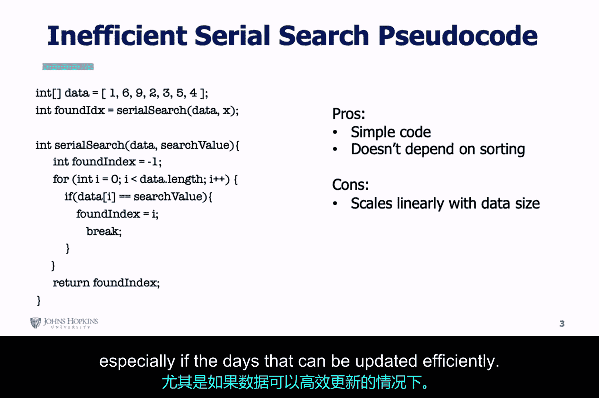
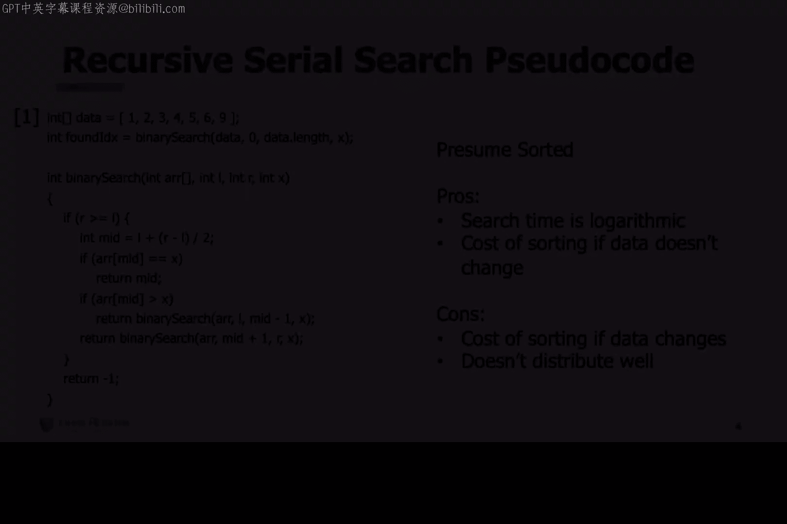
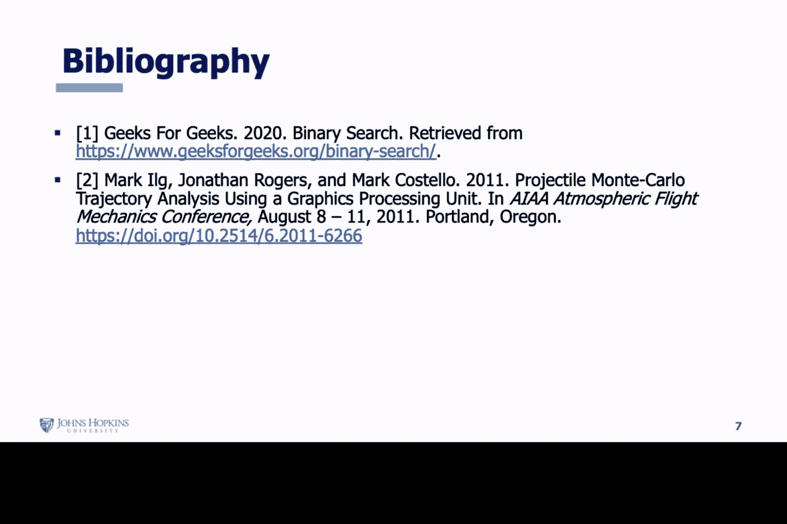

# 009：串行与并行代码及Flynn分类法 🚀


在本节课中，我们将学习串行代码与并行代码的核心区别，并通过一个搜索算法的例子来具体说明。我们还将探讨Flynn分类法，这是一个用于描述计算机架构和程序并行性的经典模型。理解这些概念是选择正确编程模型和硬件的基础。

## 串行搜索 🔍

上一节我们介绍了课程主题，本节中我们来看看最简单的搜索实现方式：串行线性搜索。

以下是一个用于在数据集中查找特定值的简单顺序算法伪代码：

```pseudocode
function serialSearch(data, searchValue):
    for i from 0 to length(data)-1:
        if data[i] == searchValue:
            return i  // 找到则返回索引
    return -1  // 未找到
```

该算法的执行流程如下：
*   从数据集第一个元素开始，逐个进行比较。
*   如果当前元素等于搜索值，则立即返回其索引。
*   如果遍历完所有元素仍未找到，则返回-1表示未找到。





这种方法的优点是实现极其简单，并且无需对数据进行预先排序（排序本身可能成本高昂）。缺点是，在最坏情况下，可能需要检查数据集中的每一个元素，效率较低。线性搜索在需要执行大量搜索操作时并不理想。

## 并行搜索 ⚡

了解了串行搜索的局限性后，本节我们来看看如何利用并行性来加速搜索过程。

并行搜索的核心思想是将数据集分割成多个子集，并分配多个线程同时进行搜索。其伪代码逻辑如下：

```pseudocode
function parallelSearch(data, searchValue, numThreads):
    sliceSize = length(data) / numThreads
    for each thread t in [0, numThreads-1]:
        start = t * sliceSize
        end = start + sliceSize
        // 每个线程搜索自己的数据片
        for i from start to end-1:
            if data[i] == searchValue:
                // 找到后，需通知其他线程停止并返回索引
                signalOtherThreadsToStop()
                return i
    return -1
```

以下是并行搜索的关键点分析：
*   **优点**：无需预先排序数据。通过增加线程数量，理论上可以线性提升搜索速度（在理想情况下）。
*   **挑战**：线程管理较为复杂，需要合理分配数据。当找到目标值时，需要安全地终止其他线程，这需要精心设计的逻辑。如果线程数量远小于数据规模，其效率可能仅略高于低效的串行搜索。

并行搜索的潜力在于拥有大量线程的场景，这正是图形处理器（GPU）的用武之地。如果每个线程只需执行一次比较，并在找到时更新一个共享变量，那么搜索时间可以降低到常数级别，优于对数级别的二分搜索。

## Flynn分类法 📊

在比较了串行与并行代码后，我们需要一个框架来对计算任务进行分类。Flynn分类法根据**指令流**和**数据流**的数量对计算模型进行划分。

该分类法由两个维度构成：
*   **指令流（I）**：可以是**单指令流（SI）** 或**多指令流（MI）**。这指的是在所有数据上执行的是相同的逻辑还是不同的逻辑。
*   **数据流（D）**：可以是**单数据流（SD）** 或**多数据流（MD）**。这指的是处理的数据是单个复杂对象，还是大量简单数据项。

由此组合出四种经典类型：

1.  **SISD（单指令流单数据流）**：这是传统的串行处理器模型。单个处理器核心按顺序执行指令，处理单个数据流。例如运行一个复杂的模拟程序。
2.  **SIMD（单指令流多数据流）**：同一指令同时作用于多个数据项。这是GPU和向量处理器的典型模式，非常适合对大量像素、顶点或数组元素进行相同操作。
3.  **MISD（多指令流单数据流）**：多个处理器对同一数据流执行不同的操作。这种模型较为罕见，通常用于容错系统。
4.  **MIMD（多指令流多数据流）**：多个处理器独立地执行不同的指令，处理不同的数据。现代多核CPU集群、分布式系统属于此类。

大多数基于CPU的顺序程序可归类为**MISD**，因为它们包含不同的处理步骤，作用于单个或少数复杂对象。而GPU等分布式编程方案通常是**SIMD**，旨在使用大量线程，对海量数据执行相同的逻辑。

## 总结 🎯

本节课中我们一起学习了串行与并行代码的差异。我们通过搜索算法的例子，对比了串行线性搜索、二分搜索和并行搜索的优缺点。随后，我们介绍了Flynn分类法，它从指令流和数据流的角度，将计算任务分为SISD、SIMD、MISD和MIMD四类。



理解你的数据特征和计算目标，并据此确定所属的Flynn类别，是选择合适编程语言、框架和硬件架构的关键第一步。对于处理大规模简单数据的任务（SIMD），GPU并行编程将展现出巨大优势。