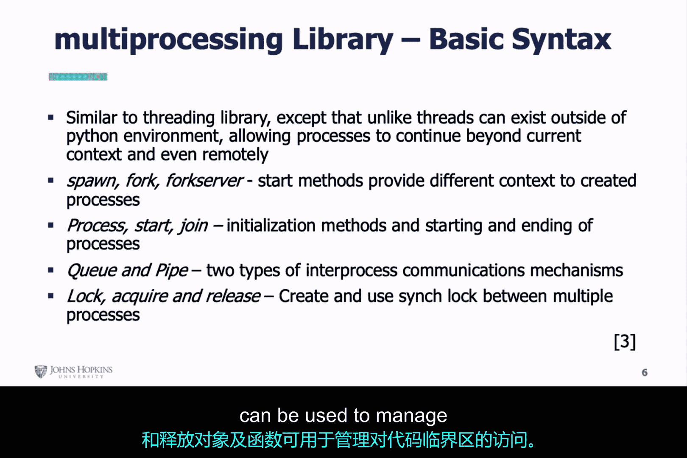
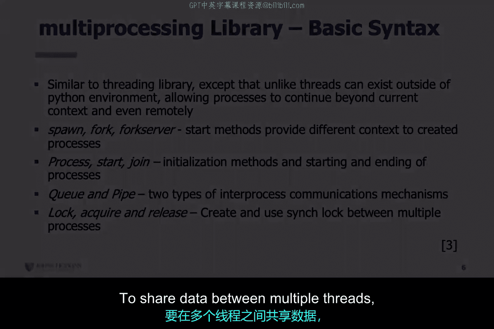
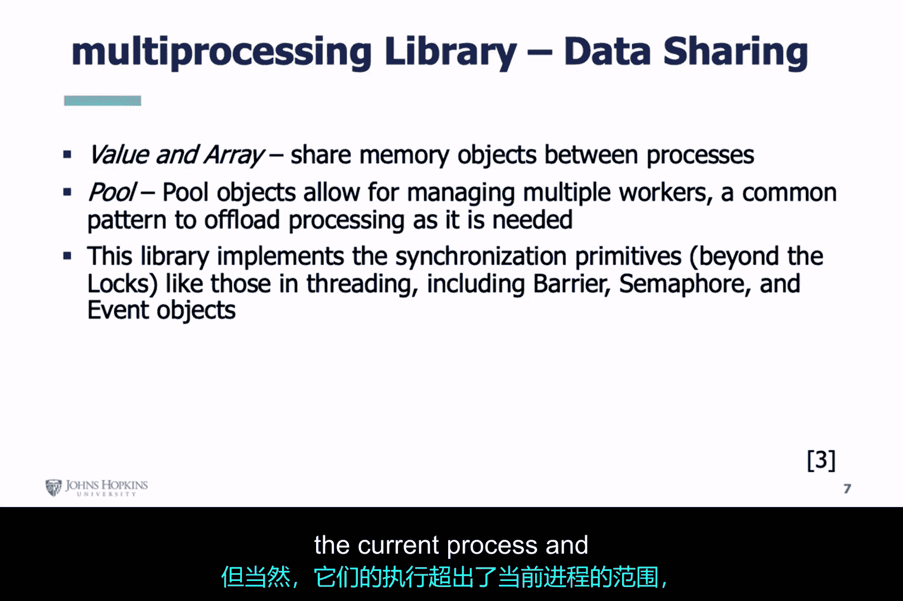
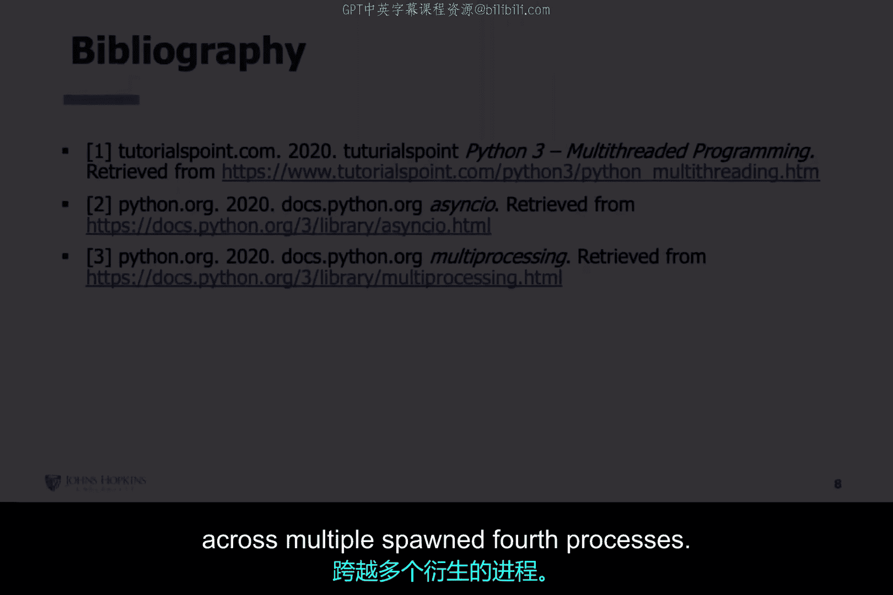

# 010：Python3并行编程语法与模式 🚀

在本节课中，我们将学习如何在Python 3编程语言中进行并行编程。Python标准库提供了多个用于并发和并行编程的库，我们将重点介绍其中三个核心库：`threading`、`asyncio`和`multiprocessing`。通过学习它们的基本概念和使用模式，你将能够编写出更高效、响应更快的Python程序。

---

## 概述：Python 3中的并行编程库

Python 3标准发行版中主要包含三个用于并行编程的库。虽然可以下载许多其他功能类似的库，但我们只介绍这三个，因为它们开箱即用且支持良好。

*   `_thread`和`threading`库：它们是Python 3线程的低级和高级接口。
*   `asyncio`库：它实现了异步执行代码的一系列核心功能。
*   `multiprocessing`库：这个库旨在超越线程，为并发软件提供更多可能。

---

## 线程库：`_thread`与`threading`

上一节我们概述了三个核心库，本节中我们来看看用于线程操作的两个库。要使用`_thread`或`threading`库，只需在Python文件顶部添加导入语句，以便全局访问；或者在方法顶部导入，以便在方法级别访问这些库。

线程通过`start_new_thread`方法启动。你需要向该方法传递线程将要执行的函数名，以及该函数所需的参数和关键字参数。这相当于`run`和`start`方法的简写形式，可以减少样板代码。

以下是使用`_thread`库启动线程的示例代码：
```python
import _thread

def print_numbers(name, count):
    for i in range(count):
        print(f"{name}: {i}")

# 启动一个新线程
_thread.start_new_thread(print_numbers, ("Thread-1", 5))
```

### 线程同步机制

使用`threading`库时，你可以利用多种机制来协调线程。以下是常见的同步原语：

*   **锁（Lock）**：你可以获取`start_new_thread`方法或类似函数的返回值（即已启动线程的句柄），然后对代码的关键部分进行`acquire`（加锁）和`release`（释放锁）操作。这是保护关键代码段的常用模式。
*   **信号量（Semaphore）**：信号量可用于控制对变量的访问。默认情况下，一次只允许一个线程访问（二进制信号量）。有界信号量则允许预定数量的线程同时访问变量。
*   **事件（Event）**：还有一种使用事件和事件处理在线程间进行通信的方案。
*   **屏障（Barrier）**：可以在代码中设置屏障，以确保所有活动线程都执行到屏障处，但在所有线程都到达屏障之前，不会执行屏障之后的代码。这是在多个线程间同步数据的好方法，特别是当一个或多个变量需要在多个线程间保持一致性时。

---

## 异步编程：`asyncio`库

上一节我们介绍了线程库，本节我们转向`asyncio`库。`asyncio`是多种编程语言中常见的语言结构，它以一种非常简单的方式管理异步代码。导入后，函数可以使用`async`关键字来表明它们可以以异步方式执行。

可以将其想象成这样一种情况：你的代码需要从网络服务器获取信息，但你不需要让整个系统等待一行或多行代码的执行。`asyncio`库保证异步方法最终会完成，并会处理相关事宜。

### 执行异步函数

要调用函数并让其在自己的线程中执行，调用代码只需将异步方法包装在`asyncio.run()`方法中。或者，如果你希望代码等待异步方法的执行，则使用`await`关键字，这在让线程休眠时很常见。

以下是异步函数的基本用法：
```python
import asyncio

async def say_hello():
    await asyncio.sleep(1)
    print("Hello, async world!")

# 运行异步函数
asyncio.run(say_hello())
```

### 高级功能：任务与并发

`asyncio`的一些更高级功能包括创建任务。与返回线程所调用方法的`run`调用不同，`create_task`不仅执行协程，还返回可用于检索结果的任务对象。

任务可以作为一系列调用的一部分，通过`gather`方法并行执行。`sleep`方法非常重要，因为它允许执行线程等待预定的时间。这在你的代码除了处理计算结果外还在做其他事情，但又想等待一个最终会返回的结果时非常方便。

此外，如果你希望线程拥有一个只要它们存在就不断执行的循环（例如，轮询文件系统以查找更改，然后执行计算或在应用程序窗口中显示文件内容），`asyncio`也能很好地支持。

---

## 多进程编程：`multiprocessing`库

上一节我们探讨了`asyncio`，本节我们来看看功能更强大的`multiprocessing`库。这个库非常强大，它借鉴了Python3上下文中线程独立执行的思想，并允许在当前调用进程之外，甚至在远程机器上执行代码。

### 创建进程的方法

`spawn`、`fork`和`fork server`都有三个通用目标：从当前进程创建新进程，尽管它们的结果不同。

*   `spawn`是最常见的版本，它会创建一个新的Python解释器进程，该进程与当前进程相似但不完全相同（基本上，Python解释器将拥有现有的库）。
*   `fork`更像是当前进程的一个副本，它可以随时间而变化。
*   `fork server`是最复杂的。它创建一个服务器，当被调用时，会`fork`出一个新进程，因此可以被重复调用。它还会处理可能随时间出现的任何死进程。

### 进程的创建与管理

进程的构造函数与其他库中创建线程的方式非常相似。你将关键字参数传递给要在进程中执行的目标函数，以及将传递给关联方法的参数。

在进程执行中，你调用`start()`。当你希望暂停调用线程的执行直到进程完成时，调用`join()`。

以下是创建和管理进程的示例：
```python
from multiprocessing import Process

def worker(name):
    print(f'Worker {name} started')

if __name__ == '__main__':
    processes = []
    for i in range(3):
        p = Process(target=worker, args=(i,))
        processes.append(p)
        p.start()

    for p in processes:
        p.join()
```

### 进程间通信与数据共享





为了让进程能够相互通信，可以将队列（`Queue`）或管道（`Pipe`）作为参数传递给各个进程。队列是顺序访问的数据结构，而管道是用于在管道两端之间进行通信的双向机制。可以让两个以上的进程访问管道的同一端，但同时进行读写会破坏队列。因此，如果希望在父进程和子进程（或此情况下的多个进程）之间进行多次读写，使用多个队列可能更有意义。

与前面提到的两个线程库类似，`Lock`对象的`acquire`和`release`方法可用于管理对代码关键部分的访问。

要在多个线程之间共享数据，可以使用`Value`对象来共享单个值对象，使用`Array`来共享基本类型的集合。

### 进程池模式

如果你希望启动多个进程来持续完成工作，工作池（`Pool`）是一种常见模式。你可以创建一个包含指定数量进程的池对象。然后，每次你希望由池进行并行执行时，只需对池执行函数，例如`map`。`map`是一个函数，你向它传递要对值数组执行操作的函数。然后，工作进程池使用数组中的一个值执行该函数，直到数组被完全映射。

这种函数式编程形式正变得越来越普遍，编程语言也正在越来越高效地处理它。当然，也存在其他常见的原语，类似于`thread`和`threading`库中的那些，但它们执行的范围超出了当前进程，并跨越多个`spawn`或`fork`的进程。

---

## 总结





本节课中，我们一起学习了Python 3中进行并行编程的三种主要方式。我们介绍了`threading`库用于管理线程及其同步，`asyncio`库用于编写高效的异步代码，以及`multiprocessing`库用于利用多核CPU进行真正的并行计算。每种工具都有其适用的场景，理解它们的基本概念将帮助你为不同的任务选择最合适的并发模型，从而提升程序的性能和响应能力。