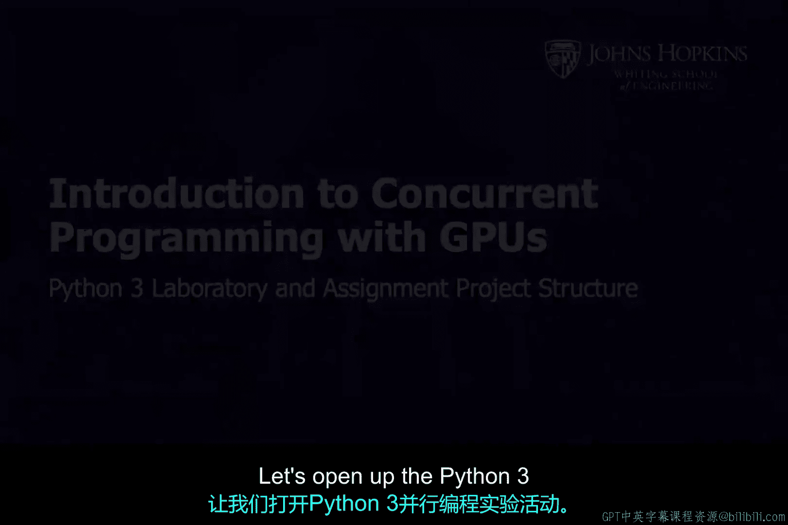
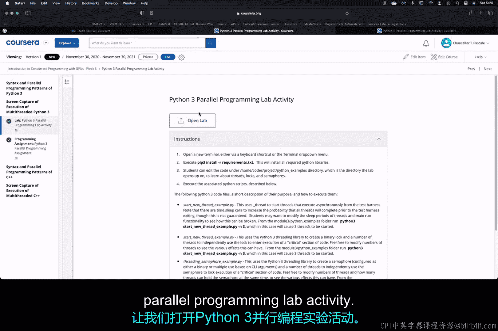
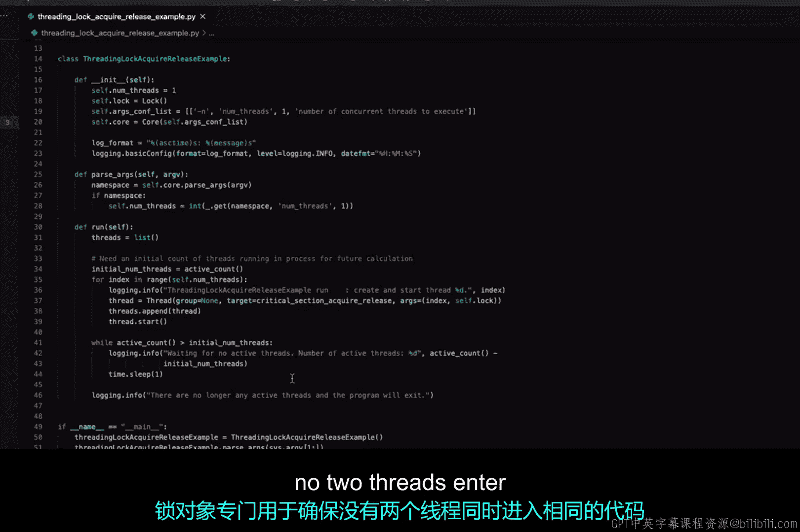
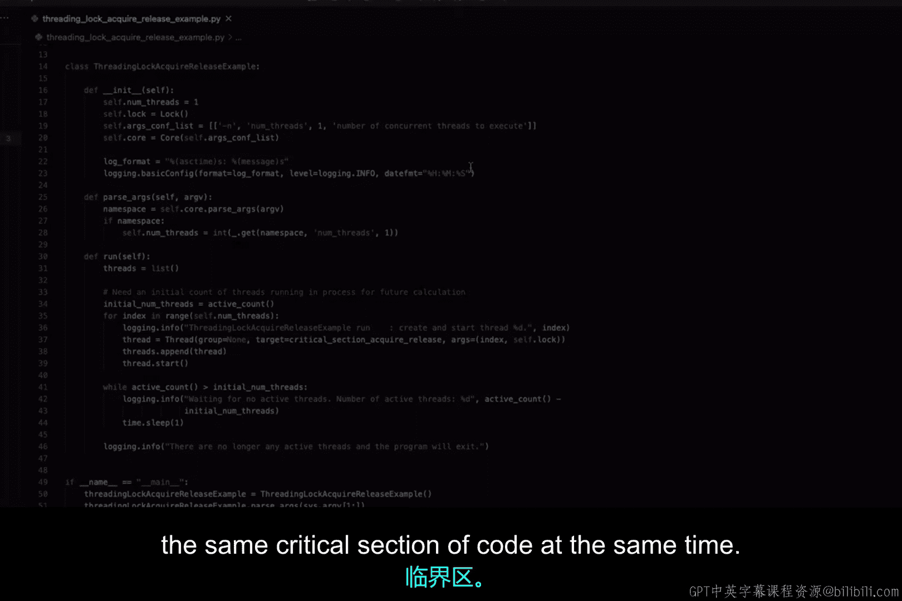
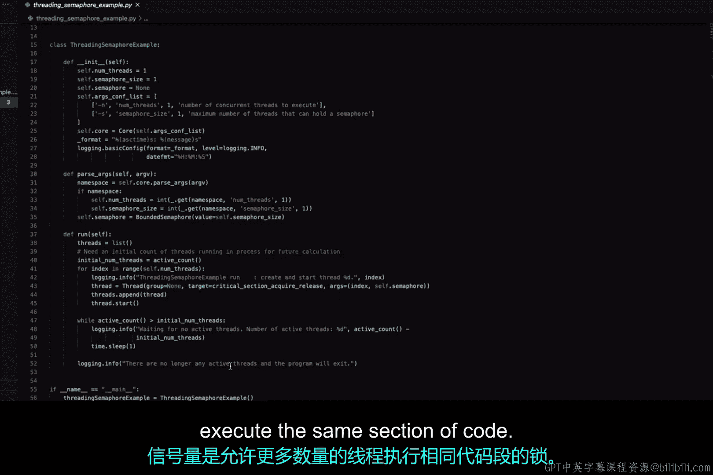

# 011：Python3实验项目结构 🐍

在本节课中，我们将通过视频讲座，探索Python 3并行编程实验和作业的项目结构。

## 项目概述

首先，我们打开Python 3并行编程实验活动。我们的重点是查看根目录下 `Python examples` 文件夹中的内容。

## 项目基本结构

Python III编程实验的基本结构包含一些必需但不重要的文件，例如 `.init.py` 和 `requirements.txt`。`requirements.txt` 文件用于安装项目所需的适当库。

核心功能分布在多个 `.py` 文件中，包括 `core.py`。根据你想要探索的实验活动或库，主要关注以下三个并行编程示例文件：
*   `start_new_thread_example.py`
*   `threading_lock_acquire_release_example.py`
*   `threading_semaphore_example.py`

`core.py` 文件的作用是存放一系列变量和函数，供其他三个示例Python文件共同使用。因此，所有这些示例都依赖于 `core.py`。

## 核心文件解析

现在我们已经打开了 `core.py`，接下来讨论它的两个主要部分。

在文件顶部，定义了两个静态的、公开可用的函数：
*   `thread_function`
*   `critical_section_acquire_release`

`thread_function` 定义了线程在此案例中应该执行的操作：输出开始和结束信息，并在中间休眠一秒钟。

`critical_section_acquire_release` 函数执行以下操作：接收一个同步对象，获取其锁，执行一些工作（即调用 `thread_function`），然后释放锁。需要注意的是，这个同步对象实际上可以是锁（Lock）或信号量（Semaphore），我们稍后会详细讨论。

此外，`core.py` 中还定义了一个核心类及其函数。它有一个构造函数 `__init__`，用于解析参数，这对处理命令行参数非常有用。它还包含 `parse_args` 和 `add_argparse_argument` 函数。`add_argparse_argument` 函数的作用是告诉命令行参数解析器添加一个参数，它接收四个值：命令行中使用的标志（如 `-h` 代表帮助）、该参数的目标变量、任何默认值以及描述性文本。

## 并行编程示例详解

上一节我们介绍了项目的核心文件，本节中我们来看看三个具体的并行编程示例。

以下是三个主要示例文件的简要说明：

1.  **基础线程示例**：位于 `start_new_thread_example.py` 文件中。其构造函数设置核心对象来解析 `-n` 参数，该参数用于获取将并行执行的线程数量。`run` 函数用于并发执行相同的代码（在本例中是 `core.py` 中的 `thread_function`）给每个线程。`parse_args` 方法设置该类的核心对象来处理传递的命令行参数，以获取线程数量变量。

2.  **锁的获取与释放示例**：位于 `threading_lock_acquire_release_example.py` 文件中。这段代码看起来应该与上一个文件相似，这是有意为之的设计。它旨在适应一种简单的模式，可以在不同示例之间保持函数组织连贯的同时进行更新或扩展。在 `run` 方法中启动的每个线程，所创建的线程对象都会并行执行，执行相同的临界区代码。锁对象专门用于确保没有两个线程同时进入同一个临界区代码。

3.  **信号量示例**：`threading_semaphore_example.py` 包含了信号量示例代码。此处展示的信号量示例，根据信号量的大小，执行用户定义数量的线程，并允许预定数量的线程进入临界区代码。每个线程都执行相同的 `critical_section_acquire_release` 函数，但使用不同类型的同步对象。信号量是一种锁，它允许更多数量的线程同时执行同一段代码。

## 总结

本节课中，我们一起学习了Python 3并行编程实验的项目结构。我们了解了核心文件 `core.py` 的作用，它提供了公共函数和参数解析功能。我们还详细分析了三个关键示例：基础线程创建、使用锁进行线程同步以及使用信号量控制并发访问。这些示例基于Python的基础编程库 `threading`，为探索线程、锁和信号量提供了清晰的实践路径。