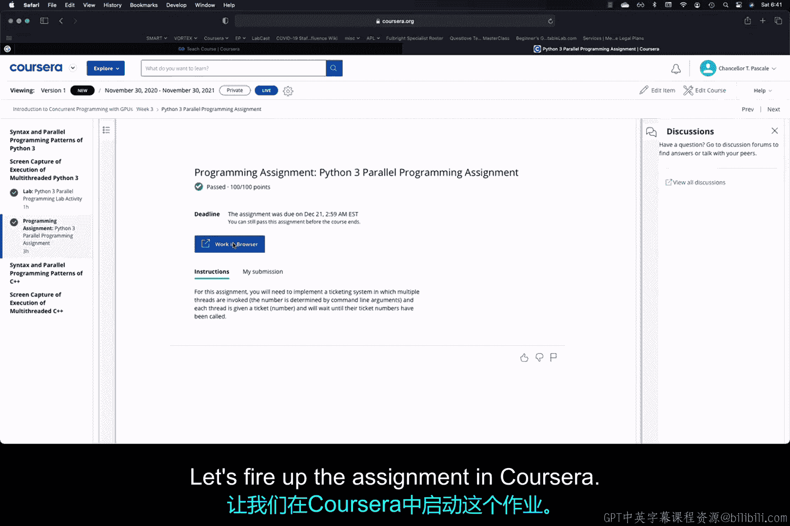
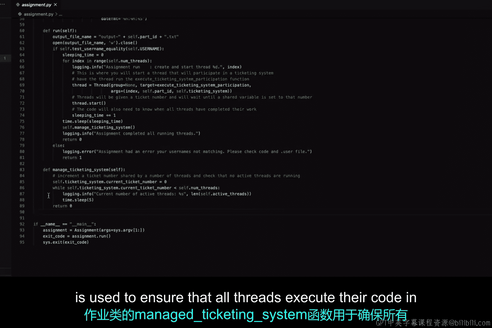
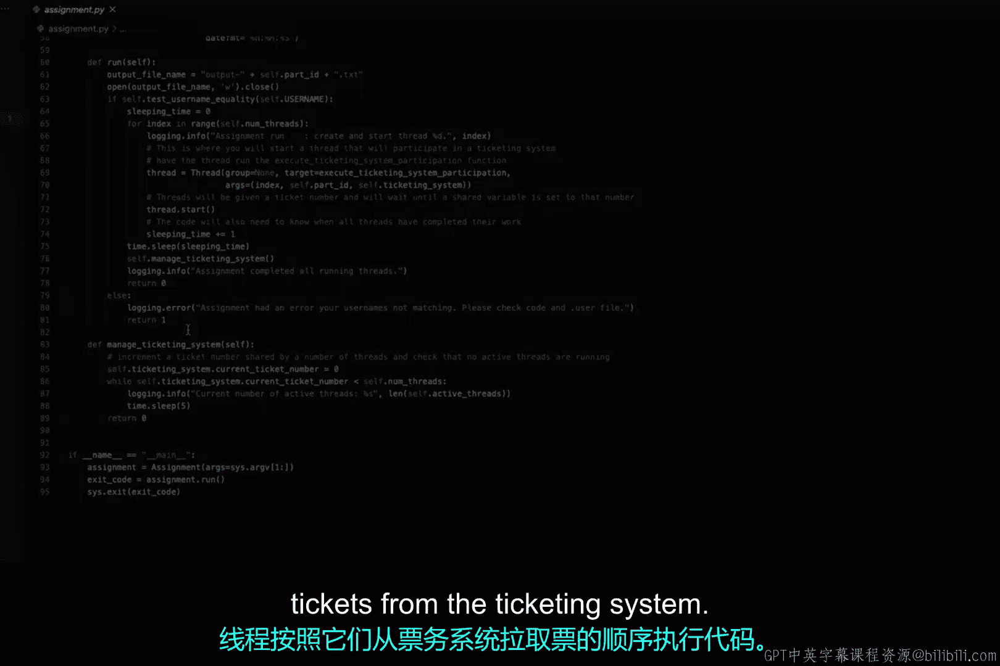
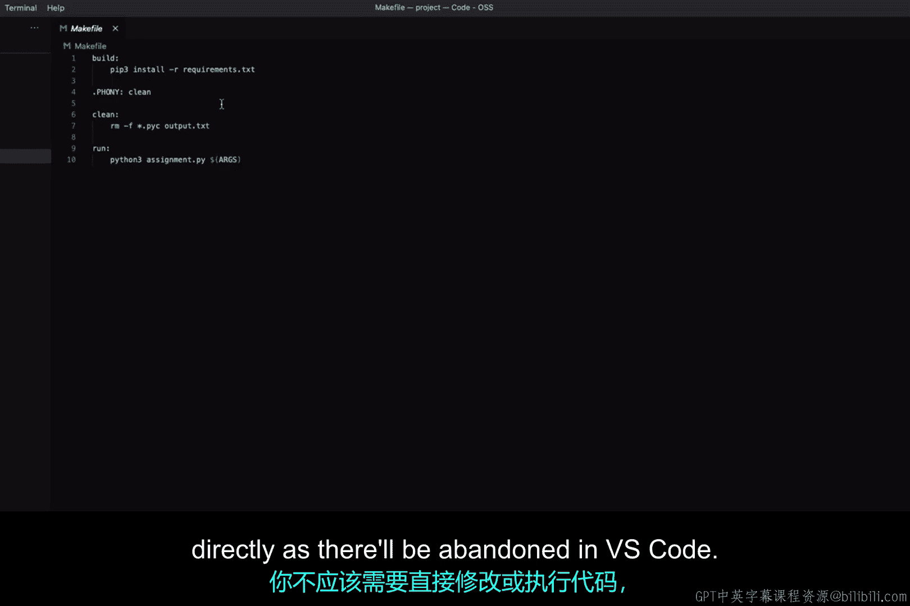

# 012：Python3作业项目结构详解 🏗️

在本节课中，我们将详细讲解课程作业的项目结构。理解这个结构对于正确完成后续的编程任务至关重要。



## 概述

我们将启动Coursera平台上的作业项目，并逐一解析其核心文件和功能。作业的结构与之前的实验项目有许多相似之处，但也有一些关键变化。

## 项目结构解析

现在，我们来启动Coursera上的作业项目。


与实验项目一样，许多文件的结构和名称保持不变。但你会注意到 `Qua.py` 文件发生了一些变化。

### 核心对象与变量

新的核心对象包含以下几个变量：
*   `number_of_threads`: 线程数量。
*   `user_name_file`: 用户名文件。
*   `CI_argument_past_username`: 传递给用户名的CI参数。
*   `Coursera_assignment_Part_I_D`: Coursera作业的Part I D。

`read_user_file` 和 `test_user_name_equality` 这两个函数用于验证提交的代码。

### 参数解析与文件结构

`parse_arguments` 函数现在位于 `quoda.py` 文件中，而不是之前的 `example.py` 文件。它增加了用于指定线程数、用户名和作业部分的参数。

以下是关于作业文件结构的重要说明：
*   作业 `IP_UI` 文件中预定义的类和函数结构**不应被修改**。
*   你需要在不涉及日志记录的代码部分，填充实现一个完整票务系统所需的功能性代码。

### 票务系统执行函数

`execute_ticketing_system_participation` 是一个在作业 `A_Py` 文件中任何代码都可以调用的函数。它的函数签名如下：

```python
execute_ticketing_system_participation(ticket_number, current_assignment_part_I_D, ticketing_system_object)
```

该函数将执行必要的步骤，让多个线程按顺序执行关键代码。票务系统需要管理对票的访问，确保任意数量的线程都能安全地取票，并且**线程执行代码的顺序必须与它们从票务系统中取票的顺序一致**。

这个函数与作业类（`assignment class`）中的 `managed_ticketing_system` 函数配合使用，共同保证所有线程按其取票顺序执行代码。






### Makefile 使用说明

这里展示的 `Makefile` 对于正确执行作业 `W_PY` 文件非常有用。

以下是使用步骤：
1.  运行 `make clean build` 来清除所有已编译的Python文件，并安装所需的Python包。
2.  最后一步是运行 `make run` 命令，并传递参数。命令格式为：
    ```bash
    make run ARGS="-N <线程数> -U <用户名> -P <作业部分ID>"
    ```
    你需要设置 `numb_threads`、`username` 等环境变量，或者直接在make命令示例中用具体值替换它们。

通常，你不需要直接修改或执行代码，因为VS Code中会有一个按钮来完成这些操作。




## 总结


本节课中，我们一起学习了第二次作业的项目结构。我们分析了核心文件（如 `Qua.py`）的变化，了解了用于验证和参数解析的新函数，重点讲解了实现并发票务系统的关键函数 `execute_ticketing_system_participation` 及其与作业类的协作方式，最后介绍了如何使用提供的 `Makefile` 来构建和运行项目。理解这个结构是成功完成后续并发编程任务的基础。