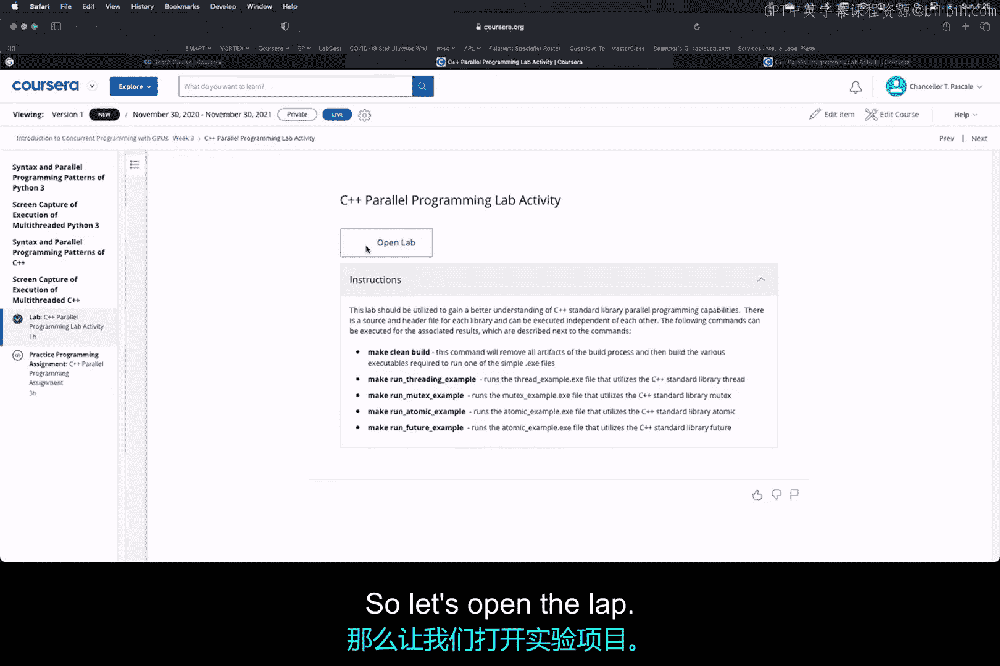
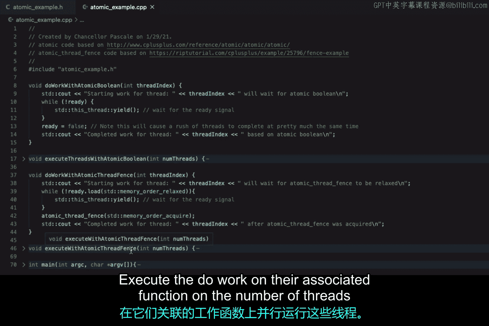

# 014：C语言实验项目结构 🧪

在本节课中，我们将学习约翰霍普金斯大学GPU编程课程中C语言实验项目的结构。我们将打开项目目录，逐一查看其中的关键文件，并理解每个示例代码的功能。

## 项目目录概览

首先，我们打开实验项目目录。

您在这里看到的目录名为 `Project`。

它位于 `coders` 用户的 `project` 文件夹下。您会注意到其中有四对C++源文件（`.cpp`）和头文件（`.h`）。

它们分别对应 `threads`、`mutexes`、`futures` 和 `atomics` 这四个主题。

头文件展示了诸如常量变量和函数签名等内容，而C++文件则包含了实际的代码实现。

另一个您将看到的重要文件是 `Makefile`，我们稍后会详细讲解它。

`Makefile` 描述了 `make` 命令的多种使用方式，用于改变文件、编译文件等操作。

## Makefile详解

现在，让我们打开 `Makefile`。

这个C++示例的 `Makefile` 管理着代码的编译、相关可执行文件的运行，以及清理构建过程中产生的中间文件（如目标文件和可执行文件）。

对于四个示例中的每一个，都有一个 `build` 目标和一个 `run` 目标。

此外，还有用于构建和运行所有示例的总体 `build-all` 和 `run-all` 目标。

`all` 目标会执行所有适用的目标，即清理所有内容、构建所有内容，然后运行所有内容。

## 线程示例分析

打开 `thread` 示例文件。

您会看到左侧标签页是头文件（`.h`）。它包含了三个非主函数的函数签名。

在右侧标签页，您可以看到 `thread_example.cpp` C++代码。其中实现了三个函数。

以下是这三个函数：

*   `do_work`：该函数包含线程要执行的工作，在本例中是记录正在运行的线程。
*   `execute_threads`：该函数并行执行一个预定数量（本例中为3）的线程，然后等待它们完成（`join`）。
*   `execute_and_detach_thread`：该函数以分离模式执行一个线程，意味着它不再与调用它的上下文绑定。

## 互斥锁示例分析

接下来，我们讲解 `Mutex` 示例。

左侧标签页是互斥锁示例代码的头文件。它包含了共享的 `mutex` 变量和四个非主函数。

现在让我们查看这个C++代码。

您将看到四个函数。以下是这些函数：

*   `do_work_with_mutex_lock`
*   `execute_threads_with_mutex_lock`
*   `do_work_with_mutex_trylock`
*   `execute_and_detach_threads_with_mutex_trylock`

两个 `do_work` 函数（`do_work_with_mutex_lock` 和 `do_work_with_mutex_trylock`）负责单个线程针对共享互斥锁的工作。

两个 `execute` 函数（`execute_threads_with_mutex_lock` 和 `execute_and_detach_threads_with_mutex_trylock`）则根据传入的线程数量变量来执行对应的 `do_work` 函数。

## Future示例分析

现在，让我们继续学习 `futures` 的示例代码。

左侧标签页 `future_example.h` 是该示例的头文件，它包含了四个非主函数。

其中实现了四个函数。以下是这些函数：

*   `do_work_with_futures`
*   `ex_threads_with_futures`
*   `do_work_with_async`
*   `ex_with_async`

两个 `do_work` 函数（在此处展开）负责单个线程针对 `futures` 和整数输入的工作。

两个 `execute` 函数根据预定的或传入的 `future` 数量来执行 `do_work` 函数，其中 `execute_the_do_work_with_async` 函数是异步执行的。

## 原子操作示例分析

最后，让我们学习 `atomics` 的示例代码。

`atomic_example.h` 头文件包含了四个非主函数。

`atomic_example.cpp` 包含了原子变量的示例代码。

其中实现了四个函数。以下是这些函数：

*   `do_work_with_atomic_bool`
*   `ex_threads_with_atomic_bool`
*   `do_work_with_atomic_thread_fence`
*   `ex_with_atomic_thread_fence`

两个 `do_work` 函数（在此处和此处展开）负责单个线程针对所使用的原子变量的工作，第一个处理原子布尔变量，第二个实现原子线程栅栏。

两个 `execute` 函数（`execute_threads_with_atomic_bool` 和 `execute_with_atomic_thread_fence`）根据传入的线程数量变量，并行执行其关联的 `do_work` 函数。

## 总结

本节课中，我们一起学习了C语言实验项目的整体结构。我们查看了项目目录，分析了 `Makefile` 的作用，并逐一探讨了 `threads`、`mutexes`、`futures` 和 `atomics` 四个核心并发编程概念的示例代码及其函数构成。这为我们后续动手实践这些并发编程技术打下了基础。