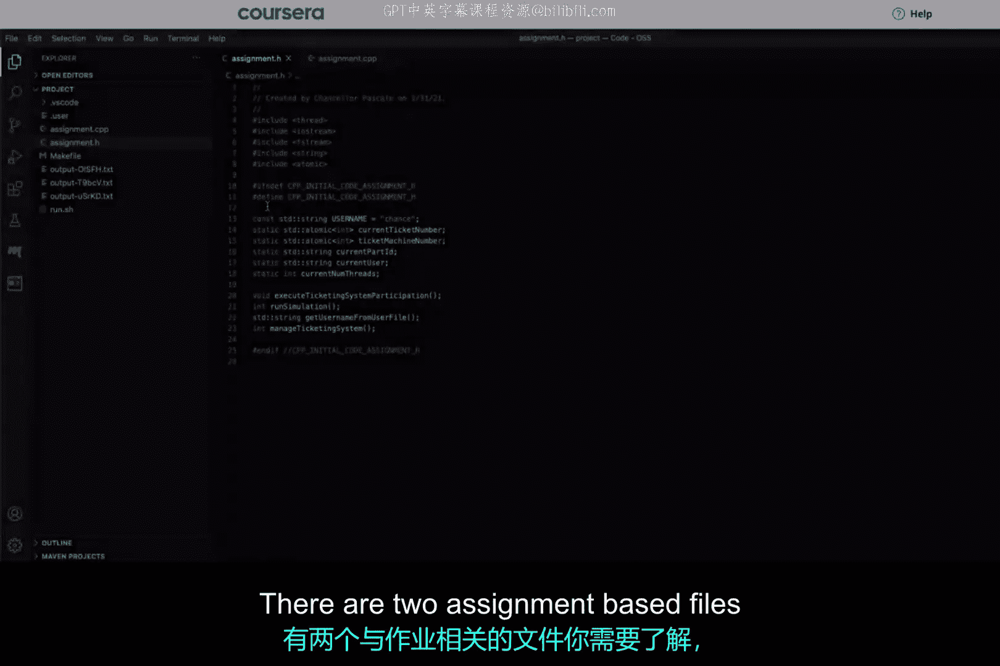
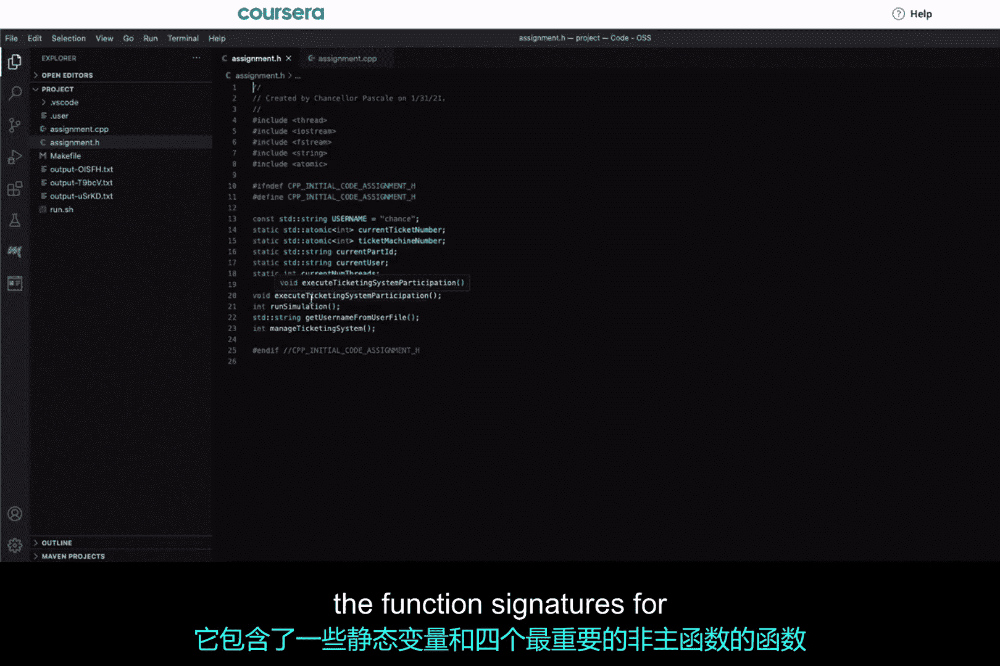
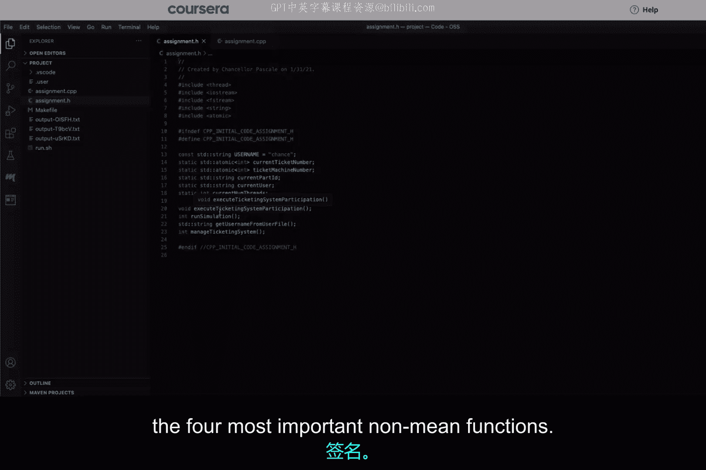
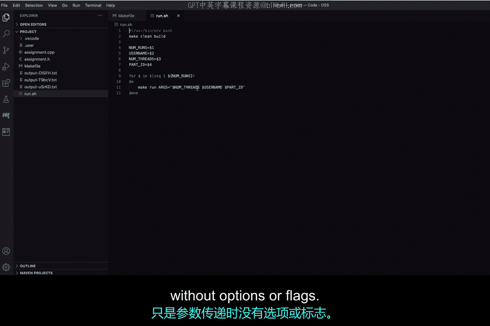

# 015：C++作业项目结构详解 🏗️

在本节课中，我们将详细讲解C++作业的项目结构。了解清晰的项目结构是高效完成编程作业的第一步。我们将逐一介绍核心文件及其作用，帮助你快速上手。

## 项目文件概览 📁

我们将首先在浏览器环境中进行工作。你需要了解两个与作业相关的基础文件。

## 核心头文件：`assignment.h`

第一个关键文件是作业的头文件 `assignment.h`。它包含了一系列静态变量，以及四个最重要的非主函数的函数签名。

以下是该头文件的核心内容：

*   **静态变量**：定义了作业模拟中使用的各种配置参数。
*   **函数签名**：声明了四个核心函数，包括 `execute_ticketing_system_participation`、`run_simulation`、`get_username_from_user_file` 和 `manage_ticketing_system`。

## 核心源文件：`assignment.cpp`

现在，我们来看右侧标签页中的 `assignment.cpp` 文件，这是作业的主要源代码文件。其中定义了四个我们感兴趣的非主函数。

以下是这四个函数及其简要说明：

*   **`execute_ticketing_system_participation`**：执行票务系统的参与逻辑。
*   **`run_simulation`**：运行一次作业模拟。
*   **`get_username_from_user_file`**：从用户文件中检索用户名。
*   **`manage_ticketing_system`**：管理票务系统。

## 模拟运行流程 🔄

上一节我们介绍了核心函数，本节中我们来看看 `run_simulation` 函数的具体执行流程。该函数基于头文件中先前定义的静态变量执行一次作业模拟。

在 `run` 函数内部，执行顺序如下：

1.  首先调用 `get_username_from_user_file` 函数，从用户文件中获取用户名。
2.  接着，根据线程数量，在分离的线程上执行 `execute_ticketing_system_participation` 调用。
3.  最后，`manage_ticketing_system` 函数负责管理这些独立线程与票务系统之间的交互。

> **注意**：`manage_ticketing_system` 函数的目标是确保票务系统正常工作，使得线程按照它们从票务系统中取出的票的顺序来执行其工作。

## 辅助支持文件 🛠️

除了核心代码文件，完成作业还需要两个支持文件。

以下是这两个支持文件的说明：

*   **`Makefile`**：包含典型的构建（build）、清理（clean）、运行（run）和默认（all）目标，用于自动化编译和运行流程。
*   **`run_out.sh`**：该文件与Python 3作业中的 `run_out.sh` 非常相似，区别在于传递参数时不需要选项或标志。

---

本节课中我们一起学习了C++作业项目的完整结构，包括核心头文件与源文件的作用、模拟运行的逻辑流程以及必要的辅助脚本。理解这个结构将帮助你更有效地定位代码和完成后续的编程任务。