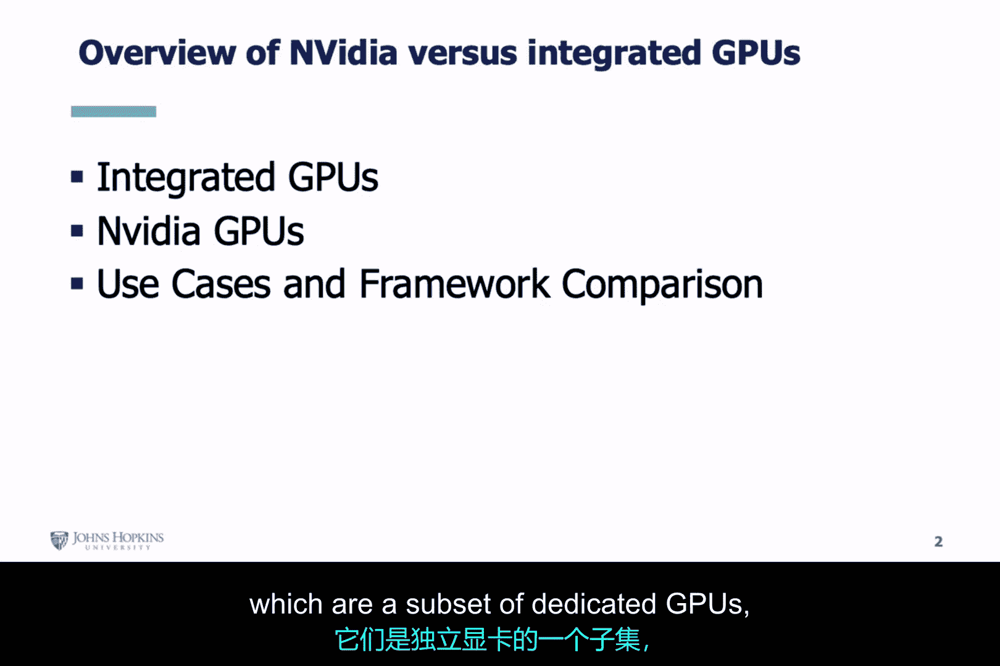
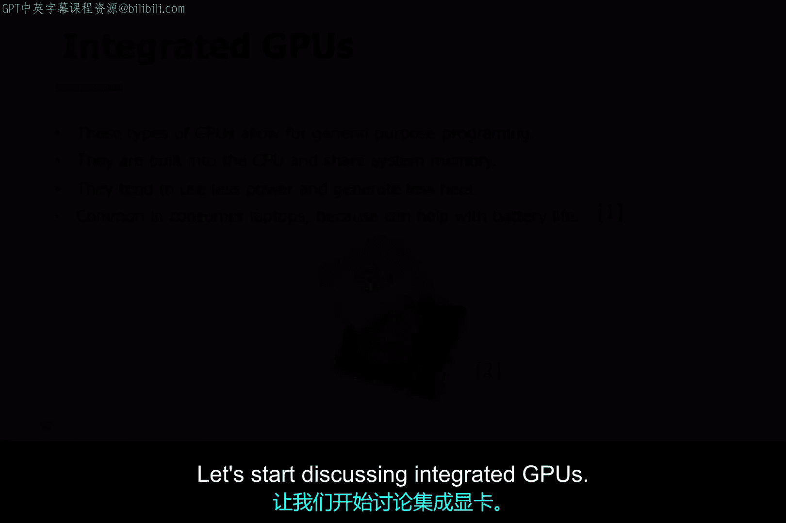
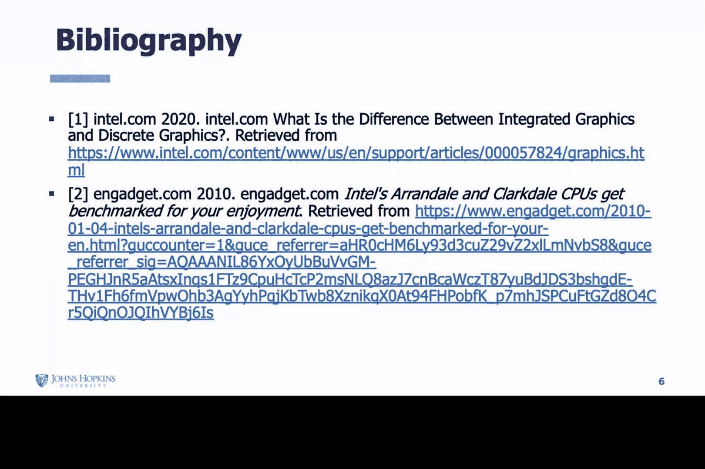

# 016：集成GPU与独立GPU对比

在本节课中，我们将学习集成GPU与独立（专用）GPU的核心概念、能力差异以及它们各自适用的编程框架。理解这些硬件区别是进行高效GPU编程的基础。

## 概述：两种GPU类型

首先，我们来明确两种主要的GPU类型：集成GPU和独立GPU。集成GPU通常与CPU集成在同一芯片上，而独立GPU则是一块独立的硬件。

上一节我们介绍了课程模块，本节中我们来看看这两种GPU的具体定义和特点。

### 集成GPU

集成GPU是大多数消费级笔记本电脑和台式机的基础配置硬件。它们不支持特定的厂商编程框架，例如CUDA，但可以与通用或异构编程框架（如OpenCL和OpenACC）一起使用。

以下是集成GPU的一些关键特征：

*   **制造**：通常由制造该机器CPU的同一家公司生产。
*   **集成含义**：GPU与CPU位于同一芯片上，这就是“集成”的含义。
*   **优点**：
    *   物理上靠近CPU，并共享系统内存。
    *   发热量更低，功耗更小，有助于延长电池寿命。
*   **缺点**：性能远不如独立GPU，因为它们必须与CPU共存。

### 独立GPU

NVIDIA制造了最常用的可编程GPU。AMD也生产功能强大的GPU，但其在GPU上直接编程的普及程度不及NVIDIA。AMD GPU更侧重于视频和游戏应用。

以下是关于独立GPU的更多信息：

*   **趋势**：NVIDIA GPU正朝着以更低功耗和更少发热实现更多处理能力的方向发展。
*   **常见设备**：高性能笔记本电脑可能包含NVIDIA显卡，但它们更常见于台式机和服务器。
*   **平台限制**：无法在Mac电脑上获得NVIDIA GPU，只能使用AMD GPU。这可能与苹果对OpenCL和CUDA缺乏支持兴趣有关，他们更专注于自家的GPU编程框架Metal。

## 应用场景与编程框架

了解了硬件区别后，我们来看看它们各自的应用场景以及如何通过不同的编程框架来利用它们。

### 常见应用场景

集成GPU的一个常见应用场景是编程或异构工作流程不太明确的情况。因为GPU可能使用也可能不使用，所以硬件成本和额外功耗较低。

独立GPU在以下用例中得到了更广泛的应用：

*   加密货币挖矿与验证
*   自然语言处理
*   计算机视觉

在自然语言处理和计算机视觉领域，程序员通常直接或间接地使用神经网络，因为它们能很好地映射到NVIDIA硬件上执行。这涉及到许多处理器同时进行少量工作。

### 编程框架对比

如果一个程序需要利用不同类型的硬件来执行不同的任务，选择合适的编程框架至关重要。

以下是三种主流异构编程框架的简要对比：

*   **OpenCL**：一种广泛使用的开源计算软件，其核心目标是支持尽可能多的硬件平台。OpenCL代码位于单独的文件中，或作为文本编译到C/C++代码中，然后发送到硬件上进行即时编译。
*   **OpenACC**：OpenCL的后续框架，全称Open Accelerator。它取消了需要单独代码的要求，而是让开发者使用宏来标记可以利用加速器（如GPU和FPGA）的代码段。
*   **CUDA**：应用最广泛的框架，为开发者提供了对NVIDIA硬件更深入的访问和控制能力。

## 总结

本节课中我们一起学习了集成GPU与独立GPU的核心区别。集成GPU功耗低、成本低，适合通用或轻量级异构计算；而独立GPU性能强大，是深度学习、科学计算等密集型任务的首选。同时，我们了解了OpenCL、OpenACC和CUDA这三大编程框架的定位，CUDA在NVIDIA生态中提供了最直接和强大的控制能力。理解这些内容是选择合适硬件和工具进行GPU编程的关键第一步。