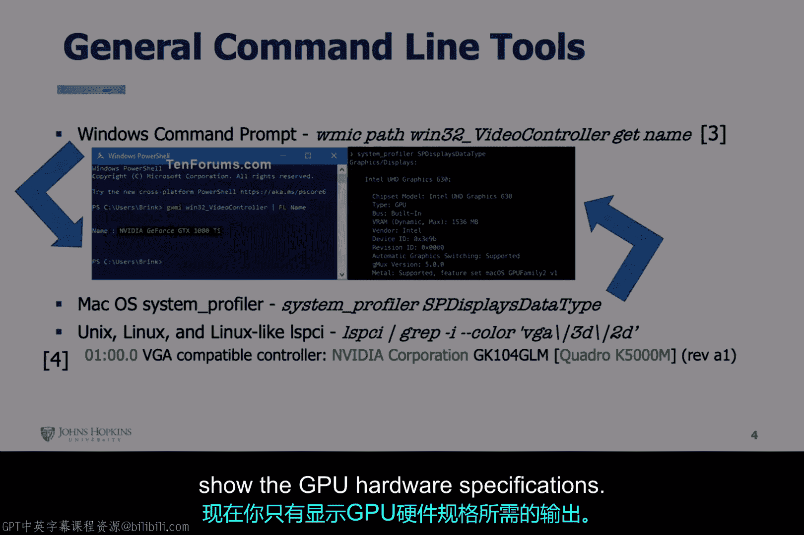
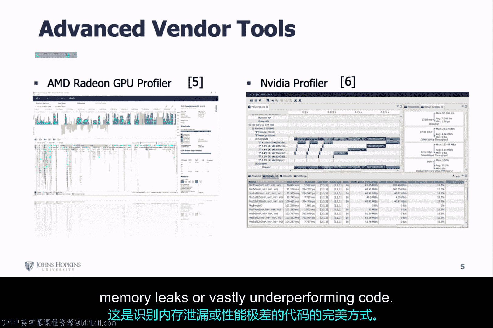

# 017：使用GUI与CLI工具识别GPU硬件 🖥️🔍

在本节课中，我们将学习如何使用图形界面（GUI）和命令行界面（CLI）工具来识别您当前计算机上的GPU硬件及其规格。掌握这些工具是进行GPU编程和性能优化的第一步。

我们将介绍三类工具：操作系统自带的硬件分析工具、普遍可用的命令行工具，以及由GPU制造商提供的、能获取更详细硬件信息的专用工具。

## 操作系统自带工具 🖱️

首先，我们来看看操作系统本身提供的图形化工具，它们通常能提供最直观的硬件概览。

以下是几种常见操作系统下的工具：

*   **Windows设备管理器**：其界面是一个大型的树状结构。您需要导航至“显示适配器”类别，其下会列出所有已安装的GPU硬件。
*   **Linux系统信息（`hardinfo`）**：该工具默认安装在Ubuntu和Mint等Linux发行版中。在应用程序左侧，您可以看到CPU、系统（指操作系统）、GPU等类别。
*   **macOS“关于本机”**：在兼容macOS的系统上，“关于本机”工具会在“显示器”标签页下显示GPU相关信息。

## 通用命令行工具 ⌨️

上一节我们介绍了图形界面工具，本节中我们来看看更强大、更灵活的命令行工具。它们允许您通过输入命令来快速获取信息。

以下是不同操作系统下的常用命令：

*   **Windows命令提示符/PowerShell**：使用 `wmic` 或 `Get-WmiObject` 命令可以显示大量硬件信息。配合 `wmic path win32_VideoController get` 标志，可以专门获取GPU信息。
*   **macOS系统概述**：系统提供了一个名为 `system_profiler` 的CLI工具。您可以传入 `SPDisplaysDataType` 数据类型来筛选出GPU和显示器的信息。
*   **Linux `lspci` 工具**：大多数Linux发行版都提供 `lspci` 工具来列出PCI设备信息。像大多数Linux命令一样，`lspci` 可以与其他命令组合使用。

`lspci` 命令常与 `grep` 命令结合，后者用于筛选出匹配特定模式的行。您可以在下面的代码中看到 `grep` 命令的用法。这里我添加了 `--color` 选项来使用颜色高亮，使输出更清晰。

```bash
lspci | grep --color -i vga
```

通过管道将 `lspci` 的输出传递给 `grep` 命令，现在您就只得到了显示GPU硬件规格所需的输出。


## 厂商专用分析工具 🏭



除了通用工具，GPU制造商还提供了功能更强大的专用分析器。这些工具对于深入了解硬件运行状态至关重要。

在独立GPU领域的两大主要厂商，AMD和NVIDIA，都拥有各自的性能分析工具。

这些工具对于确定哪些操作（例如内存拷贝、硬件流处理器等）在任意时刻被积极使用非常有帮助。它们非常适合用于分析正在运行的代码，并识别在任意时间点发生的情况，这可能是识别内存泄漏或性能低下代码的完美方式。




---


本节课中我们一起学习了识别GPU硬件的多种方法。我们从操作系统自带的GUI工具开始，了解了如何快速查看基本信息；然后探索了更强大的命令行工具，它们提供了更灵活的查询方式；最后，我们介绍了由AMD和NVIDIA提供的专业分析工具，这些工具能提供最深入的硬件运行时洞察，是进行GPU性能分析和调试的利器。掌握这些工具是高效进行GPU编程的基础。