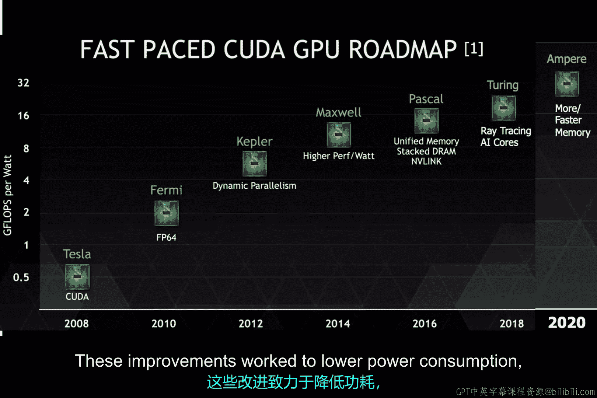
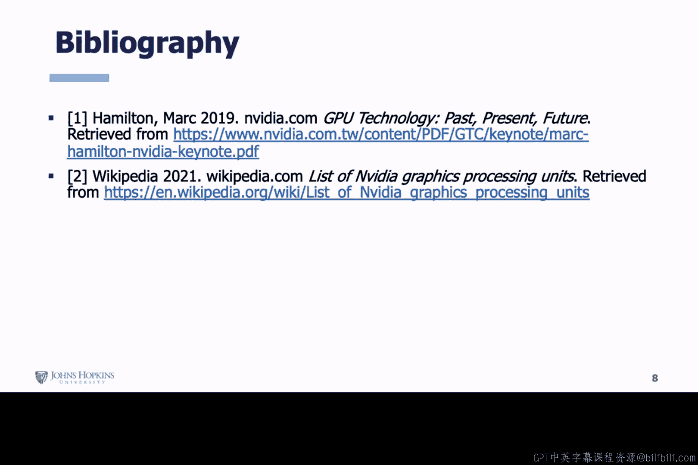

# 018：NVIDIA GPU架构解析 🚀

在本节课中，我们将首次深入了解NVIDIA特定的硬件和软件能力。我们将回顾自2008年Tesla架构以来，NVIDIA推出的七代主要GPU架构，分析每一代在性能、功耗和编程能力上的演进。

## 架构演进概述 📈

上一节我们介绍了课程目标，本节中我们来看看NVIDIA GPU架构的发展历程。截至2021年初，共有七代主要的GPU硬件支持基于CUDA的编程。每一代硬件都在提升性能与软件能力的同时，致力于降低功耗。

以下是七代NVIDIA GPU架构的列表，每一代都是NVIDIA在大约两年时间内生产的主要架构。

*   **Tesla** (2008)
*   **Fermi** (2010)
*   **Kepler** (2012)
*   **Maxwell** (2014)
*   **Pascal** (2016)
*   **Turing** (2018)
*   **Ampere** (2020)

在接下来的几页中，我们将每页介绍两代架构，覆盖大约四到五年的硬件发展。

## 早期架构：Tesla与Fermi (2007-2012) ⚙️

Tesla和Fermi架构的生产周期从2007年持续到2012年。

Tesla是首个支持协同编程（CUDA）的架构。它核心数量较少，且功耗较高。

对于Fermi架构，其最受欢迎的显卡型号（如GTX 480）的核心数量较Tesla**翻了两番**，内存容量**翻倍**，内存速度提升了**33%**，而功耗和发热量仅有小幅增加。

## 能效提升：Kepler与Maxwell (2012-2016) 💡

Kepler和Maxwell架构的生产周期从2012年持续到2016年。

Kepler架构的主要目标是增强GPU的可编程性，其核心数量和内存容量再次实现翻倍。内存速度有所降低，整体功耗也得到控制。

Maxwell架构的显卡则再次近乎**翻倍**了核心数量，同时提升了内存带宽并进一步降低了功耗。

在这两代架构中，你不仅能看到功耗的轻微下降，更重要的是，由于可用核心数大幅增加，**每瓦性能**实际上随着每一代更新而翻倍。

## 近期架构：Pascal与Turing (2016-2020) 🔄

在最新一代架构之前的两代硬件——Pascal和Turing，生产于2016年至2020年。

Pascal架构致力于使内存模型更加统一，从而减少对内存配置的顾虑。它还引入了**NVLink**技术，使得主机与设备之间的内存传输更快、更便捷。

核心数量有小幅增长（每代约增加50%），功耗改善在这些架构中放缓。显卡内存容量更高，速度几乎是Maxwell架构的**两倍**。

## 当前架构：Ampere (2020-) ⚡

Ampere是当前最新的硬件架构。它继承了Turing架构的张量核心和光线追踪核心，并创建了更多专用核心。

核心数量再次近乎**翻倍**，同时功耗**减半**，这意味着**每瓦性能提升了四倍**。内存带宽基本保持稳定，或根据具体安装的显卡型号略有降低。

---

本节课中我们一起学习了NVIDIA GPU从Tesla到Ampere共七代架构的演进历程。我们看到了核心数量、内存性能和能效比（每瓦性能）的显著提升，以及NVLink等关键技术的引入。理解这些硬件特性是进行高效GPU编程的基础。