# 019：CUDA Linux安装指南 🖥️

在本节课中，我们将学习如何在Linux系统上安装CUDA工具包。我们将使用Ubuntu发行版作为示例，并详细介绍从下载到验证安装的完整步骤。

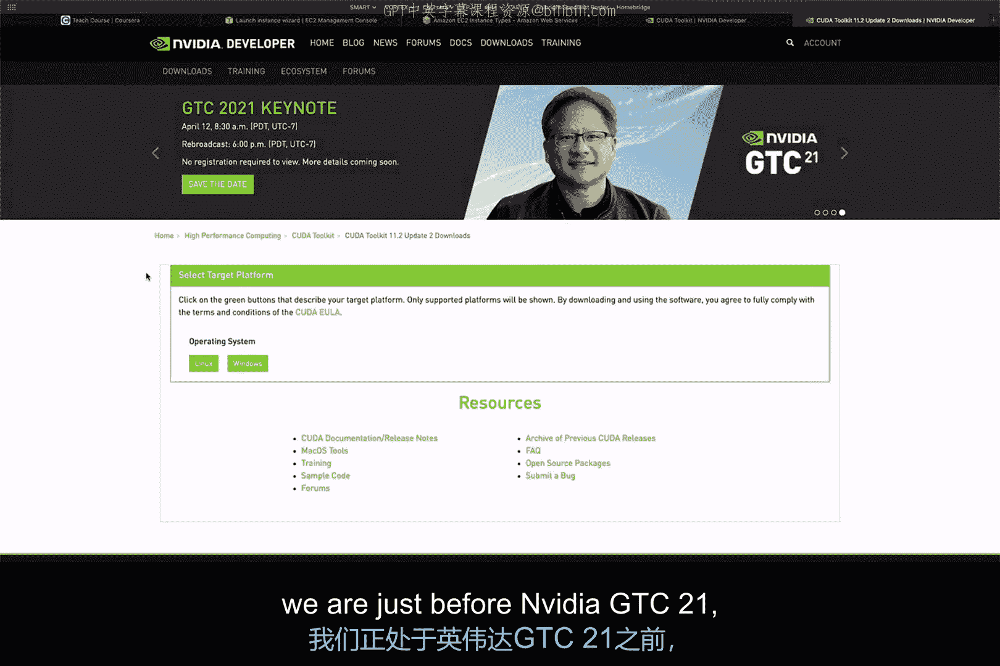

## 概述

本节教程将指导你完成在Linux（特别是Ubuntu）系统上安装CUDA工具包的过程。我们将从访问NVIDIA开发者网站开始，选择合适的安装选项，然后通过一系列命令行步骤完成安装，最后通过编译和运行一个简单的CUDA程序来验证安装是否成功。

## 选择安装平台与版本

首先，我们需要访问NVIDIA的CUDA下载页面。在撰写本教程时，我们正处于NVIDIA GTC 2021大会前夕。在目标平台选项中，我们选择 **Linux**。


接下来，选择架构。对于大多数AWS EC2实例，我们选择 **x86_64** 架构。

然后，需要选择Linux发行版。本教程选择 **Ubuntu**，因为它非常常见且支持良好。我们选择一个长期支持版本，在录制时是 **20.04**。

## 选择安装包类型

最后一步是选择安装包类型。我们选择 **Debian包管理器** 版本，这种类型会通过网络拉取所有必要的文件。

点击选择后，页面会显示基本的安装命令。

## 执行安装命令

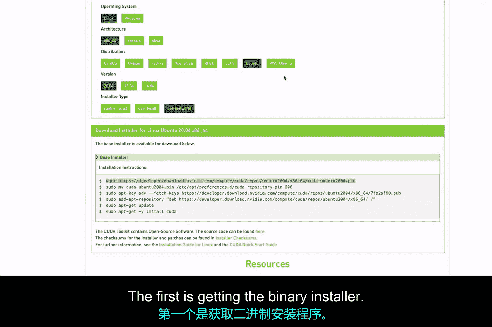

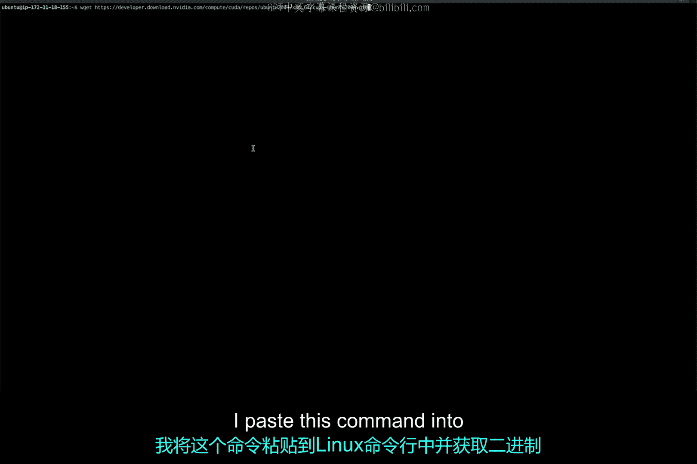

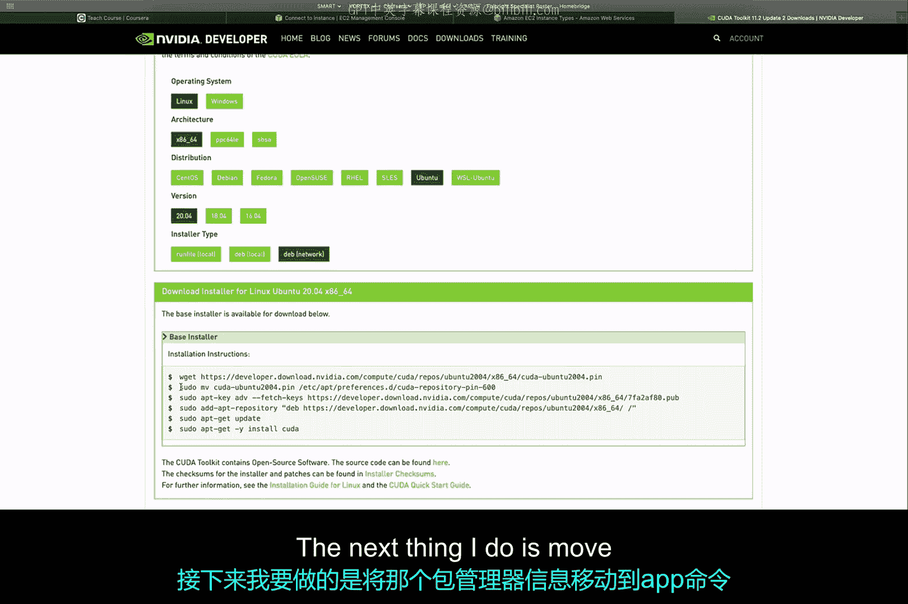

以下是需要在基于Debian包管理器的系统上执行的六个命令。

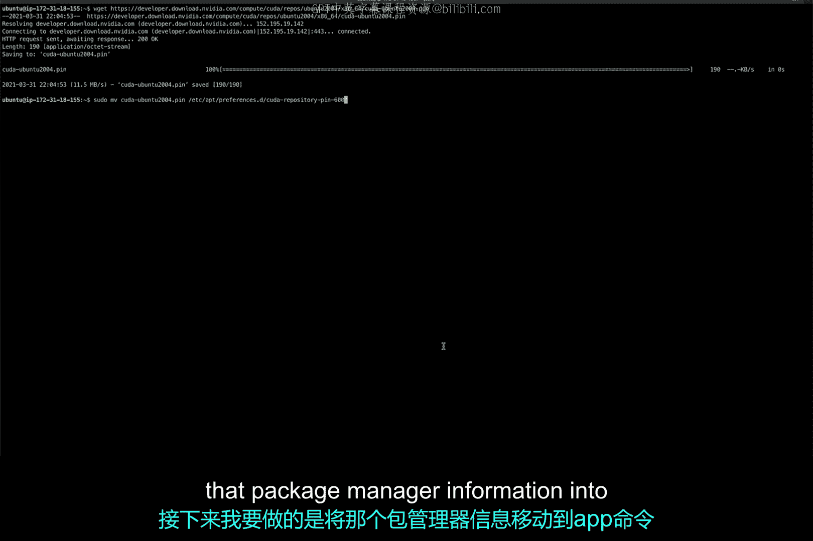

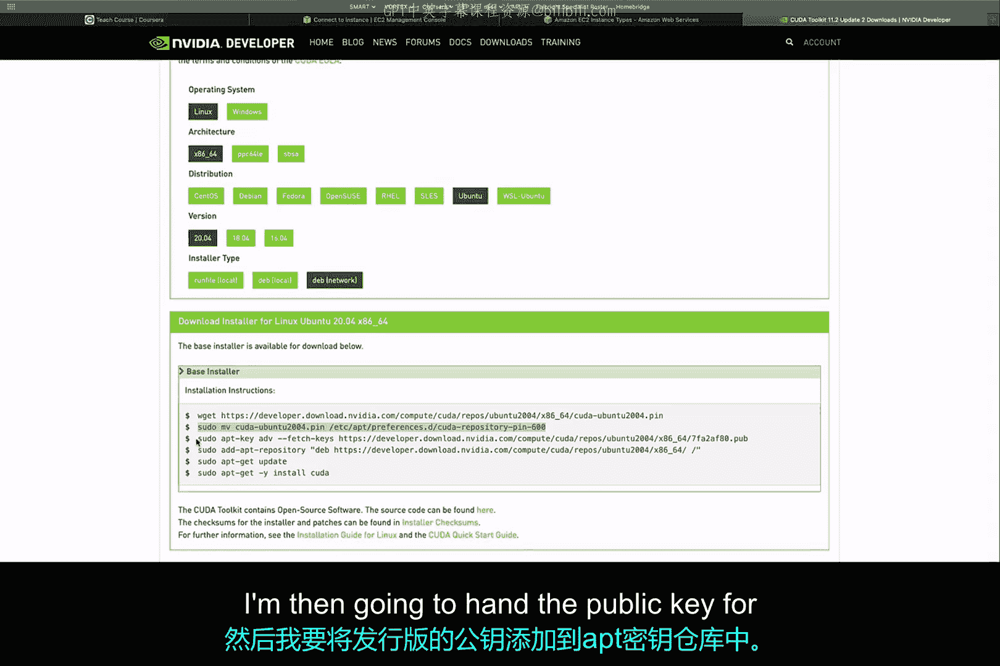

**1. 下载安装程序**
首先，使用 `wget` 命令获取二进制安装程序。
```bash
wget https://developer.download.nvidia.com/compute/cuda/repos/ubuntu2004/x86_64/cuda-ubuntu2004.pin
```

**2. 移动包管理器信息**
接下来，将包管理器信息文件移动到APT命令的首选项目录。
```bash
sudo mv cuda-ubuntu2004.pin /etc/apt/preferences.d/cuda-repository-pin-600
```

**3. 添加公钥**
然后，添加该发行版的公钥。
```bash
sudo apt-key adv --fetch-keys https://developer.download.nvidia.com/compute/cuda/repos/ubuntu2004/x86_64/7fa2af80.pub
```

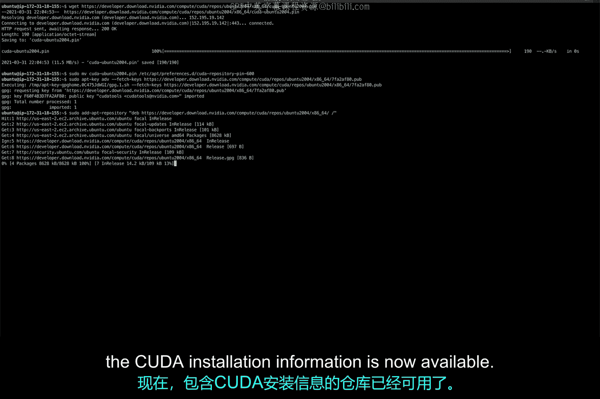

**4. 添加软件仓库**
接着，将与公钥关联的软件仓库添加到APT命令中。
```bash
sudo add-apt-repository "deb https://developer.download.nvidia.com/compute/cuda/repos/ubuntu2004/x86_64/ /"
```
现在，包含CUDA安装信息的软件仓库已可用。

**5. 更新软件仓库列表**
更新APT仓库，以获取新添加仓库的最新信息。
```bash
sudo apt-get update
```

**6. 安装CUDA工具包**
最后一步，告诉APT命令安装CUDA库。此命令也会安装许多依赖包。
```bash
sudo apt-get -y install cuda
```
在此命令执行完毕后，你将能够执行所需的命令，如 `nvcc`，并且将拥有必要的C库。

有时CUDA工具包可能不包含 `nvcc` 编译器。为了确保安装，可以运行以下命令：
```bash
sudo apt-get install nvidia-cuda-toolkit
```
这个命令总会安装 `nvcc` 命令。

## 验证安装

现在，让我们使用Linux中的 `vim` 编辑器查看测试CUDA文件 `test.cu` 的内容。

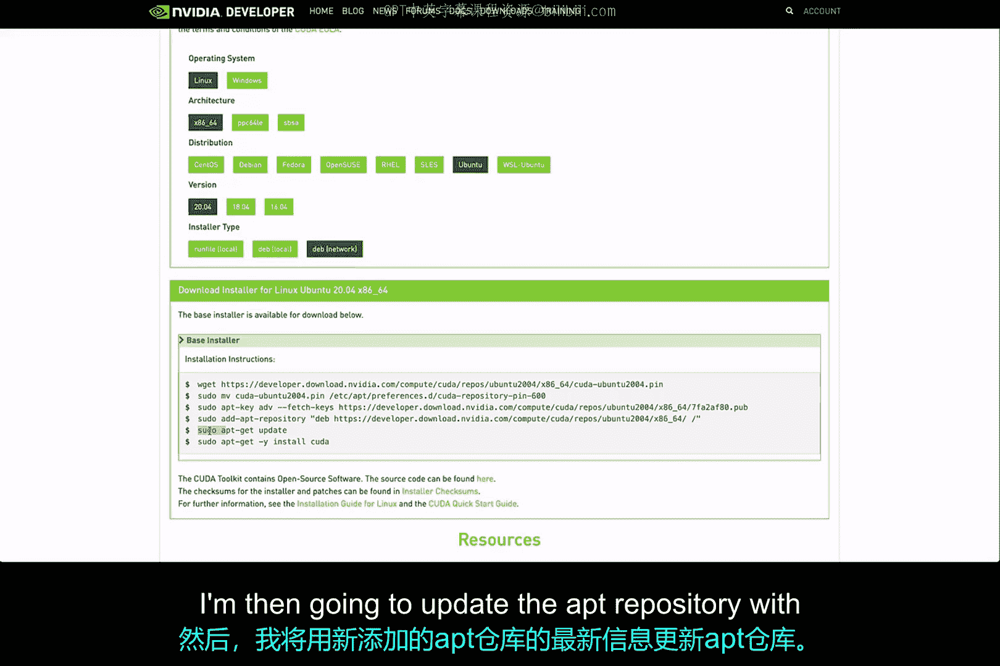

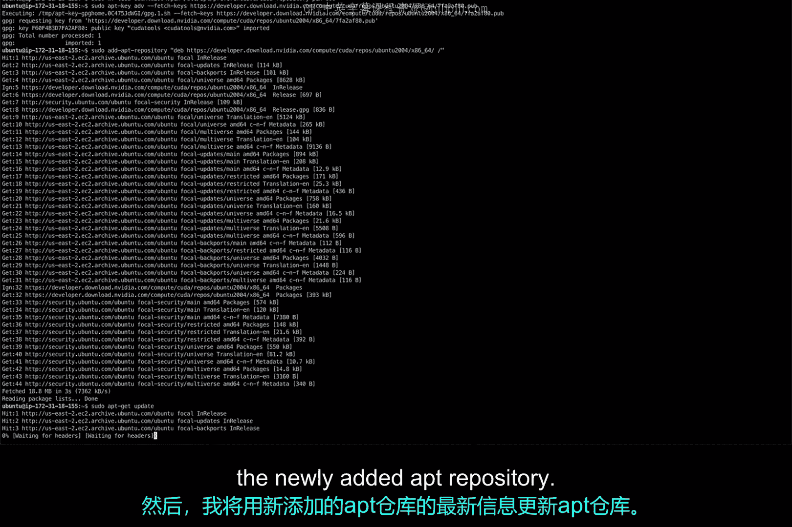

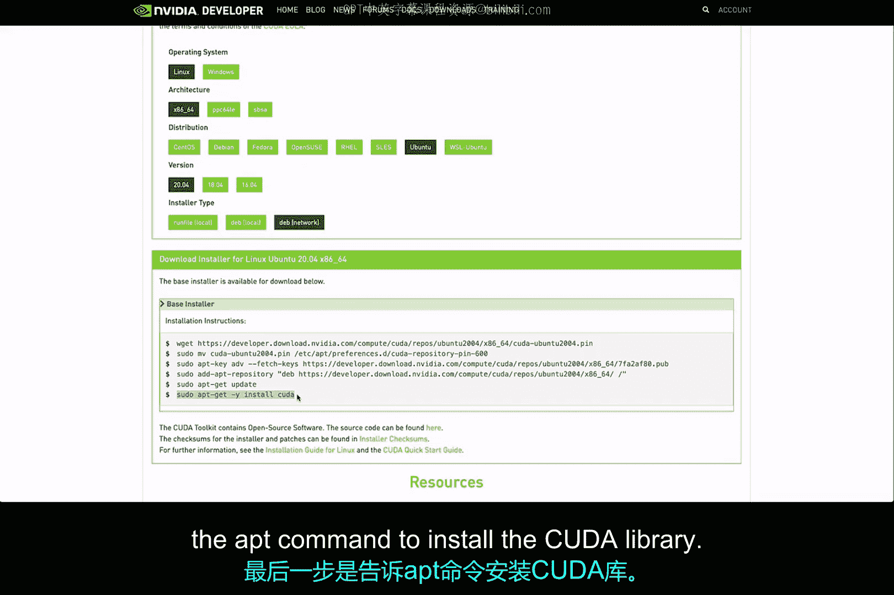

该文件顶部有一个使用 `__global__` 修饰符定义的全局内核函数，其方法名为 `saxpy`，这是一个简单的数学运算。

文件中还有一个 `main` 函数，它执行了内存分配、双向数据拷贝以及运算操作。最后，它会打印出计算中观察到的最大误差。

接下来，我们使用 `nvcc` 命令编译 `test.cu` 文件，并输出可执行文件 `test.exe`。
```bash
nvcc -o test.exe test.cu
```

然后，使用 `./` 命令在Linux中运行 `test.exe`。
```bash
./test.exe
```

你将看到输出的最大误差，在这个例子中是 **0**，这表明安装成功且程序运行正确。

## 总结

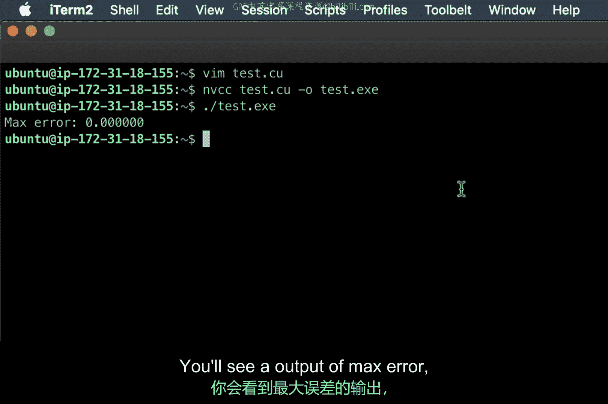

在本节课中，我们一起学习了在Ubuntu Linux系统上安装CUDA工具包的完整流程。我们从选择正确的平台和版本开始，逐步执行了六个关键的APT命令来完成安装，最后通过编译和运行一个示例CUDA程序验证了安装结果。现在，你的Linux环境已经准备好进行CUDA编程了。