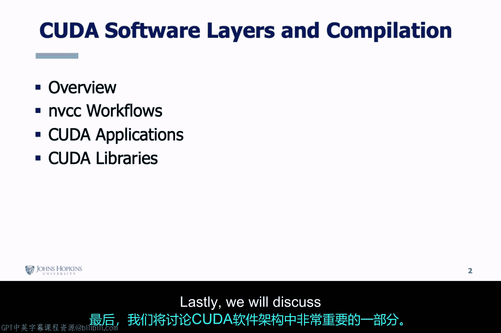
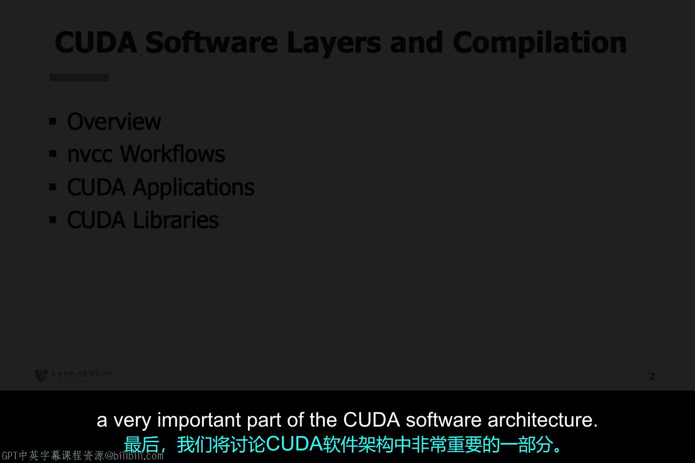
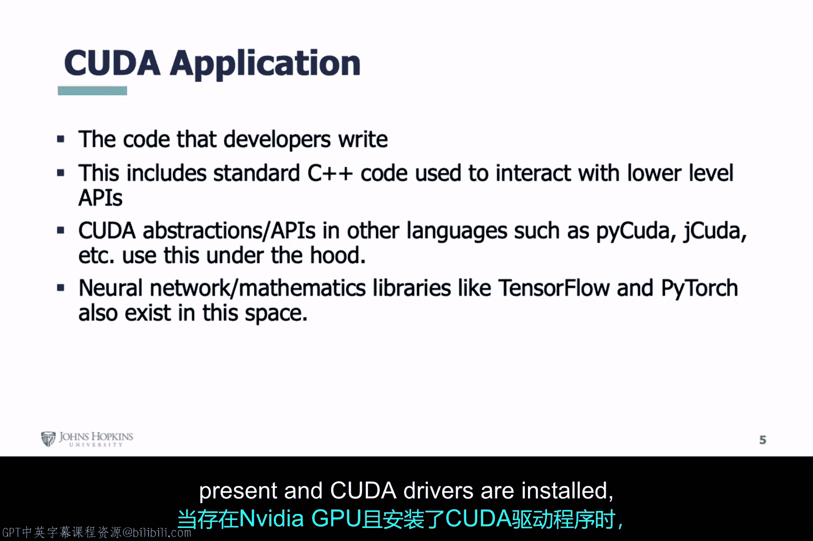
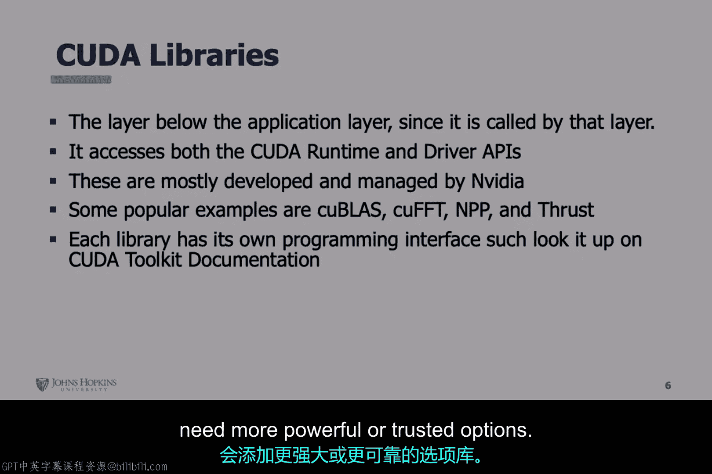

# 020：CUDA软件层级架构 🏗️

在本节课中，我们将深入学习CUDA开发者工具包，理解其软件层级架构。这对于决定如何使用CUDA至关重要。我们将从各软件层之间的通用通信开始，接着探讨通过NVCC命令编译CUDA代码的两种主要工作流，然后介绍顶层的应用层，最后讨论CUDA软件架构中一个非常重要的部分。

## 软件层交互概述

我们将使用CUDA软件层级图来展示开发过程中不同部分是如何交互的。

在本次讨论中，您开发的CUDA应用程序将与运行时API或驱动API进行通信。您选择让代码更直接地与底层硬件通信，还是通过更高级的接口，这个决定非常重要。它将定义您的代码形态、编译方式以及生成的中间文件。

## CUDA代码编译工作流

上一节我们介绍了软件层的交互，本节中我们来看看编译CUDA代码的两种主要工作流。

以下是两种主要的工作流程：

1.  **运行时API工作流**：如果您选择通过运行时API使用更高级的访问模式，那么您可以将GPU代码嵌入到主机代码中。为此，您需要通过NVCC命令编译这两种类型的代码。一旦主机代码链接到GPU的PTX或CUBIN文件，它们就可以协同工作。您仍然需要使用面向主机的编译器，如GCC或G++，来生成最终的可执行文件。幸运的是，这个工作流可以通过NVCC命令简化，让它默认输出基于主机的可执行文件。这是大多数用户最常用的方式，也是本课程中将使用的方式。

2.  **驱动API工作流**：如果您目标是驱动API，则需要分别编译GPU和CPU代码，然后让主机可执行文件通过驱动API与GPU代码交互。这种方式较少使用，因为该过程更依赖于特定的硬件和编译器组合，而运行时工作流可以生成更通用的可执行文件。

## 应用层

了解了编译流程后，现在让我们聚焦于最顶层的软件层——应用层。您很快就要开始开发CUDA应用程序，所以让我们看看在开始编写代码时需要考虑什么。

您的应用程序将一部分基于主机，一部分面向GPU。这两部分代码可以共存于同一个文件，也可以是分开的。不过，任何包含CUDA代码的文件都应使用 `.cu` 或 `.cuh` 作为代码和头文件的扩展名。

您当然也可以通过特定语言的抽象层或API（如PyCUDA或JCUDA）用其他语言编写代码。它们内部会使用CUDA，但您可以按照该语言的开发模式编写常规代码。

两个非常流行的用于创建神经网络和其他数学结构的库是TensorFlow和PyTorch。当系统中存在NVIDIA GPU并安装了CUDA驱动时，这些框架也会使用CUDA。

## CUDA库

上一节我们讨论了应用层的代码编写，本节中我们来看看如何利用现成的强大工具——CUDA库。

使用CUDA能力的另一种常见方式是使用NVIDIA CUDA开发者工具包中的库。

其中一些库旨在消除编写复杂CUDA代码的需要，或者让复杂的数据结构和算法能在您的CUDA代码中使用。它们几乎都由NVIDIA维护。随着新的用例或领域需要更强大或更可靠的选项，新的库会被不断添加。

## 总结

本节课中我们一起学习了CUDA的软件层级架构。我们了解了应用程序通过运行时API或驱动API与底层硬件通信，探讨了分别对应这两种API的NVCC编译工作流，认识了应用层代码的组织形式（`.cu`/`.cuh`文件），并介绍了可以简化开发的各类CUDA库。理解这个架构是有效使用CUDA进行GPU编程的基础。