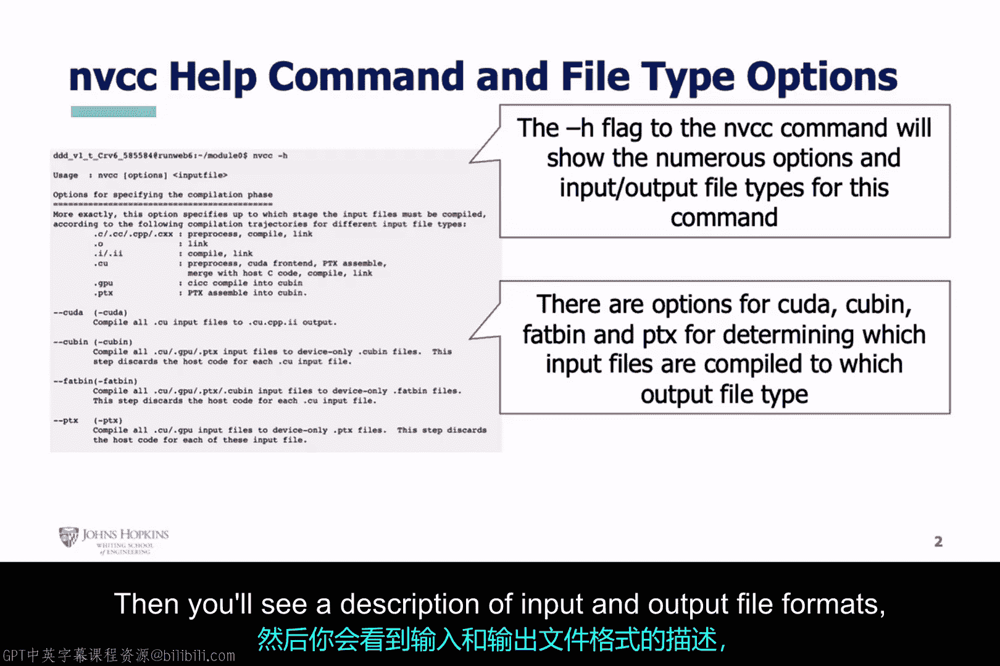
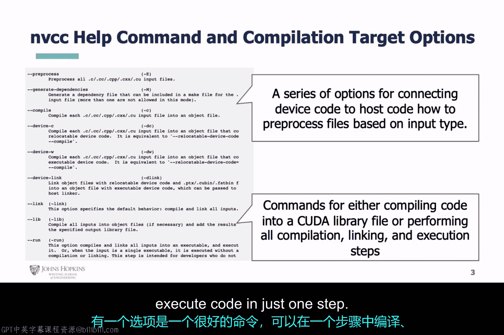
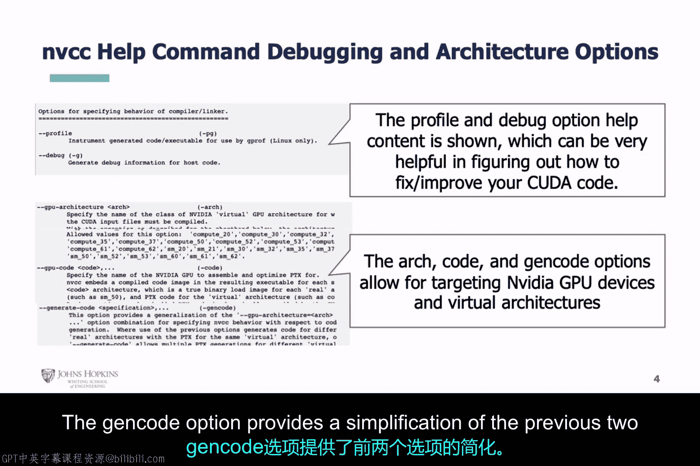
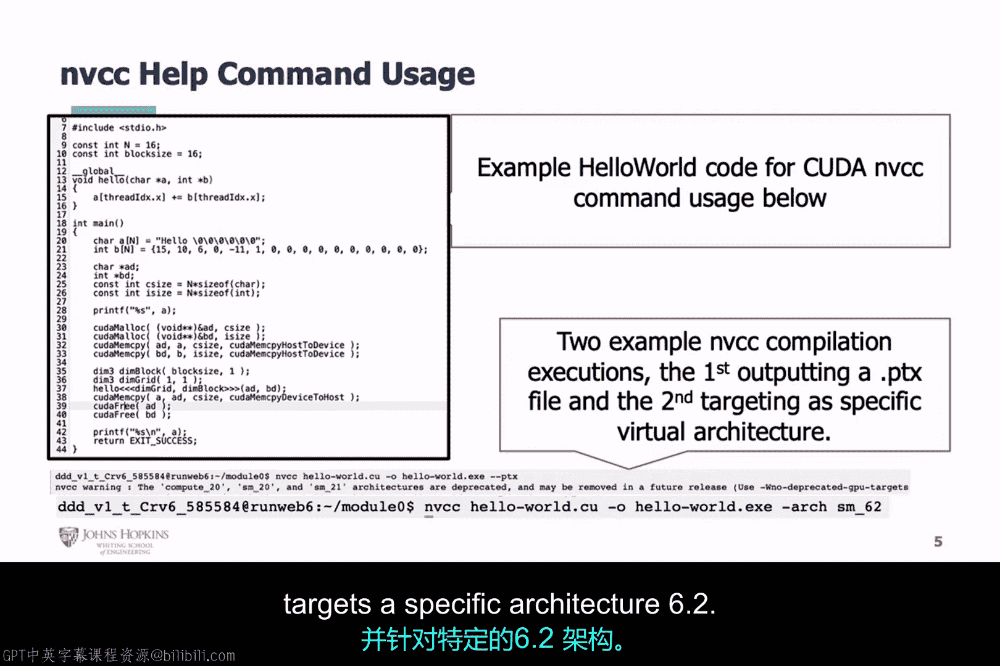

# 021：CUDA代码编译原理 🚀

在本节课中，我们将学习如何使用NVCC编译器来编译CUDA代码。我们将深入探讨NVCC命令的各种选项，理解如何将设备代码和主机代码链接成一个可执行文件，以及如何针对特定的硬件架构进行编译。

## 编译过程概述

上一节我们介绍了CUDA编程的基本概念，本节中我们来看看CUDA代码的编译原理。理解NVCC编译器的编译过程对于高效地开发和调试CUDA程序至关重要。

## NVCC命令选项

要理解NVCC编译器，我们需要研究该命令的各种可用选项。了解这些选项可以帮助我们更好地控制编译过程。

### 查看帮助内容



了解此命令各部分的最简单方法之一是使用 `-H` 选项，该选项表示您希望查看其帮助内容。

以下是使用 `-H` 选项查看帮助的示例：

```bash
nvcc -H
```

### 输入与输出文件格式

您首先会看到命令的使用模式。接着，您会看到对输入和输出文件格式的描述，以及用于处理它们的命令选项。


## 链接设备与主机代码



接下来需要研究的重要领域是如何将设备代码和主机代码链接成一个可执行文件。请务必注意链接和编译后的代码是否会创建可重定位的可执行文件。

### 编译为库文件

`-lib` 命令选项允许您将所有输出文件编译到一个库文件中，这对于大型或共享项目非常有用。

### 一步编译、链接与执行

`-run` 选项是一个很好的命令，可以一步完成编译、链接和执行代码。


## 调试、性能分析与目标架构

最后两类选项是用于调试、性能分析和输出架构的选项。默认情况下，输出的代码不允许对GPU代码进行性能分析或调试主机代码。`-profile` 和 `-debug` 选项允许在可执行文件中包含此类附加内容。

### 指定目标架构

如果您希望针对特定的硬件和软件架构，将需要使用 `-arch` 和 `-code` 选项。真实架构决定了代码的生成方式以及如何为特定的硬件架构进行编译，而虚拟架构则与不同计算版本相关的功能有关。

*   **`-arch` 选项**：允许您确定代码将支持哪些GPU硬件架构。
*   **`-code` 选项**：可用于确定嵌入式PTX代码将如何编译，以供特定的真实和虚拟架构使用。
*   **`-gencode` 选项**：提供了对前两个选项的简化。




## 编译示例

现在，让我们将所有这些内容整合起来。在左侧，您将看到一些示例的“Hello World”代码，这些代码旨在与CUDA一起使用，并通过NVCC命令进行编译。

以下是两个NVCC编译执行的示例：

1.  第一个命令旨在生成PTX文件。您还会注意到它没有指定任何架构，因此会看到关于为已弃用架构编译的警告。
2.  第二个命令专门输出 `.exe` 文件，并以特定的架构6.2为目标。



## 总结


本节课中我们一起学习了CUDA代码的编译原理。我们探讨了NVCC编译器的各种命令选项，包括如何查看帮助、处理输入输出文件、链接设备与主机代码、编译为库文件、以及进行调试和性能分析。我们还学习了如何通过 `-arch`、`-code` 和 `-gencode` 选项来指定目标硬件架构。最后，通过两个编译示例，我们看到了这些选项在实际应用中的效果。掌握这些编译知识将帮助您更有效地构建和优化CUDA应用程序。