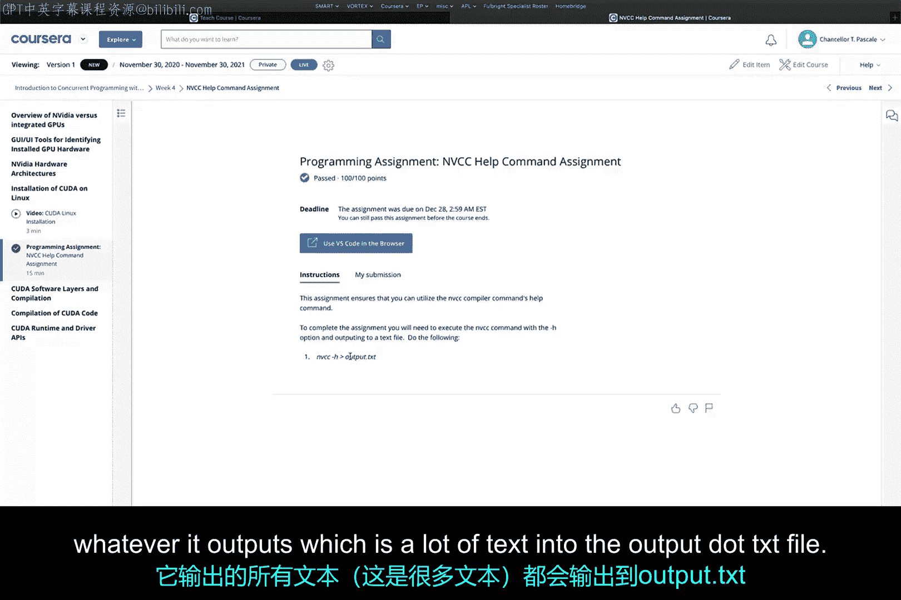
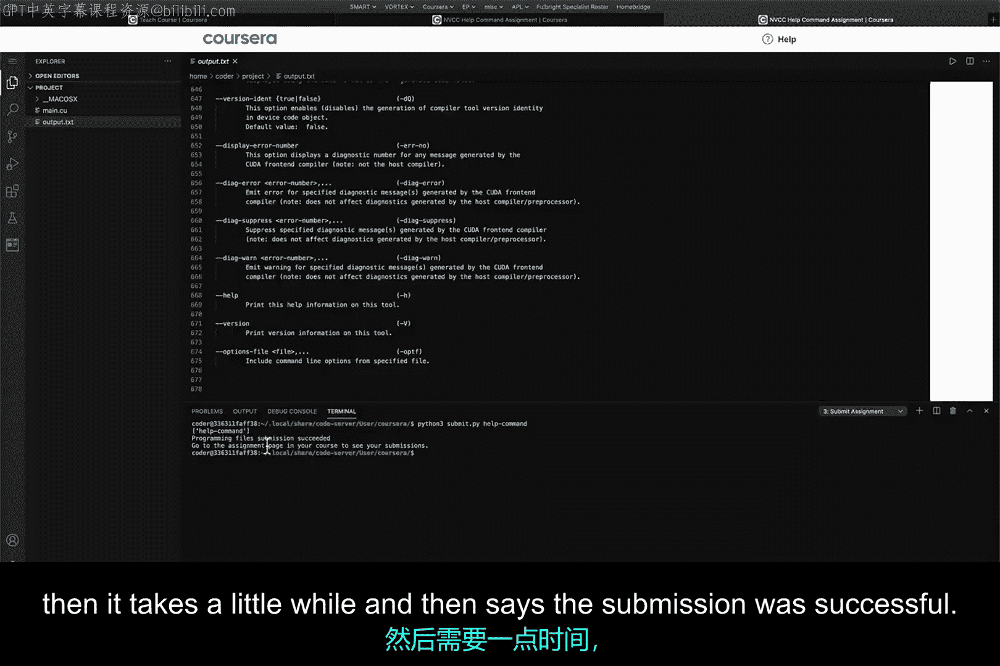
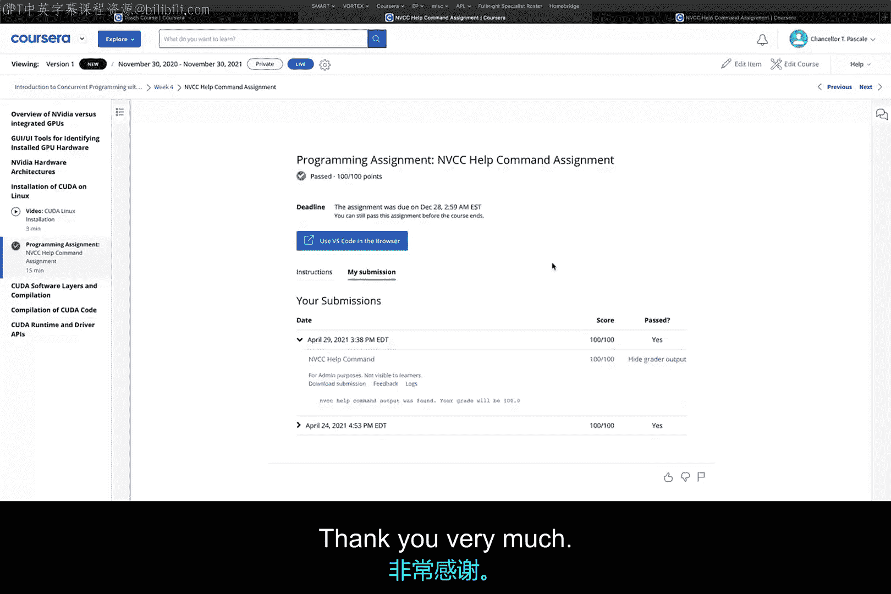

# 022：CUDA帮助实验与作业指导 🧪

在本节课中，我们将学习如何完成与在Linux系统上安装CUDA相关的实验和作业。主要内容是使用NVCC编译器的帮助命令，并将输出结果保存到文件中。

---

## 作业与实验概述

首先，让我们打开作业说明。作业内容非常简单，实验部分也使用了相同的代码，你可以随意探索。

你需要完成的任务非常直接：运行带有帮助标志的NVCC命令（即NVIDIA交叉编译器），并将其输出的大量文本内容保存到一个名为`output.txt`的文件中。这一切操作将在你浏览器中的VS Code集成开发环境中完成。





## 查看项目文件

现在，我想给你一个机会查看项目中的文件。这里总有一个C语言源文件，我希望你能有机会接触并探索实际的代码，以及生成的`output.txt`文件。

这个实验和作业都需要一定程度的终端使用技巧。让我们打开一个新的终端窗口。默认情况下，终端会将你置于项目文件夹中，正如屏幕右侧所示。

## 执行NVCC帮助命令

如前所述，你需要执行的命令非常简单，格式如下：
```bash
nvcc --help > output.txt
```
这个命令使用`nvcc`编译器，加上`--help`标志（或选项），然后将输出重定向（`>`）到`output.txt`文件中。

## 分析输出文件

现在，让我们查看生成的文件。你将看到帮助命令的全部内容，可以随意浏览。虽然不要求你掌握所有细节，但其中一些内容非常重要，例如如何创建PTX文件或`.bin`文件等。

我们将在后续课程以及与作业相关的部分中更详细地讲解这些标志或选项。

## 提交作业

创建了这个长文件后，你只需点击“提交作业”按钮。系统会提示它将运行一个Python命令进行评分。




## 查看提交状态与反馈

在作业提交并等待评分时，作业旁边会显示琥珀色状态，并告知你提交时间。这是实际的评分输出结果。


反馈信息显示，系统在你的提交中找到了NVCC帮助命令的输出，因此你获得了100分（满分）。


## 关于实验部分

实验部分使用相同的代码和相同的命令，区别在于你无需提交实验部分。因此，请自由地在实验环境中进行探索。

---

## 总结



本节课中，我们一起学习了如何完成CUDA安装后的第一个实践任务。我们使用`nvcc --help`命令获取了CUDA编译器的详细帮助信息，并将其输出保存到文件。你成功提交了作业并获得了满分。实验部分为你提供了自由探索相同内容的机会。掌握查看编译器帮助文档是后续学习的重要基础。