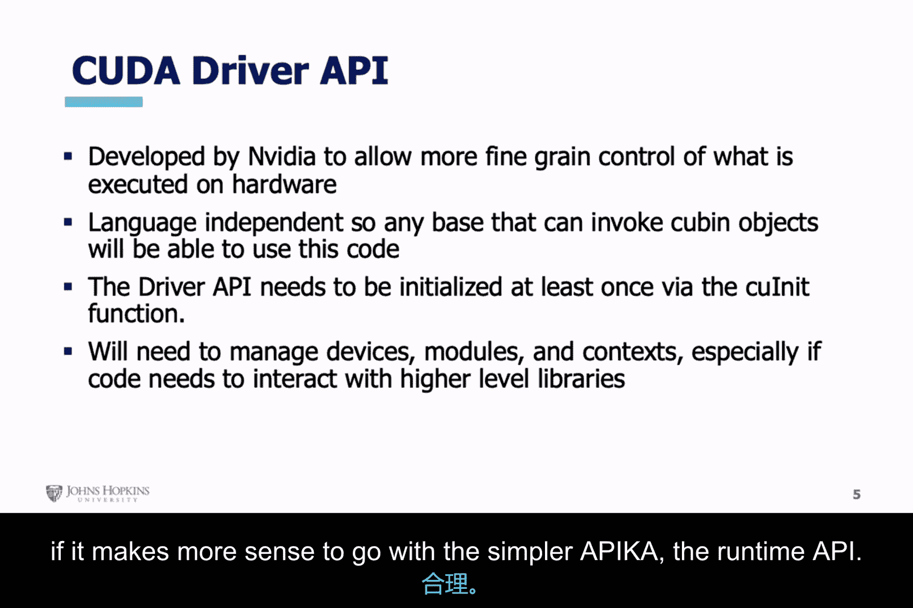

# 023：CUDA运行时与驱动API 🚀

在本节课中，我们将聚焦于CUDA运行时API与驱动API。我们将回顾CUDA软件架构的各个层次，并深入探讨这两种API的具体细节与区别。

上一节我们介绍了CUDA软件架构的概览，本节中我们来看看其核心的编程接口。

我们将再次使用CUDA软件层次图来说明开发过程中不同部分的交互方式。

对于本次讨论，您开发的CUDA应用程序将与运行时API或驱动API进行通信。选择让您的代码更直接地与底层NVIDIA硬件通信，还是一个重要的决策，它将定义您的代码形态以及如何编译生成中间文件。

## 运行时API

运行时API是驱动API的一个抽象层，它将开发者从诸如模块初始化和上下文管理等底层任务中解放出来。

另一个简化之处在于，在运行时API中，所有编译到任何PTX或GPU代码中的内核函数对主机代码都是立即可用的，无需选择性地将模块和内核加载到当前上下文中。

要编写使用此API的代码，您需要使用C++语言。通常，这是最常见的开发形式。

以下是运行时API的主要特点：
*   它是一个高级别的、对开发者友好的接口。
*   自动管理上下文、模块和内核加载。
*   代码编写更简洁，开发效率更高。

## 驱动API

如果您希望开发更低级别的代码，以便对编译后的代码及其在GPU中的执行方式施加更多控制，那么CUDA驱动API是您的工具。

最有趣的特点是，尽管它是低级代码，但不仅可以用汇编语言编写，任何能够链接和执行CUBIN对象的语言都可以使用。

该API本身需要在主机代码中显式初始化，使用`cuInit`函数。

编写驱动API代码的主要复杂性在于，诸如设备、代码模块以及执行GPU代码的上下文等主要组件都必须由您的代码来管理。

因此，您需要考虑为了获得额外的控制能力而付出的这些开发成本是否值得，或者选择更简单的API（即运行时API）是否更有意义。

以下是驱动API的主要特点：
*   提供低级控制，灵活性更高。
*   需要显式管理设备、上下文和模块。
*   支持更多编程语言，不限于C++。

## 总结

本节课中我们一起学习了CUDA的两种核心编程接口：运行时API和驱动API。运行时API提供了更高级的抽象，简化了开发流程，是大多数应用的首选。而驱动API则提供了底层的精细控制能力，适用于需要深度定制或使用非C++语言的特殊场景。开发者应根据项目对控制力与开发效率的需求，在这两者之间做出合适的选择。