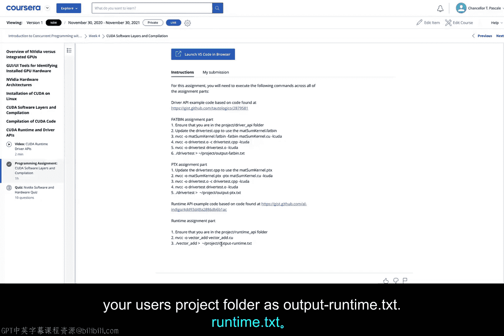
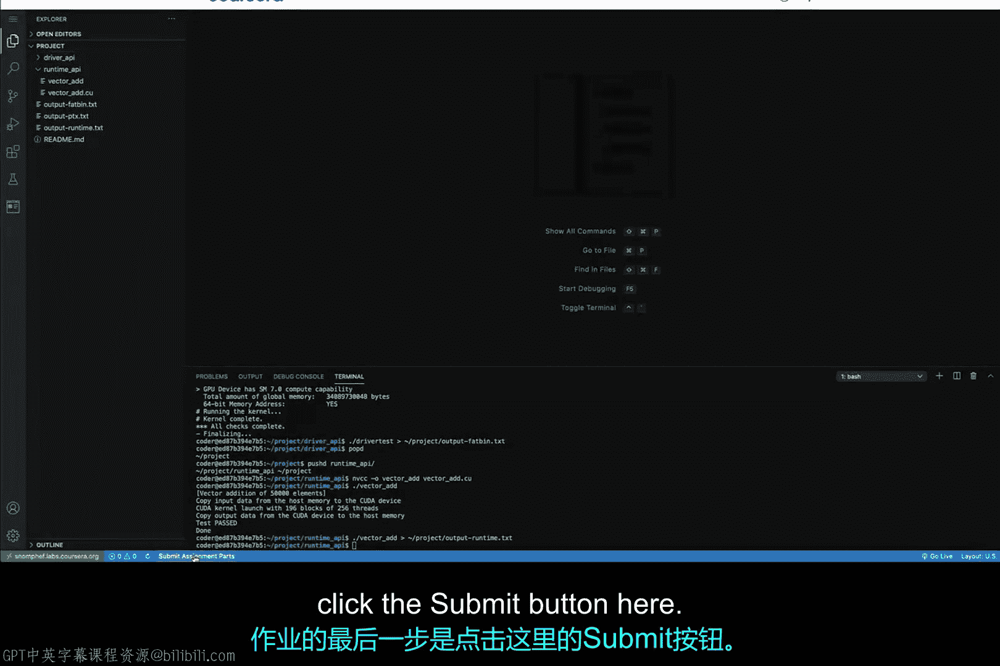
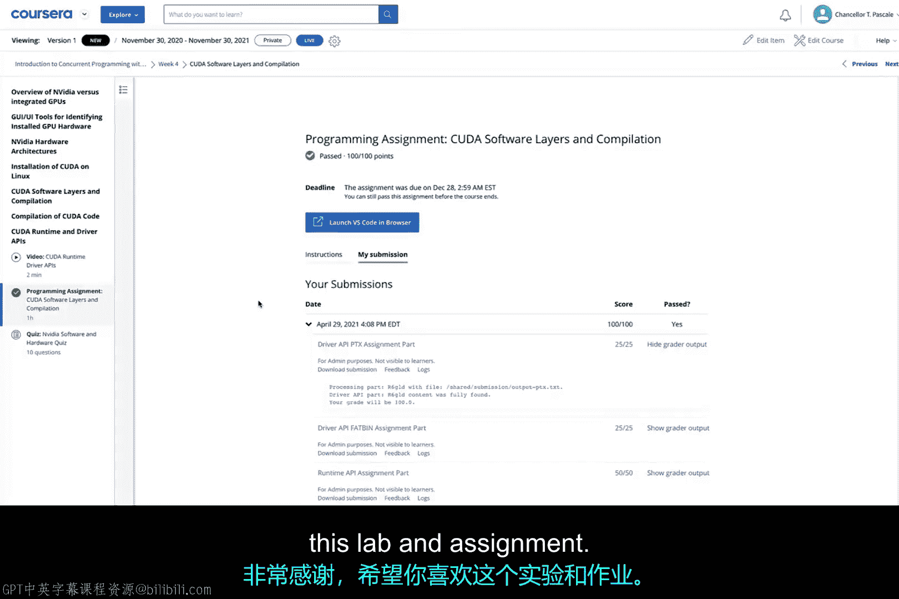

# 024：CUDA驱动与运行时API实验指导 🚀

在本节课中，我们将学习如何完成一个涉及CUDA驱动API和运行时API的编程实验。我们将分步讲解如何编译、链接和执行代码，并最终提交作业。

---

## 实验概述

本次实验包含三个主要部分：
1.  **Fat Binary 部分**：使用驱动API，将CUDA代码编译为`fatbin`格式并执行。
2.  **PTX 部分**：同样使用驱动API，但将CUDA代码编译为`PTX`中间代码格式并执行。
3.  **运行时API 部分**：使用更简单的CUDA运行时API来执行一个向量加法核函数。

实验的核心在于理解驱动API需要手动管理模块加载和内核启动，而运行时API则将这些过程自动化。

---

## 第一部分：驱动API - Fat Binary 作业

上一节我们介绍了实验的整体结构，本节中我们来看看如何完成驱动API的Fat Binary部分。此部分需要手动编译CUDA代码并链接到主机程序。

以下是完成此部分的具体步骤：

1.  进入`driver_api`文件夹。
2.  修改`driver_test.cpp`文件，确保其指向正确的`fatbin`文件。
3.  将`.cu`文件编译为`fatbin`文件。编译命令需链接CUDA库。
4.  编译`driver_test.cpp`文件，生成目标文件`driver_test.o`。此文件将引用上一步生成的`fatbin`。
5.  再次使用`nvcc`编译，将目标文件链接为最终的可执行文件`driver_test`。
6.  执行`./driver_test`命令。程序会将输出写入项目文件夹下的`output.fatbin.txt`文件。

**关键概念**：在驱动API中，主机程序需要显式地加载编译好的GPU代码模块（如`fatbin`或`PTX`）。这通过`cuModuleLoad`函数实现，代码中需要指定模块文件的路径。



```cpp
// 在 driver_test.cpp 中，加载模块的代码可能类似这样：
cuModuleLoad(&module, “mat_sum_kernel.fatbin”); // 指向 fatbin 文件
// 或
// cuModuleLoad(&module, “mat_sum_kernel.ptx”); // 指向 PTX 文件
```

**注意事项**：请确保所有相关文件（`.cu`、`.cpp`、`.fatbin`）位于同一文件夹中，以避免路径错误。生成的文件（如`.o`、`.fatbin`）是二进制文件，无需尝试查看其内容。

---

## 第二部分：驱动API - PTX 作业

完成了Fat Binary部分后，我们来看看PTX部分。其流程与第一部分几乎完全相同，主要区别在于编译CUDA代码时使用的标志和生成的文件格式。

以下是此部分与第一部分的区别：

*   在编译`.cu`文件时，使用`-ptx`标志来生成PTX格式的中间代码文件（例如`mat_sum_kernel.ptx`）。
*   需要修改`driver_test.cpp`文件，将`cuModuleLoad`函数指向新生成的`.ptx`文件，而非`.fatbin`文件。
*   执行流程不变，但输出文件将命名为`output.ptx.txt`。

**核心概念**：PTX（Parallel Thread Execution）是一种低级的、类似汇编的中间语言。驱动API可以直接加载并执行PTX代码，这提供了更大的灵活性，但通常`fatbin`（包含多种架构二进制代码的“胖二进制文件”）是更通用的部署选择。

---

## 第三部分：运行时API 作业

上一节我们处理了较为复杂的驱动API，本节中我们来看看更简单的运行时API部分。运行时API封装了许多底层细节，让CUDA编程更加便捷。

以下是完成此部分的步骤：

1.  退出`driver_api`文件夹，进入`runtime_api`文件夹。
2.  使用`nvcc`编译器直接编译CUDA源文件。命令为：`nvcc -o vector_add vector_add.cu`。`-o`参数用于指定生成的可执行文件名称。
3.  执行生成的可执行文件：`./vector_add`。
4.  程序将进行向量加法计算，并输出结果到`output.runtime.txt`文件。

**关键区别**：运行时API无需手动加载模块或获取函数指针。核函数直接通过`<<<...>>>`语法启动，编译器会自动处理背后的模块加载和内核启动配置。

```cpp
// 运行时API的核函数调用非常简单直接
vectorAdd<<<blocksPerGrid, threadsPerBlock>>>(d_A, d_B, d_C, numElements);
```

**提示**：使用`-o`为可执行文件命名是一个好习惯，可以避免默认生成的`a.out`文件造成混淆。

---

## 作业提交与评分

完成所有三个部分的代码并成功运行后，即可提交作业。

1.  在课程界面底部找到“提交作业”按钮。
2.  点击提交后，系统会自动处理并评分。
3.  你可以查看每部分的评分详情。请注意，不同部分的权重可能不同。
4.  通常需要获得总分的75%以上才能通过本次作业。



---

## 总结

本节课中我们一起学习了CUDA驱动API与运行时API的实验操作。我们掌握了：
*   使用驱动API时，如何将CUDA代码编译为`fatbin`或`PTX`格式，并修改主机程序来加载和执行它们。
*   使用运行时API时，如何直接编译和运行CUDA程序，其过程更加简洁。
*   实验的完整流程：从代码编译、链接到执行，最后提交作业。



希望你能通过本实验加深对CUDA两种编程接口的理解。