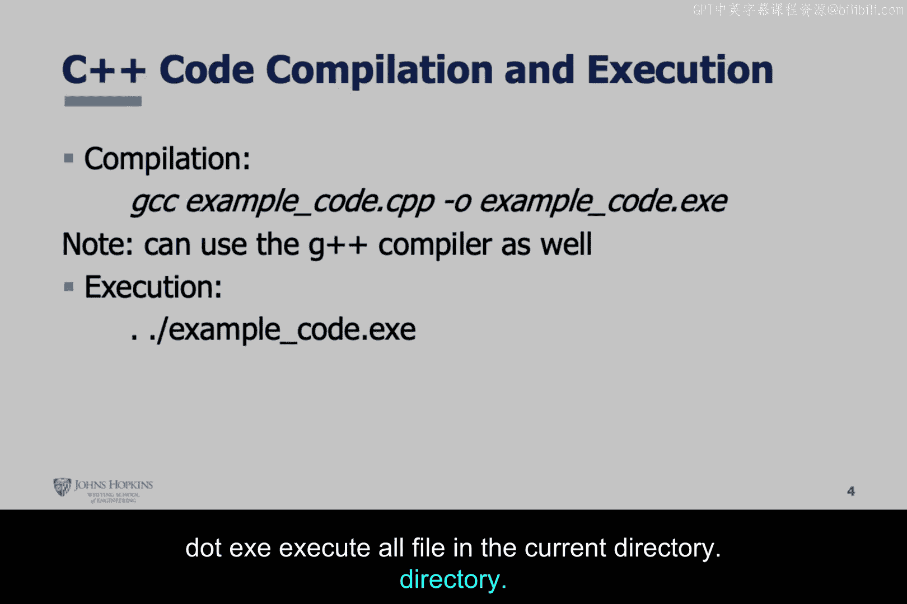
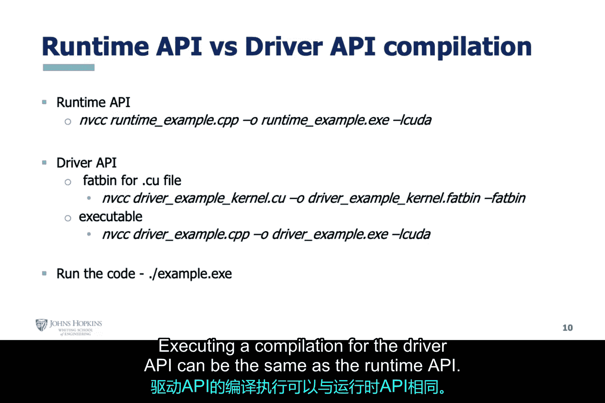
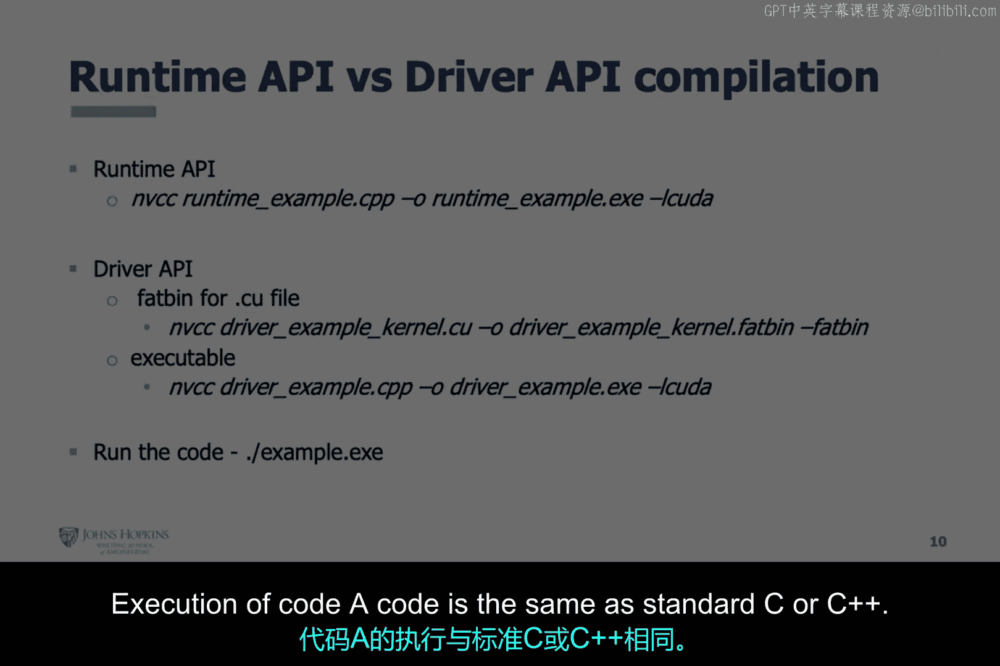

# 025：目标环境检测与代码语法

## 概述
在本节课中，我们将学习如何将CUDA代码编译并执行。课程内容分为三个主要部分：首先介绍标准C++示例的编译与执行流程，然后探讨使用CUDA运行时API的完整周期，最后分析更底层的CUDA驱动API的使用方法。通过对比三种方式，您将理解在不同抽象层级上操作GPU代码的异同。

---

## C++示例：编译与执行

上一节我们概述了课程结构，本节中我们来看看一个基础的C++示例代码。

该示例的主函数首先初始化两个数组`X`和`Y`，分别赋值为`1.0`和`2.0`。随后，它调用`add`函数对这两个数组中总计一百万个元素进行求和操作。操作完成后，代码会检查更新后的`Y`数组与预期值（应全部为`3.0`）之间的最大差异，理论上结果应为`0`。最后，程序释放`X`和`Y`数组所占用的内存并退出。

`add`函数是一个简单的循环包装，它将两个输入指针`x`和`y`所指向数组的前`n`个值相加，并将每次迭代的结果存回`y`指针。

**核心概念**：`add`函数的所有循环迭代都在单个线程中顺序执行，因此这是一系列非常顺序化的操作。

了解代码后，编译过程就是将源文件传递给交叉编译器。在上述例子中，使用的是`GCC`编译器（本例中同样可以使用`G++`），并将输出文件命名为`example_code.exe`。

执行则更为简单，在Linux系统中，使用点操作符运行当前目录下的可执行文件`example_code.exe`即可。

---

## CUDA运行时API

上一节我们介绍了标准的C++顺序代码，本节中我们来看看使用CUDA运行时API的代码有何不同。

运行时API的内核代码与普通的C/C++顺序代码非常相似，主要区别在于使用了`__global__`关键字。

**核心概念**：`__global__`关键字指示编译器，该函数应被编译以便在GPU上执行。

要执行运行时API内核，您需要像其他C/C++程序一样，拥有一个`main`函数。

与任何C++或C程序类似，您需要分配内存。在本例中，需要为六个浮点指针分配内存：三对数组，分别用于主机（CPU）和设备（GPU）。

以下是后续步骤：
1.  用数值初始化输入数组。
2.  将主机内存中的数据复制到设备（GPU）内存。
3.  执行内核。请注意，示例中展示的是最不理想的情况：每次只分配一个包含单个线程的块。通常，选择每个块的线程数至少应为32，并且由于某些架构约束，最好是32的倍数。
4.  如果您要解决三维问题（例如地图或视频处理），可能需要根据问题规模确定每个网格中的块数。
5.  将内存从设备复制回关联的主机指针。
6.  释放所有内存。

这里并未展示所有内存操作，但以上概述能让您了解大致的流程。

---

## CUDA驱动API

上一节我们探讨了运行时API，本节中我们来看看更底层的驱动API，这提供了更强的控制力但也更复杂。

驱动API代码与运行时API示例代码差异不大，您同样可以访问关于线程和块的信息。在本例中，我们明确声明此代码是为C语言开发的。

驱动API代码的复杂之处在于初始化。您需要初始化一系列内容以确保CUDA和驱动API能正确运行，这些操作被封装在下一张幻灯片所示的单个函数中。

与运行时API代码类似，需要分配主机和设备内存。但请注意，所有设备内存都需要指定为`CUdeviceptr`类型。

启动驱动API代码看起来更像普通函数调用，没有`<<< >>>`符号，只需传递函数指针、各种块和网格大小、内存指针以及输入内存的大小，这些参数以一个参数数组的形式传递。

使用完内存后，务必释放主机和GPU上的内存。

初始化CUDA相关属性提供了运行时API所没有的许多控制选项，但也更复杂。您需要确定并设置CUDA设备，这能提供关于CUDA主次版本号、设备名称等更多信息。

获取设备后，需要为设备创建上下文以便代码运行。

随后是一个复杂的过程：从指定路径加载模块（`fatbin`文件），根据函数名从模块中获取函数，最后将引用赋值给`CUfunction`变量。

在此，您将传入初始化函数的`CUfunction`指针与找到的函数连接起来。

是的，这非常复杂。让我重复一遍：您将传入此初始化函数的`CUfunction`指针与找到的函数相链接，使它们关联在一起。

---

## 编译与执行总结

本节课我们一起学习了三种不同的代码执行流程，最后我们来总结它们的编译与执行。

运行时API的编译可以很复杂，但通常与C或C++类似，区别在于您需要使用NVIDIA的`nvcc`交叉编译器，并将其链接到CUDA驱动程序库。

驱动API的编译分为两步：
1.  为CUDA内核生成`fatbin`二进制文件。
2.  编译可执行文件。

请注意，初始化CUDA的函数需要知道`fatbin`文件的位置。因此，只有当`fatbin`文件与可执行文件位于同一目录，且代码中的路径正确时，此方法才有效。当然也存在其他策略，但这是最简单的一种。

驱动API的可执行文件编译过程可以与运行时API相同。

CUDA代码的执行与标准的C或C++程序执行方式相同。