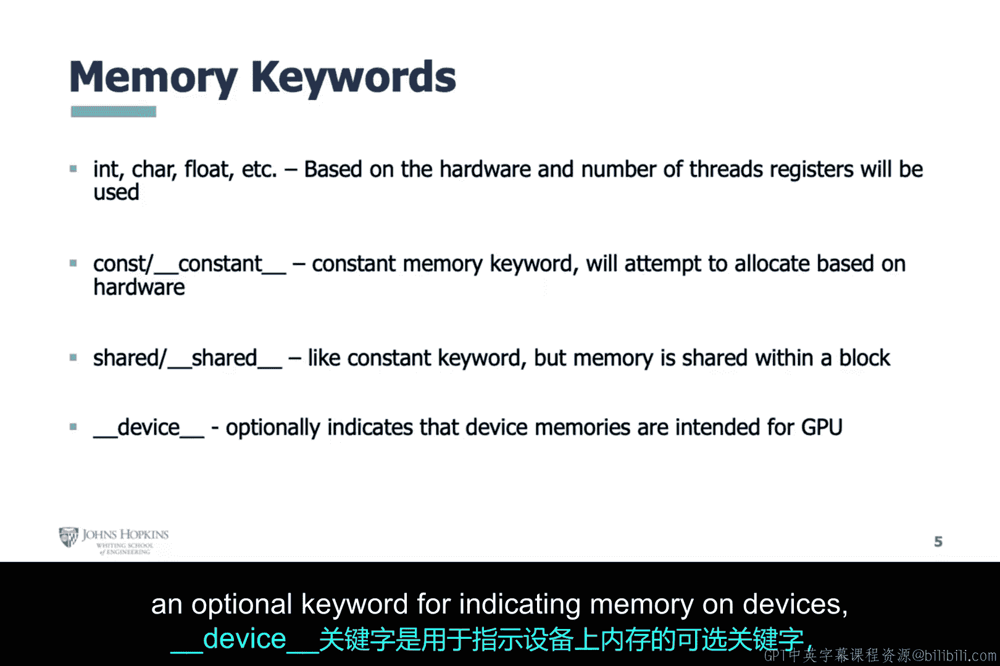

# 026：CUDA关键字解析 🧠

在本节课中，我们将学习CUDA编程中的核心关键字。这些关键字对于控制代码在何处以及如何执行至关重要，是编写高效GPU程序的基础。我们将它们分为三类：函数执行位置、计算划分以及内存管理。

---

上一节我们介绍了CUDA关键字的重要性，本节中我们来看看第一类关键字，它们定义了代码的调用和执行位置。

这些关键字是函数签名的一部分，决定了函数是在CPU（主机）上执行，还是在GPU（设备）上执行，或者两者兼有。正确使用它们能确保代码在预期的硬件上运行。

以下是关于函数执行位置的关键字：

*   **`__host__`**： 此关键字修饰的函数在CPU上执行，并且只能从CPU调用。它是C/C++函数的默认行为。
*   **`__global__`**： 此关键字修饰的函数（称为**内核**）在GPU上执行，但**从CPU调用**。调用时使用特殊的三角括号语法 `<<<...>>>` 来配置执行参数。
*   **`__device__`**： 此关键字修饰的函数在GPU上执行，并且**只能从GPU上的其他函数（通常是 `__global__` 或 `__device__` 函数）调用**。它用于构建GPU内部的层次化代码结构。

---


了解了代码的执行位置后，我们来看看如何组织GPU上成千上万的线程进行计算。这涉及到第二类关键字，它们描述了计算的划分方式。

当从CPU调用一个 `__global__` 内核时，我们需要指定线程的组织结构。这通过调用时的 `<<<...>>>` 配置来完成。

```
kernelFunction<<<gridDim, blockDim, sharedMemSize, stream>>>(arguments);
```

在这个配置中：
*   **`gridDim`**： 定义了**网格**的维度。网格是线程块（Block）的集合。
*   **`blockDim`**： 定义了每个**线程块**的维度。线程块是线程（Thread）的集合。

以下是关于线程组织的关键概念：

*   **线程**： GPU上最基本的执行单元。每个线程独立运行内核函数的一份副本。
*   **线程块**： 线程的集合。块内的线程可以**通过共享内存进行通信和同步**。一个块通常应包含多个32的倍数（如128、256、512）的线程，以匹配GPU的硬件架构（Warp）。
*   **网格**： 线程块的集合。网格可以是一维、二维或三维的，这非常适合于处理具有相应维度的数据（如图像、视频或地图数据）。

---

最后，我们来探讨第三类关键字，它们与内存管理相关。高效地利用不同特性的内存是GPU编程性能优化的关键。

CUDA提供了多种内存空间，关键字用于指示变量应优先存放在哪种内存中。

以下是主要的内存类型及其关联的关键字：

*   **寄存器**： 速度最快，但容量最小。使用标准的C/C++基本数据类型（如 `int`, `float`）定义的局部变量，编译器会尽可能将其放入寄存器。
*   **常量内存**： 只读，缓存效率高。使用 `__constant__` 关键字修饰的变量会被放入常量内存。
*   **共享内存**： 块内线程共享，速度极快。使用 `__shared__` 关键字修饰的变量会被放入共享内存。但需要注意，如果声明的共享内存总量超过硬件限制，编译器可能不得不将部分数据放入全局内存。
*   **全局内存**： GPU上容量最大但延迟最高的内存。使用 `__device__` 关键字修饰的全局变量会驻留在设备全局内存中。这是一个可选关键字，用于明确指示内存位于设备端而非主机端。

---




本节课中我们一起学习了CUDA编程的三类核心关键字。我们首先了解了控制函数执行位置的 `__host__`、`__global__` 和 `__device__` 关键字。接着，我们探讨了用于划分大规模并行计算的网格和线程块概念。最后，我们学习了管理不同内存空间（如寄存器、常量内存、共享内存和全局内存）的关键字。掌握这些关键字是编写正确且高效CUDA程序的基础。